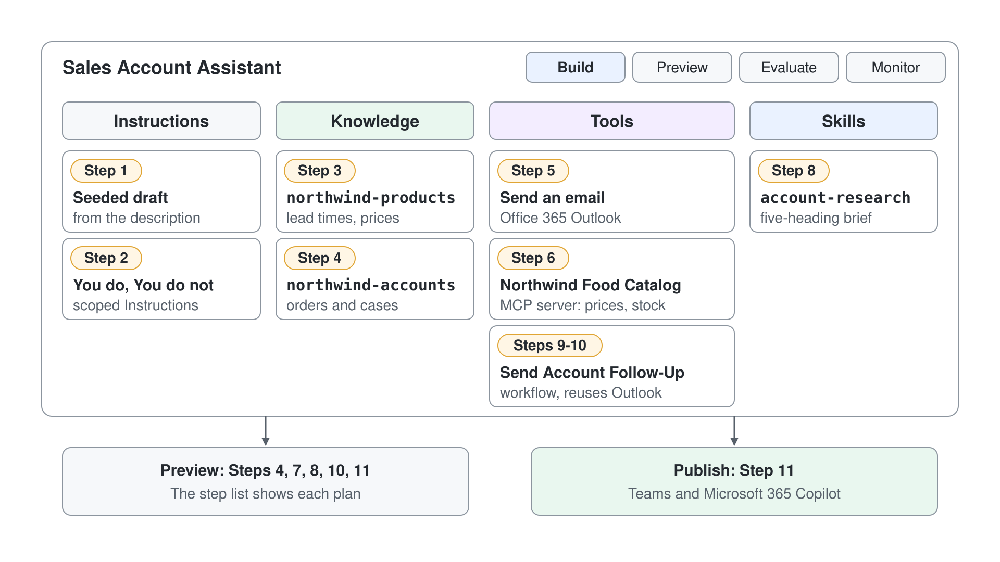

# Einen Sales Account Assistant als Microsoft Copilot Harness Agent bauen

Jeder Seller verliert die ersten zehn Minuten eines Kundengesprächs damit, Account-Fakten aus CRM-Datensätzen, Produktblättern, E-Mail-Verläufen und offenen Support-Tickets zusammenzusuchen. Ein Assistant, der Fragen zu Accounts beantwortet, ein Briefing vor dem Gespräch zusammenstellt und die Follow-up E-Mail an einer Stelle entwirft, gibt diese Zeit zurück und hält das Vorgehen über ein ganzes Verkaufsgebiet hinweg einheitlich. In diesem Capstone Lab bauen Sie genau diesen Assistant als Microsoft Copilot Harness Agent, von einer Beschreibung aus einem Satz bis zu einem veröffentlichten Agent mit Grounding auf echten Daten.

Das Szenario-Unternehmen ist Northwind Traders, ein Großhändler, dessen Seller jeweils Dutzende Accounts betreuen. Sie erstellen einen Sales Account Assistant, schärfen seine Instructions, grounden ihn auf zwei Knowledge-Dokumenten, binden eine Outlook Action und den Food Catalog MCP Server der Klasse an, beobachten, wie der Orchestrator sie verkettet, verpacken einen wiederverwendbaren Skill für Account Research, bauen einen Follow-up Workflow, übergeben ihn dem Agent als Tool und veröffentlichen den Agent für die Seller. Dieses Lab basiert auf dem Lab mcs-orchestration von Microsoft, und jeder Schritt speist den nächsten: Die Instructions formen die Tests in Preview, Knowledge und Tools werden vom Orchestrator verkettet, der Skill, den Sie hochladen, stammt aus dem Begleitordner dieses Labs, und der Workflow nutzt den Outlook Connector wieder, bei dem Sie sich zuvor angemeldet haben.



## Was dieses Lab abdeckt

| Schritt | Was Sie üben | Modulthema |
|------|-------------------|--------------|
| 1 | Den Agent aus einer Beschreibung in natürlicher Sprache erstellen | [The Two Copilot Studio Experiences](../../../demos/06-cs-copilot-harness/01-standard-vs-copilot-harness/readme.md) |
| 2 | Abgegrenzte Instructions auf der einheitlichen Build-Oberfläche schreiben | [The Unified Build Surface and the New Orchestrator](../../../demos/06-cs-copilot-harness/02-unified-build-and-orchestrator/readme.md) |
| 3 | Produkt-Knowledge hinzufügen und den Agent grounden | [The Unified Build Surface and the New Orchestrator](../../../demos/06-cs-copilot-harness/02-unified-build-and-orchestrator/readme.md) |
| 4 | Account-Knowledge hinzufügen und das Grounding in Preview bestätigen | [The Unified Build Surface and the New Orchestrator](../../../demos/06-cs-copilot-harness/02-unified-build-and-orchestrator/readme.md) |
| 5 | Eine Office 365 Outlook Connector Action als Tool hinzufügen | [Tools, MCP, and the New Workflows Designer](../../../demos/06-cs-copilot-harness/04-workflows-and-mcp/readme.md) |
| 6 | Den Food Catalog MCP Server der Klasse hinzufügen | [Tools, MCP, and the New Workflows Designer](../../../demos/06-cs-copilot-harness/04-workflows-and-mcp/readme.md) |
| 7 | Knowledge und Tools verketten und den Plan prüfen | [The Unified Build Surface and the New Orchestrator](../../../demos/06-cs-copilot-harness/02-unified-build-and-orchestrator/readme.md) |
| 8 | Einen wiederverwendbaren Skill (SKILL.md) verpacken und hochladen | [Agent Skills in Copilot Studio](../../../demos/06-cs-copilot-harness/03-agent-skills/readme.md) |
| 9 | Einen Workflow mit typisierten Inputs bauen und veröffentlichen | [Tools, MCP, and the New Workflows Designer](../../../demos/06-cs-copilot-harness/04-workflows-and-mcp/readme.md) |
| 10 | Den Workflow als Tool konfigurieren und den Agent seine Inputs füllen lassen | [Tools, MCP, and the New Workflows Designer](../../../demos/06-cs-copilot-harness/04-workflows-and-mcp/readme.md) |
| 11 | Einen End-to-End-Test in Preview ausführen und dann veröffentlichen | [The Unified Build Surface and the New Orchestrator](../../../demos/06-cs-copilot-harness/02-unified-build-and-orchestrator/readme.md) |

## Lab-Dateien

| Datei | Zweck |
|------|---------|
| [lab-01-sales-account-assistant/SKILL.md](lab-01-sales-account-assistant/SKILL.md) | Der Skill für Account Research, den Sie in Schritt 8 hochladen, damit der Assistant ein wiederverwendbares, einheitliches Rezept für Briefings vor dem Gespräch bekommt |

## Voraussetzungen

- Eine Copilot Studio Environment, in der Sie Agents erstellen können (eine Power Platform Environment mit der Maker-Rolle).
- Ihre eigene Environment: Wählen Sie unten in der linken Navigation den Namen der Environment (**Switch environment**) und prüfen Sie, dass unter **Current environment** die nach Ihrem Account benannte Environment steht, zum Beispiel `copilot-studio-01` (Sandbox) für `copilot-studio-01@mst.fastlane.net`. Arbeiten Sie das ganze Lab darin, nie in der gemeinsamen Default Environment.
- Verfügbare Microsoft Copilot Harness Agents: Öffnen Sie [copilotstudio.microsoft.com](https://copilotstudio.microsoft.com), gehen Sie zu **Agents** und prüfen Sie, dass das Menü **New agent** den Eintrag **Agent** mit dem Badge **GitHub Copilot** anbietet. Das ist der einzige Setup-Schritt; alles danach ist Bauen.
- Die Berechtigung, Connectors und Tools hinzuzufügen. Der MCP Server in Schritt 6 ist der Food Catalog der Klasse unter `https://lab-food-catalog-api.azurewebsites.net/api/mcp`, für die Klasse gehostet und ohne Anmeldung erreichbar.
- Die Begleitdatei `SKILL.md` lokal im Ordner `lab-01-sales-account-assistant` neben dieser Anleitung, für den Upload in Schritt 8.
- Keine separaten Knowledge-Dateien zum Vorbereiten: Die Beispieldokumente zu Produkten und Accounts stehen direkt in den Schritten 3 und 4, bereit zum Einfügen in eine Datei.

## Schritt 1: Den Agent aus einer Beschreibung erstellen

Ein Microsoft Copilot Harness Agent ist Natural-Language-First. Statt Topics und Trigger Phrases zu schreiben, beschreiben Sie die Aufgabe des Agents in einem Satz und verfeinern sie von dort aus. Das ist der schnellste Weg zu einem funktionierenden Agent und der klarste Weg zu spüren, wie sich ein Microsoft Copilot Harness Agent von einem Standard Agent unterscheidet, bei dem Sie Topics von Hand gebaut hätten, bevor der Agent ein Wort sagt.

1. Wählen Sie im Seitenbereich **Agents**, öffnen Sie den Pfeil neben **New agent** und wählen Sie unter **Optimize your business processes** den Eintrag **Agent** mit dem Badge **GitHub Copilot**.
2. Wählen Sie das Stiftsymbol neben dem Namen des Agents und geben Sie `Sales Account Assistant` ein.
3. Fügen Sie im Abschnitt **Instructions** Folgendes ein und wählen Sie dann **Save** (das Diskettensymbol oben rechts):

```text
You are the Northwind Sales Assistant. You help Northwind Traders sellers prepare for customer calls by answering questions about products, pricing, lead times, and account tiers, preparing pre-call briefings, and drafting follow-up emails.
```

4. Sehen Sie sich die Tabs am oberen Rand und das Components Panel auf dem Tab **Build** an.

Erwartet: Der Agent öffnet sich auf dem Tab **Build**, und die Tabs oben lauten Build, Preview, Evaluate und Monitor. **Instructions** enthält Ihre Beschreibung, und das Components Panel zeigt **Skills** leer, **Tools** mit **Work IQ** und **Knowledge** mit **Search all websites**, beide standardmäßig hinzugefügt. Sie haben kein einziges Topic geschrieben.

> **Hinweis:** Zeigt der Agent Topics, Knowledge, Tools und Settings, haben Sie einen Standard Agent erstellt. Gehen Sie zurück zu **Agents** und erstellen Sie den Agent erneut mit **Agent** (GitHub Copilot) aus dem Menü **New agent**. Ein Agent lässt sich nicht zwischen den beiden Arten konvertieren, deshalb ist es wichtig, an der richtigen Stelle zu beginnen.

## Schritt 2: Die Instructions des Agents schreiben

In einem Microsoft Copilot Harness Agent ersetzen die **Instructions** die Topic-Logik eines Standard Agents. Sie sind das stets im Kontext stehende Briefing, auf dessen Basis die Enhanced Orchestration Runtime in jedem Turn schlussfolgert, deshalb ist ein knapper, aufgelisteter Instruction-Block der größte einzelne Hebel für die Qualität der Antworten. Sie ersetzen die Beschreibung aus Schritt 1 durch eine schärfere Version, die Scope, Tonfall und Guardrails für die beiden Aufgaben dieses Assistants festlegt: Briefings und Follow-up E-Mails.

1. Wählen Sie auf dem Tab **Build** den Text unter **Instructions**.
2. Ersetzen Sie ihn durch Folgendes:

```text
Role: You are the Sales Account Assistant, an internal helper for Northwind Traders sellers.

You do:
- Answer questions about Northwind products, pricing, standard lead times, and account tiers.
- Prepare a short pre-call briefing when a seller names an account, using the account-research format.
- Draft a follow-up email that recaps decisions and next steps after a call.
- Cite the knowledge source or record you drew each fact from.

You do not:
- Give binding price quotes, contract terms, or legal advice.
- Invent account facts; if data is missing, say so instead of guessing.
- Answer questions unrelated to Northwind sales.

Style: concise and professional. If a request does not name the account or product it needs, ask for it before answering.
```

3. Wählen Sie **Save**.

Erwartet: **Instructions** zeigt Ihren gespeicherten Text, und die Identität des Agents spiegelt die Rolle zur Unterstützung der Seller. Sonst hat sich noch nichts geändert; Sie haben Verhalten festgelegt, nicht Knowledge.

> **Tipp:** Schreiben Sie Instructions als kurze Listen nach dem Muster "You do / You do not" statt als einen langen Absatz. Die Runtime befolgt abgegrenzte, aufgelistete Guardrails deutlich zuverlässiger als Fließtext, und erst die aufgelistete Liste "You do not" bringt den Agent später dazu, ein Angebot außerhalb des Scopes abzulehnen.

## Schritt 3: Produkt-Knowledge hinzufügen

Ein Agent ohne Knowledge antwortet aus dem allgemeinen Model und kann keinen einzigen Northwind Fakt zitieren. Eine **Knowledge** Source verankert die Antworten in Ihren Inhalten und lässt den Agent zeigen, woher jeder Fakt stammt; das macht ihn vertrauenswürdig für Seller, die gleich in einem Live-Gespräch eine Lead Time nennen. Sie fügen eine Referenz zu Produkten und Accounts hinzu, damit der Assistant aus echten Northwind Daten antwortet.

Erstellen Sie zuerst eine Datei namens `northwind-products.md` (oder ein Word-Dokument) mit diesem Inhalt:

```text
# Northwind Traders - Product and Account Reference
## Account tiers and standard lead times
- Tier 1 (strategic): 3 business days, priority support.
- Tier 2 (growth): 5 business days, standard support.
- Tier 3 (transactional): 10 business days, standard support.
## Selected products
- NWT Cold Brew Concentrate (SKU CB-100): case of 12, list price 48.00 USD.
- NWT Organic Green Tea (SKU GT-220): case of 24, list price 62.00 USD.
- NWT Dark Roast Beans (SKU DR-330): 5 kg bag, list price 74.00 USD.
```

1. Öffnen Sie auf dem Tab **Build** die Component **Knowledge** und wählen Sie **Add knowledge**.
2. Wählen Sie das Hochladen einer Datei und dann Ihr Dokument `northwind-products`.
3. Warten Sie, bis das Dokument unter **Knowledge** erscheint.

Erwartet: Das Dokument erscheint unter **Knowledge**. Der Agent kann jetzt die Lead Times der Tiers und die Produktpreise daraus beziehen, auch wenn Sie noch nicht bestätigt haben, dass er es tut; diese Prüfung folgt nach dem zweiten Dokument.

> **Hinweis:** Um den Agent in Live-Daten aus Microsoft 365 wie E-Mails, Dateien und Meetings zu grounden, würden Sie Microsoft IQ über dieselbe Component **Knowledge** hinzufügen. Dieses Lab nutzt hochgeladene Dateien, damit alle Teilnehmenden es ohne tenantspezifische Daten abschließen können.

## Schritt 4: Account-Knowledge hinzufügen und das Grounding testen

Ein Dokument erzählt dem Agent von Produkten; ein zweites gibt ihm die Accounts und Bestellungen, die ein Briefing tatsächlich braucht. Die Aufteilung spiegelt, wie die Fakten in einem Unternehmen wirklich liegen, und Sie können in Schritt 7 beobachten, wie der Orchestrator aus mehr als einer Quelle schöpft. Nachdem Sie das zweite Dokument hinzugefügt haben, bestätigen Sie das Grounding in **Preview**, dem Tab, auf dem Sie das Verhalten des Agents sehen, bevor es jemand anderes sieht.

Erstellen Sie zuerst eine Datei namens `northwind-accounts.md` (oder ein Word-Dokument) mit diesem Inhalt:

```text
# Northwind Traders - Account and Order Reference
## Accounts
- Alfreds Futterkiste (Tier 1): region North, owner J. Berg.
- Around the Horn (Tier 2): region North, owner M. Diaz.
## Recent orders (last quarter)
- Alfreds Futterkiste: 40 cases Cold Brew Concentrate, delivered on time.
- Around the Horn: 12 cases Organic Green Tea, 1 case backordered.
## Open support cases
- Alfreds Futterkiste: case 4821, damaged shipment, open.
```

1. Öffnen Sie auf dem Tab **Build** die Component **Knowledge** und wählen Sie erneut **Add knowledge**.
2. Laden Sie Ihr Dokument `northwind-accounts` hoch und warten Sie, bis die Verarbeitung abgeschlossen ist.
3. Öffnen Sie den Tab **Preview** und senden Sie diese Nachricht:

```text
What did Around the Horn order last quarter, and what is their standard lead time?
```

4. Lesen Sie die Antwort und suchen Sie nach einem Zitat, das auf Ihre Knowledge Sources verweist.

Erwartet: **Preview** antwortet, dass Around the Horn 12 Kartons Organic Green Tea bestellt hat (ein Karton davon im Rückstand) und als Tier 2 Account eine Standard Lead Time von 5 Werktagen hat. Die Antwort zitiert die beiden Quellen `northwind`, statt eine generische Antwort zu liefern. Das bestätigt, dass der Agent beide Dokumente in einem Turn kombiniert hat.

## Schritt 5: Eine Outlook Connector Action als Tool hinzufügen

**Tools** lassen den Agent auf echten Systemen handeln, statt nur darüber zu reden. Ein Connector stellt eine einzelne externe Action bereit, etwa das Senden einer E-Mail, und eine klare Tool-Beschreibung sagt dem Orchestrator genau, wann er sie nutzen soll. Sie fügen die Office 365 Outlook Action **Send an email** hinzu, damit der Assistant aus einem entworfenen Follow-up eine gesendete Nachricht machen kann, und Sie verwenden dieselbe Action im Workflow in Schritt 9 wieder.

1. Wählen Sie auf dem Tab **Build** das **+** neben **Tools**.
2. Wählen Sie den Connector Office 365 Outlook und die Action **Send an email (V2)**.
3. Schließen Sie die Anmeldung für die Connection ab, falls der Connector danach fragt; eine bestehende Outlook Connection Ihres Accounts wird wiederverwendet.
4. Wählen Sie unter **Tools** den Eintrag **Send an email (V2)**, wählen Sie das Stiftsymbol neben **Description for Intelligence** und fügen Sie Folgendes ein, damit der Orchestrator weiß, wann er es aufrufen soll:

```text
Use this action to send a follow-up email to a customer after a call. Call it only when the seller has confirmed the recipient, subject, and body. Do not use it to send anything the seller has not reviewed.
```

5. Wählen Sie **Save**.

Erwartet: Die Office 365 Outlook Action **Send an email (V2)** erscheint mit Ihrer Beschreibung in der Liste **Tools**. Der Agent kann das Senden von E-Mails jetzt als verfügbare Fähigkeit nennen, sendet aber nichts, bis ein Seller die Details bestätigt.

> **Tipp:** Halten Sie eine Action pro Tool und geben Sie jeder eine Beschreibung nach dem Muster "call it when". Der Orchestrator wählt Tools aus, indem er die Anfrage mit diesen Beschreibungen abgleicht, deshalb ist eine vage Beschreibung der häufigste Grund, warum eine verfügbare Action nie genutzt wird.

## Schritt 6: Den Food Catalog MCP Server der Klasse hinzufügen

Ein MCP Server gibt dem Agent über das Model Context Protocol einen standardisierten, gemeinsamen Satz von Tools statt einer einzelnen Connector Action. Die Klasse hostet den Food Catalog von Northwind als MCP Server, damit der Assistant Gerichte, aktuelle Preise und Lagerbestände live lesen kann, ohne dass Sie einzelne Actions verdrahten. Weil die Connection den Streamable Transport nutzt, kommen spätere Änderungen am Server an, ohne dass Sie den Agent neu veröffentlichen.


1. Wählen Sie auf dem Tab **Build** das **+** neben **Tools**.
2. Wählen Sie in **Add a tool** den Eintrag **+ Add** und dann **Model Context Protocol (MCP)**.
3. Geben Sie in **Add MCP server** `Northwind Food Catalog` als **Server name** ein, fügen Sie den Text unten als **Server description** ein, damit der Orchestrator weiß, wann er den Server aufrufen soll, geben Sie `https://lab-food-catalog-api.azurewebsites.net/api/mcp` als **Server URL** ein, setzen Sie **Authentication** auf **None** und wählen Sie **Add**:

```text
Use this server to look up Northwind's live food catalog: dishes, current prices, and units in stock. Prefer it over uploaded documents when the seller asks about the current price or stock of a food item. Only read from it; never add, update, or delete catalog items.
```

4. Öffnen Sie unter **Select a connection** die Liste **Not connected**, wählen Sie **Create new connection**, im Dialog der Connection **Create** und dann **Add**, und wählen Sie **Save**, bevor Sie das Tool öffnen (bei ungespeicherten Änderungen erscheint **Leave without saving?**, und **Discard** verwirft das neue Tool).
5. Wählen Sie unter **Tools** den Eintrag **Northwind Food Catalog**, um **Edit tool** zu öffnen. Schalten Sie unter **Tool permissions** die Tools **Add food item**, **Update food item**, **Update food item stock** und **Delete food item** aus, lassen Sie **Get all food items** und **Get food items by name** eingeschaltet, wählen Sie **Done** und dann **Save**.

Erwartet: **Northwind Food Catalog** erscheint in der Liste **Tools** neben der Outlook Action, und seine **Tool permissions** erlauben nur lesende Tools wie **Get all food items** und **Get food items by name**. Der Agent hat jetzt zwei Arten von Quellen, hochgeladene Dokumente für Accounts und Bestellungen und einen Live-Server für Preise und Lagerbestände, und der nächste Schritt zwingt ihn, sie zu kombinieren.

> **Hinweis:** Der Food Catalog Server stellt einen standardisierten Satz von Tools bereit, deshalb haben Sie keine einzelnen Actions definiert. Alle Teilnehmenden teilen sich diesen Katalog, und er bietet auch schreibende Tools an; deshalb haben Sie diese ausgeschaltet, und die Beschreibung beschränkt den Agent aufs Lesen. Wird der Server später aktualisiert, macht der Streamable Transport diese Änderungen für Ihren Agent sichtbar, ohne dass Sie neu veröffentlichen.

## Schritt 7: Knowledge und Tools verketten und den Plan prüfen

Hier macht der Enhanced Orchestrator seinem Namen Ehre. Die Runtime ist immer aktiv und schlussfolgert in mehreren Schritten, sodass eine einzige Frage sie zwingen kann, die gegroundeten Dokumente mit einem Live-Lookup im Katalog zu kombinieren und die Reihenfolge selbst zu planen. Sie stellen eine Frage in Form eines Briefings und klappen dann die Liste der Schritte unter der Antwort auf, um den Plan zu sehen, den der Orchestrator gebaut hat; so verstehen und debuggen Sie am schnellsten, wie der Agent denkt.


1. Öffnen Sie den Tab **Preview**.
2. Senden Sie diese Nachricht:

```text
Prepare me for my call with Around the Horn: what did they order last quarter, what is their standard lead time, and what do we charge for Kaiserschmarrn today and how many are in stock?
```

3. Lassen Sie den Agent antworten und klappen Sie dann die Liste der Schritte unter der Antwort auf (**Debug mode** im Header von **Preview** ist standardmäßig eingeschaltet), um die Schritte zu sehen, die er ausgeführt hat.
4. Prüfen Sie, dass die Schritte **Used tool: Searched knowledge** für die Bestellhistorie und die Lead Time zeigen und eine Zeile **Used tool** für ein Tool des Food Catalog wie `get_food_items_by_name` für Preis und Lagerbestand.

Erwartet: eine einzige Antwort, die die Bestellung des letzten Quartals und die Tier 2 Lead Time aus **Knowledge** mit dem Preis von 9 für Kaiserschmarrn und seinem aktuellen Lagerbestand aus dem Food Catalog Server verbindet (der Bestand ändert sich, während andere Teilnehmende den Katalog nutzen). Die Liste der Schritte zeigt, wie der Orchestrator in einem Turn über Knowledge und das MCP Tool hinweg plant, statt aus einer einzigen Quelle zu antworten.

> **Tipp:** Schlussfolgert der Agent bei einer komplexen Anfrage nicht tief genug, nehmen Sie das Keyword "reason" in Ihren Prompt oder Ihren Instruction-Schritt auf. Deep Reasoning setzt bei schwierigen Fragen automatisch ein, und das Keyword erzwingt es, wenn Sie den ausführlicheren Plan wollen.

## Schritt 8: Einen wiederverwendbaren Skill verpacken und hochladen

**Skills** verpacken ein fokussiertes Rezept für eine Aufgabe im offenen Format SKILL.md, das der Agent nur bei Bedarf lädt, wenn eine Anfrage passt; so bleibt der Assistant modular und seine Briefings einheitlich. Statt darauf zu setzen, dass der Agent die Form eines Briefings jedes Mal neu erfindet, laden Sie einen Skill hoch, der das Format festlegt: Account, Relationship, Recent activity, Open items, Recommended next step. Dieses Lab liefert diesen Skill in seinem Begleitordner mit.

1. Öffnen Sie auf dem Tab **Build** die Component **Skills**.
2. Wählen Sie im Panel **Skills** den Eintrag **Upload a skill** und dann SKILL.md aus dem Ordner lab-01-sales-account-assistant neben dieser Anleitung.
3. Prüfen Sie, dass der Skill mit dem Namen account-research und seiner Description importiert wird.
4. Öffnen Sie den Tab **Preview** und senden Sie diese Nachricht:

```text
Give me an account brief for Alfreds Futterkiste before my call.
```

Erwartet: Der Skill erscheint in der Liste **Skills** als account-research, und die Antwort in **Preview** folgt den fünf Überschriften des Skills in dieser Reihenfolge: Account, Relationship, Recent activity, Open items und Recommended next step. Für Alfreds Futterkiste bedeutet das, dass das Tier 1 Profil, die Bestellung von 40 Kartons Cold Brew und der offene Case 4821 zur beschädigten Lieferung jeweils in ihrem Abschnitt landen, und die Liste der Schritte zeigt **Used skill: account-research**. Nutzt die Antwort andere Überschriften und fehlt die Zeile zum Skill, wählen Sie **New chat** und senden Sie die Nachricht erneut.

## Schritt 9: Den Follow-up Workflow bauen und veröffentlichen

Ein Workflow übernimmt einen wiederkehrenden, deterministischen Prozess, den der Agent bei Bedarf ausführt: einen Input entgegennehmen, eine feste Abfolge ausführen, ein Ergebnis zurückgeben. Ein Agent kann einen Workflow erst aufrufen, wenn dieser den Trigger **When an agent calls the flow** trägt, mit einer Action **Respond to the agent** endet und veröffentlicht ist, deshalb bauen Sie hier alle drei Teile, bevor Sie etwas mit dem Assistant verbinden. Nützlich macht ihn die Liste **Inputs** des Triggers: Das sind die typisierten Werte, die der Agent übergibt, und ohne sie kann der Workflow immer nur dasselbe mit denselben Daten tun.

1. Wählen Sie auf dem Tab **Build** das **+** neben **Tools**.
2. Wählen Sie in **Add a tool** den Eintrag **+ Add** und dann **Workflow**.
3. Der Workflows Designer öffnet sich mit einem Starter Template aus zwei Nodes, **When an agent calls the flow** und **Respond to the agent**.
4. Wählen Sie den Trigger Node. Prüfen Sie im Bereich rechts, dass **Trigger type** auf **When an agent calls the workflow** steht.
5. Wählen Sie unter **Inputs** den Eintrag **Add an input** und dann **Text**. Ersetzen Sie den vorbelegten Namen und die Beschreibung (**Please enter your input**) durch den Namen `accountName` und diese Beschreibung:

```text
The Northwind account the follow-up is about, for example Around the Horn.
```

6. Wählen Sie noch zweimal **Add an input** und erstellen Sie diese beiden, beide vom Typ **Text**:

```text
recipientEmail: The mailbox that receives the follow-up email.
followUpBody: The full follow-up message the seller approved, recapping decisions and next steps.
```

7. Wählen Sie das Plus zwischen den beiden Nodes und fügen Sie die Office 365 Outlook Action **Send an email** hinzu; nutzen Sie dabei die Connection aus Schritt 5 wieder.
8. Ordnen Sie die E-Mail-Felder den Trigger Inputs über das Blitzsymbol (Dynamic Content) im jeweiligen Feld zu: **To** bekommt `recipientEmail`, **Subject** bekommt zuerst den getippten Text `Follow-up: ` und danach eingefügt `accountName`, und **Body** bekommt `followUpBody`.
9. Öffnen Sie den Node **Respond to the agent**, fügen Sie einen Text Output namens `status` hinzu und setzen Sie seinen Wert auf eine Bestätigung wie `Follow-up sent`.
10. Benennen Sie den Workflow in Send Account Follow-Up um, wählen Sie das Speichern-Symbol und dann **Publish**.

Erwartet: Der Designer zeigt drei Nodes in Reihenfolge, der Bereich des Triggers listet `accountName`, `recipientEmail` und `followUpBody` jeweils mit eigener Beschreibung, und die Veröffentlichung wird ohne Fehler des Flow Checkers abgeschlossen. Der Workflow erscheint jetzt auf der Seite **Workflows**, wo andere Agents ihn wiederverwenden können; in die **Tools** dieses Agents nehmen Sie ihn im nächsten Schritt auf.

> **Hinweis:** Erscheint der Workflow später beim Hinzufügen eines Tools nicht, liegt es fast immer an einem von drei Dingen: Er ist nicht veröffentlicht, ihm fehlt die Action **Respond to the agent**, oder bei dieser Action ist unter **Networking** die Option **Asynchronous response** eingeschaltet. Der Agent kann nur einen Workflow aufrufen, der in Echtzeit antwortet.

## Schritt 10: Den Workflow als Tool konfigurieren und den Agent seine Inputs füllen lassen

Ein veröffentlichter Workflow ist eine Fähigkeit, die der Agent hat, aber noch keine, bei der er weiß, wann und wie er sie nutzt. Genau das klärt der Dialog **Workflow details**: Die Beschreibung sagt dem Orchestrator, wann er den Workflow nutzen soll, und jeder Input bekommt eine Regel, wie sein Wert ankommt. **Fill with Intelligence** bedeutet, dass der Agent den Wert aus der Unterhaltung und der Beschreibung des Inputs ableitet, während **Custom** ihn auf einen festen Wert festlegt, den Sie setzen. Sie lassen den Agent den Account-Namen und den Text der Nachricht füllen und legen den Empfänger auf Ihr eigenes Postfach fest, damit ein Testlauf keine E-Mail an einen Kunden schicken kann.


1. Wählen Sie auf dem Tab **Build** das **+** neben **Tools**, öffnen Sie in **Add a tool** den Tab **Workflows** und fügen Sie Send Account Follow-Up hinzu. Wählen Sie ihn dann unter **Tools**, um den Dialog **Workflow details** zu öffnen.
2. Wählen Sie das Stiftsymbol neben **Description for Intelligence** und fügen Sie diese Beschreibung ein:

```text
Use this workflow to send an approved follow-up email after a customer call. Call it only when the seller has confirmed the recap text. Do not call it to draft or revise the message.
```

3. Wählen Sie **Inputs**. Jeder Input erscheint mit seinem Typ, zum Beispiel `accountName * (string)`, seiner Beschreibung und der Auswahl **Fill with Intelligence** oder **Custom**.
4. Lassen Sie für `accountName` **Fill with Intelligence** ausgewählt, wählen Sie **Improve Intelligence fill** und fügen Sie diese Beschreibung ein:

```text
The Northwind account the seller just spoke with. Take it from the conversation, for example Around the Horn.
```

5. Lassen Sie für `followUpBody` **Fill with Intelligence** ausgewählt, wählen Sie **Improve Intelligence fill** und fügen Sie diese Beschreibung ein:

```text
The follow-up message the seller approved in this conversation, including the recap of decisions and the next steps.
```

6. Wählen Sie für `recipientEmail` den Eintrag **Custom**, öffnen Sie **Value**, wählen Sie **+ New** und legen Sie eine Variable an, deren Wert Ihre eigene Postfachadresse ist, damit Testläufe bei Ihnen bleiben.
7. Wählen Sie **Outputs**, prüfen Sie, dass `status` an den Agent zurückgegeben wird, und wählen Sie dann **Save**.
8. Öffnen Sie den Tab **Preview** und senden Sie diese Nachricht:

```text
Draft a follow-up for Around the Horn recapping the backordered case, then send it with the Send Account Follow-Up workflow.
```

Erwartet: Der Assistant entwirft die Zusammenfassung, bittet Sie um Bestätigung und ruft dann Send Account Follow-Up auf statt des Tools **Send an email (V2)** aus Schritt 5. Die Liste der Schritte unter der Antwort zeigt den Aufruf des Workflows mit `accountName` auf Around the Horn und `followUpBody` mit dem entworfenen Text, der Agent meldet den Wert `status` zurück, und die E-Mail landet in dem Postfach, das Sie in Punkt 6 festgelegt haben.

> **Warnung:** Der Workflow nutzt die Live-Connection zu Outlook, deshalb sendet ein Run eine echte E-Mail. Lassen Sie `recipientEmail` mit **Custom** auf Ihre eigene Adresse festgelegt, bis Sie einen vollständigen Run beobachtet haben; wenn Sie auf **Fill with Intelligence** umstellen, kann der Agent einen Kunden direkt anschreiben.

## Schritt 11: Einen End-to-End-Test in Preview ausführen und dann veröffentlichen

Wenn alle Components verdrahtet sind, führen Sie eine Unterhaltung in **Preview**, die Instructions, beide Knowledge Sources, das Outlook Tool, den Food Catalog MCP Server und den Skill account-research zusammen beansprucht, und veröffentlichen den Assistant dann für die Seller. Mit der Veröffentlichung steht der Agent in Channels wie Teams und Microsoft 365 Copilot zur Verfügung, deshalb veröffentlichen Sie erst, wenn die Schleife in Preview stimmt, damit die Seller eine Version erreichen, die Sie tatsächlich getestet haben.

1. Öffnen Sie den Tab **Preview** und senden Sie diesen vollständigen Ablauf eines Sellers:

```text
Prepare me for my call with Around the Horn, including today's price of Kaiserschmarrn as an offer, then draft a follow-up email recapping next steps.
```

2. Prüfen Sie, dass der Agent ein Briefing im Format des Skills account-research erzeugt, Bestelldaten über **Knowledge** und den Preis von Kaiserschmarrn über den Food Catalog Server abruft und eine E-Mail entwirft, die er über die Outlook Action zu senden anbietet.
3. Beheben Sie jede Lücke in Instructions oder Tool-Beschreibungen, die Ihnen auffällt, und führen Sie den Ablauf erneut aus.
4. Wenn Sie zufrieden sind, wählen Sie **Publish** und im Dialog **Publish agent**.
5. Lesen Sie die Channel-Optionen unter **Add channels** (Teams and Microsoft 365, Demo website, App), damit Sie wissen, wo die Seller den Assistant erreichen, und schließen Sie dann den Dialog.

Erwartet: Der Assistant schließt den vollständigen Ablauf in einer Unterhaltung in Preview ab, erzeugt ein formatiertes Briefing und danach eine entworfene Follow-up E-Mail und wird dann ohne Fehler veröffentlicht, wobei er die Channels auflistet, in denen er hinzugefügt werden kann. Ihr Northwind Sales Account Assistant ist jetzt live.

## Troubleshooting

| Symptom | Wahrscheinliche Ursache | Lösung |
|---------|--------------|-----|
| Die Seiten lauten Topics / Knowledge / Tools / Settings | Sie haben einen Standard Agent erstellt | Gehen Sie zurück zu **Agents** und erstellen Sie ihn neu mit **Agent** (GitHub Copilot) aus dem Menü **New agent**; ein Standard Agent lässt sich nicht konvertieren |
| Die gegroundete Antwort ist korrekt, hat aber kein Zitat | Die Knowledge Source wird noch verarbeitet, oder die Zeile zum Zitieren wurde aus den Instructions entfernt | Warten Sie, bis der Status der Quelle bereit zeigt, prüfen Sie die Zeile "cite the source" aus Schritt 2 und fragen Sie erneut |
| Die Liste der Schritte zeigt nur eine genutzte Quelle | Die Frage hat keinen Plan über mehrere Quellen erzwungen, oder eine Quelle ist nicht bereit | Stellen Sie die kombinierte Frage aus Schritt 7, die Bestellhistorie und einen Live-Preis braucht, und prüfen Sie, dass beide Dokumente und der Northwind Food Catalog unter **Knowledge** und **Tools** aufgelistet sind |
| **Northwind Food Catalog** zeigt keine Tools oder **Not connected** | Die Connection wurde in Schritt 6 nicht erstellt | Öffnen Sie das Tool, wählen Sie **Create new connection** und dann **Create**, und speichern Sie den Agent |
| Der Agent bietet an, einen Eintrag im Katalog oder seinen Bestand zu ändern | Ein schreibendes Tool ist noch eingeschaltet, oder die Zeile zum reinen Lesen fehlt in der Beschreibung | Schalten Sie die schreibenden Tools unter **Tool permissions** aus (Schritt 6); bestätigen Sie in diesem Lab nie eine Änderung am Katalog |
| Preview antwortet "You need credits to continue ... Error code: EnforcementUsageCredits" | Die Environment hat keine Copilot Credits mehr, und ein Microsoft Copilot Harness Agent verbraucht in Preview Credits | Bitten Sie den Admin, der Environment Copilot Credits zuzuweisen, und senden Sie die Nachricht erneut |
| Der hochgeladene Skill ändert die Form des Briefings nicht | Der Skill wurde importiert, aber nicht ausgelöst, oder die Anfrage passte nicht zu seiner Description | Fragen Sie ausdrücklich nach einem Account Brief, damit die Anfrage zur Description von account-research passt; prüfen Sie, dass der Skill unter **Skills** aufgelistet ist |
| Die Outlook Action wird nie aufgerufen | Die Tool-Beschreibung ist zu vage, als dass der Orchestrator sie zuordnen könnte | Schärfen Sie die Beschreibung "call it when" aus Schritt 5 und prüfen Sie, dass die Anmeldung für die Connection abgeschlossen ist |
| Der Agent sendet das Follow-up mit **Send an email (V2)** statt mit dem Workflow | Beide Tools können E-Mails senden, und die Anfrage hat den Workflow nicht genannt | Nennen Sie Send Account Follow-Up in der Anfrage, wie im Prompt aus Schritt 10 |
| Der Workflow wird beim Hinzufügen eines Tools nicht aufgelistet | Er ist nicht veröffentlicht, hat keine Action **Respond to the agent**, oder bei dieser Action ist **Asynchronous response** eingeschaltet | Veröffentlichen Sie den Workflow, prüfen Sie, dass der Node **Respond to the agent** existiert, und setzen Sie **Asynchronous response** unter **Networking** auf **Off** |
| Der Agent ruft den Workflow nie auf | Die Beschreibung unter **Details** sagt dem Orchestrator nicht, wann er ihn nutzen soll | Fügen Sie die Beschreibung "call it when" aus Schritt 10 ein und führen Sie den Prompt in Preview erneut aus |
| Ein Workflow Input kommt leer oder falsch an | Der Input steht auf **Fill with Intelligence** mit einer Beschreibung, die zu vage ist, um ihn aus der Unterhaltung zu füllen | Schärfen Sie die Beschreibung des Inputs unter **Inputs**, sodass sie den Wert nennt und ein Beispiel gibt, oder legen Sie ihn mit **Custom** fest |

## Zusammenfassung

Sie haben den Northwind Sales Account Assistant gebaut: einen Microsoft Copilot Harness Agent, aus einer Beschreibung erstellt, mit Instructions abgegrenzt, auf zwei Dokumenten gegroundet, mit einer Outlook Action und dem Food Catalog MCP Server der Klasse verbunden, um einen wiederverwendbaren Skill account-research erweitert, mit einem veröffentlichten Follow-up Workflow verdrahtet, dessen Inputs der Agent füllt, und für die Seller veröffentlicht. Sie können jetzt:

- Einen Microsoft Copilot Harness Agent aus einer Beschreibung in natürlicher Sprache erstellen und seinen Scope festlegen.
- Einen Agent auf mehreren Knowledge Sources grounden und zitierte Antworten in **Preview** bestätigen.
- Sowohl eine Connector Action als auch einen gehosteten MCP Server als **Tools** hinzufügen und in der Liste der Schritte prüfen, wie der Orchestrator sie verkettet.
- Ein Rezept für eine Aufgabe als Datei SKILL.md verpacken, hochladen und daraus einheitliche Briefings erzeugen.
- Einen Workflow mit dem Agent Trigger und typisierten Inputs bauen, ihn veröffentlichen und einem Agent als Tool hinzufügen, dessen Inputs der Orchestrator füllt.
- Einen End-to-End-Test in Preview ausführen und den Assistant in den Channels der Seller veröffentlichen.

Vertiefen Sie als Nächstes das Reasoning in [Trace an Agent's Reasoning in the New Orchestrator](../../../demos/06-cs-copilot-harness/02-unified-build-and-orchestrator/demo-02-trace-agent-reasoning.md).
