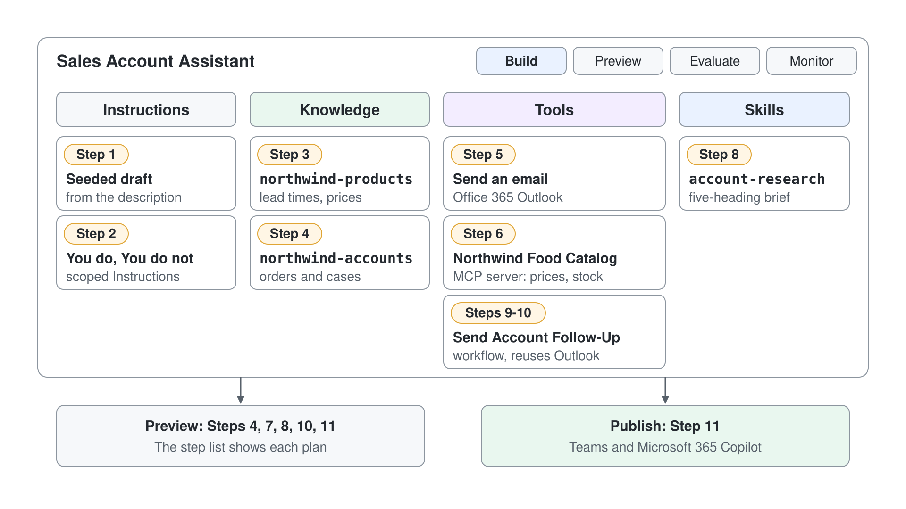

# Build a Sales Account Assistant as a Microsoft Copilot Harness Agent

Every seller loses the first ten minutes of a customer call stitching together account facts from CRM records, product sheets, email threads, and open support tickets. An assistant that answers account questions, assembles a pre-call briefing, and drafts the follow-up email in one place gives that time back and keeps the reasoning consistent across a whole territory. In this capstone lab you build exactly that assistant as a Microsoft Copilot harness agent, going from a one-sentence description to a published agent grounded on real data.

The scenario company is Northwind Traders, a wholesale distributor whose sellers each manage dozens of accounts. You will create a Sales Account Assistant, sharpen its Instructions, ground it on two knowledge documents, connect an Outlook action and the class food catalog MCP server, watch the orchestrator chain them, package a reusable account-research Skill, build a follow-up workflow and hand it to the agent as a tool, and publish for sellers. This lab is based on Microsoft's mcs-orchestration lab, and each step feeds the next: the Instructions shape the Preview tests, the Knowledge and Tools get chained by the orchestrator, the Skill you upload comes from this lab's own companion folder, and the workflow reuses the Outlook connector you signed in to earlier.



## What This Lab Covers

| Step | What you practise | Module topic |
|------|-------------------|--------------|
| 1 | Create the agent from a plain-language description | [The Two Copilot Studio Experiences](../../../demos/06-cs-copilot-harness/01-standard-vs-copilot-harness/readme.md) |
| 2 | Write scoped Instructions on the unified Build surface | [The Unified Build Surface and the New Orchestrator](../../../demos/06-cs-copilot-harness/02-unified-build-and-orchestrator/readme.md) |
| 3 | Add product Knowledge and ground the agent | [The Unified Build Surface and the New Orchestrator](../../../demos/06-cs-copilot-harness/02-unified-build-and-orchestrator/readme.md) |
| 4 | Add account Knowledge and confirm grounding in Preview | [The Unified Build Surface and the New Orchestrator](../../../demos/06-cs-copilot-harness/02-unified-build-and-orchestrator/readme.md) |
| 5 | Add an Office 365 Outlook connector action as a tool | [Tools, MCP, and the New Workflows Designer](../../../demos/06-cs-copilot-harness/04-workflows-and-mcp/readme.md) |
| 6 | Add the class food catalog MCP server | [Tools, MCP, and the New Workflows Designer](../../../demos/06-cs-copilot-harness/04-workflows-and-mcp/readme.md) |
| 7 | Chain knowledge and tools and inspect the plan | [The Unified Build Surface and the New Orchestrator](../../../demos/06-cs-copilot-harness/02-unified-build-and-orchestrator/readme.md) |
| 8 | Package and upload a reusable Skill (SKILL.md) | [Agent Skills in Copilot Studio](../../../demos/06-cs-copilot-harness/03-agent-skills/readme.md) |
| 9 | Build and publish a workflow with typed inputs | [Tools, MCP, and the New Workflows Designer](../../../demos/06-cs-copilot-harness/04-workflows-and-mcp/readme.md) |
| 10 | Configure the workflow as a tool and let the agent fill its inputs | [Tools, MCP, and the New Workflows Designer](../../../demos/06-cs-copilot-harness/04-workflows-and-mcp/readme.md) |
| 11 | Run an end-to-end test in Preview, then Publish | [The Unified Build Surface and the New Orchestrator](../../../demos/06-cs-copilot-harness/02-unified-build-and-orchestrator/readme.md) |

## Lab Files

| File | Purpose |
|------|---------|
| [lab-01-sales-account-assistant/SKILL.md](lab-01-sales-account-assistant/SKILL.md) | The account-research skill you upload in Step 8 to give the assistant a reusable, consistent pre-call briefing recipe |

## Prerequisites

- A Copilot Studio environment where you can create agents (a Power Platform environment with the maker role).
- Your own environment: select the environment name at the bottom of the left navigation (**Switch environment**) and check that **Current environment** shows the environment named after your account, for example `copilot-studio-01` (Sandbox) for `copilot-studio-01@mst.fastlane.net`. Work through the whole lab in it, never in the shared Default environment.
- Microsoft Copilot harness agents available: open [copilotstudio.microsoft.com](https://copilotstudio.microsoft.com), go to **Agents**, and confirm that the **New agent** menu offers **Agent** with the **GitHub Copilot** badge. This is the only setup step; everything after it is building.
- Permission to add connectors and tools. The MCP server in Step 6 is the class food catalog at `https://lab-food-catalog-api.azurewebsites.net/api/mcp`, hosted for the class with no sign-in.
- The companion file `SKILL.md` available locally in the `lab-01-sales-account-assistant` folder next to this guide, for the upload in Step 8.
- No separate knowledge files to prepare: the sample product and account documents are provided inline in Steps 3 and 4, ready to paste into a file.

## Step 1: Create the agent from a description

A Microsoft Copilot harness agent is natural-language-first. Instead of authoring topics and trigger phrases, you describe the agent's job in a sentence and refine it from there. This is the fastest route to a working agent and the clearest way to feel how a Microsoft Copilot harness agent differs from a Standard agent, where you would have hand-built topics before the agent said a word.

1. In the side pane, select **Agents**, open the arrow next to **New agent**, and under **Optimize your business processes** select **Agent** with the **GitHub Copilot** badge.
2. Select the pencil icon next to the agent name and enter `Sales Account Assistant`.
3. In the **Instructions** section, paste the following, then select **Save** (the disk icon at the top right):

```text
You are the Northwind Sales Assistant. You help Northwind Traders sellers prepare for customer calls by answering questions about products, pricing, lead times, and account tiers, preparing pre-call briefings, and drafting follow-up emails.
```

4. Look at the tabs across the top and the components panel on the **Build** tab.

Expected: the agent opens on the **Build** tab, and the top tabs read Build, Preview, Evaluate, and Monitor. **Instructions** holds your description, and the components panel shows **Skills** empty, **Tools** with **Work IQ** and **Knowledge** with **Search all websites**, both added by default. You authored zero topics.

> **Note:** If the agent shows Topics, Knowledge, Tools, and Settings, you created a Standard agent. Go back to **Agents** and create the agent again with **Agent** (GitHub Copilot) from the **New agent** menu. An agent can't be converted between the two kinds, so starting in the right place matters.

## Step 2: Write the agent Instructions

In a Microsoft Copilot harness agent, **Instructions** replace the topic logic of a Standard agent. They are the always-in-context brief the enhanced orchestration runtime reasons against on every turn, so a tight, itemized instruction block is the single biggest lever on answer quality. You will replace the description from Step 1 with a sharper version that sets scope, tone, and guardrails for the two jobs this assistant owns: briefings and follow-up emails.

1. On the **Build** tab, select the text under **Instructions**.
2. Replace it with the following:

```text
Role: You are the Sales Account Assistant, an internal helper for Northwind Traders sellers.

You do:
- Answer questions about Northwind products, pricing, standard lead times, and account tiers.
- Prepare a short pre-call briefing when a seller names an account, using the account-research format.
- Draft a follow-up email that recaps decisions and next steps after a call.
- Cite the knowledge source or record you drew each fact from.

You do not:
- Give binding price quotes, contract terms, or legal advice.
- Invent account facts; if data is missing, say so instead of guessing.
- Answer questions unrelated to Northwind sales.

Style: concise and professional. If a request does not name the account or product it needs, ask for it before answering.
```

3. Select **Save**.

Expected: **Instructions** shows your saved text and the agent identity reflects the seller-support role. Nothing else has changed yet; you have set behavior, not knowledge.

> **Tip:** Write instructions as short "You do / You do not" lists rather than one long paragraph. The runtime follows scoped, itemized guardrails far more reliably than prose, and the itemized "You do not" list is what makes the agent refuse an out-of-scope quote later.

## Step 3: Add product Knowledge

An agent with no knowledge answers from the general model and cannot cite a single Northwind fact. Adding a **Knowledge** source grounds answers in your content and lets the agent show where each fact came from, which is what makes it trustworthy for a seller about to quote a lead time on a live call. You will add a product and account reference so the assistant answers from real Northwind data.

First, create a file named `northwind-products.md` (or a Word document) with this content:

```text
# Northwind Traders - Product and Account Reference
## Account tiers and standard lead times
- Tier 1 (strategic): 3 business days, priority support.
- Tier 2 (growth): 5 business days, standard support.
- Tier 3 (transactional): 10 business days, standard support.
## Selected products
- NWT Cold Brew Concentrate (SKU CB-100): case of 12, list price 48.00 USD.
- NWT Organic Green Tea (SKU GT-220): case of 24, list price 62.00 USD.
- NWT Dark Roast Beans (SKU DR-330): 5 kg bag, list price 74.00 USD.
```

1. On the **Build** tab, open the **Knowledge** component and select **Add knowledge**.
2. Choose to upload a file, then select your `northwind-products` document.
3. Wait until the document appears under **Knowledge**.

Expected: the document appears under **Knowledge**. The agent can now draw tier lead times and product prices from it, though you have not yet confirmed that it does; that verification comes after the second document.

> **Note:** To ground the agent in live Microsoft 365 data such as emails, files, and meetings, you would add Microsoft IQ from this same **Knowledge** component. This lab uses uploaded files so any learner can complete it without tenant-specific data.

## Step 4: Add account Knowledge and test grounding

One document tells the agent about products; a second gives it the accounts and orders a briefing actually needs. Splitting them mirrors how the facts really live in a business, and it lets you watch the orchestrator pull from more than one source in Step 7. After adding the second document you will confirm grounding in **Preview**, the tab where you see the agent behave before anyone else does.

First, create a file named `northwind-accounts.md` (or a Word document) with this content:

```text
# Northwind Traders - Account and Order Reference
## Accounts
- Alfreds Futterkiste (Tier 1): region North, owner J. Berg.
- Around the Horn (Tier 2): region North, owner M. Diaz.
## Recent orders (last quarter)
- Alfreds Futterkiste: 40 cases Cold Brew Concentrate, delivered on time.
- Around the Horn: 12 cases Organic Green Tea, 1 case backordered.
## Open support cases
- Alfreds Futterkiste: case 4821, damaged shipment, open.
```

1. On the **Build** tab, open the **Knowledge** component and select **Add knowledge** again.
2. Upload your `northwind-accounts` document and wait for it to finish processing.
3. Open the **Preview** tab and send this message:

```text
What did Around the Horn order last quarter, and what is their standard lead time?
```

4. Read the answer and look for a citation back to your knowledge sources.

Expected: **Preview** answers that Around the Horn ordered 12 cases of Organic Green Tea (with one case backordered) and, as a Tier 2 account, has a 5 business day standard lead time. The answer cites the two `northwind` sources rather than returning a generic response. This confirms the agent combined both documents in one turn.

## Step 5: Add an Outlook connector action as a tool

**Tools** let the agent act on real systems instead of only talking about them. A connector exposes a single external action, such as sending an email, and a clear tool description tells the orchestrator exactly when to reach for it. You will add the Office 365 Outlook **Send an email** action so the assistant can turn a drafted follow-up into a sent message, and you will reuse this same action inside the workflow in Step 9.

1. On the **Build** tab, select **+** next to **Tools**.
2. Select the Office 365 Outlook connector and pick the **Send an email (V2)** action.
3. Complete the connection sign-in if the connector asks for one; an existing Outlook connection of your account is reused.
4. Under **Tools**, select **Send an email (V2)**, select the pencil next to **Description for Intelligence**, and paste the following so the orchestrator knows when to call it:

```text
Use this action to send a follow-up email to a customer after a call. Call it only when the seller has confirmed the recipient, subject, and body. Do not use it to send anything the seller has not reviewed.
```

5. Select **Save**.

Expected: the Office 365 Outlook **Send an email (V2)** action appears in the **Tools** list with your description. The agent can now cite sending mail as an available capability, though it will not send anything until a seller confirms the details.

> **Tip:** Keep one action per tool and give each a "call it when" description. The orchestrator picks tools by matching the request against these descriptions, so a vague description is the most common reason an available action never gets used.

## Step 6: Add the class food catalog MCP server

An MCP server gives the agent a standardized, shared set of tools over Model Context Protocol, rather than a single connector action. The class hosts Northwind's food catalog as an MCP server, so the assistant can read live dishes, prices, and stock without you wiring up individual actions. Because the connection uses the Streamable transport, later changes on the server are reflected without republishing the agent.


1. On the **Build** tab, select **+** next to **Tools**.
2. In **Add a tool**, select **+ Add**, then select **Model Context Protocol (MCP)**.
3. In **Add MCP server**, enter `Northwind Food Catalog` as **Server name**, paste the text below as **Server description** so the orchestrator knows when to call it, enter `https://lab-food-catalog-api.azurewebsites.net/api/mcp` as **Server URL**, set **Authentication** to **None**, and select **Add**:

```text
Use this server to look up Northwind's live food catalog: dishes, current prices, and units in stock. Prefer it over uploaded documents when the seller asks about the current price or stock of a food item. Only read from it; never add, update, or delete catalog items.
```

4. Under **Select a connection**, open the **Not connected** list, select **Create new connection**, select **Create** in the connection dialog, then select **Add**, and select **Save** before you open the tool (with unsaved changes, **Leave without saving?** appears and **Discard** drops the new tool).
5. Under **Tools**, select **Northwind Food Catalog** to open **Edit tool**. Under **Tool permissions**, turn off **Add food item**, **Update food item**, **Update food item stock**, and **Delete food item**, keep **Get all food items** and **Get food items by name** on, select **Done**, and select **Save**.

Expected: **Northwind Food Catalog** appears in the **Tools** list alongside the Outlook action, and its **Tool permissions** allow only reading tools such as **Get all food items** and **Get food items by name**. The agent now has two kinds of source, uploaded documents for accounts and orders and a live server for prices and stock, and the next step forces it to combine them.

> **Note:** The food catalog server exposes a standardized tool set, so you did not define individual actions. Every learner shares this catalog, and it also offers write tools, which is why you turned them off and the description limits the agent to reading. If the server is updated later, the Streamable transport surfaces those changes to your agent without a republish.

## Step 7: Chain knowledge and tools, and inspect the plan

This is where the enhanced orchestrator earns its name. The runtime is always on and performs multi-step reasoning, so a single question can force it to combine the grounded documents with a live catalog lookup and plan the order itself. You will ask one briefing-shaped question, then expand the step list under the answer to see the plan the orchestrator built, which is the fastest way to understand and debug how the agent thinks.


1. Open the **Preview** tab.
2. Send this message:

```text
Prepare me for my call with Around the Horn: what did they order last quarter, what is their standard lead time, and what do we charge for Kaiserschmarrn today and how many are in stock?
```

3. Let the agent respond, then expand the step list under the answer (**Debug mode** in the **Preview** header is on by default) to see the steps it took.
4. Confirm the steps show **Used tool: Searched knowledge** for the order history and lead time, and a **Used tool** line for a food catalog tool such as `get_food_items_by_name` for the price and stock.

Expected: a single answer that weaves the last-quarter order and Tier 2 lead time from **Knowledge** together with the Kaiserschmarrn price of 9 and its current stock from the food catalog server (the stock changes as other learners use the catalog). The step list shows the orchestrator planning across knowledge and the MCP tool in one turn, rather than answering from a single source.

> **Tip:** If the agent does not reason deeply enough on a complex request, include the keyword "reason" in your prompt or instruction step. Deep reasoning kicks in automatically for hard questions, and the keyword forces it when you want the fuller plan.

## Step 8: Package and upload a reusable Skill

**Skills** package a focused task recipe in the open SKILL.md format that the agent loads on demand only when a request matches, keeping the assistant modular and its briefings consistent. Instead of relying on the agent to reinvent a briefing shape each time, you upload a skill that fixes the format: Account, Relationship, Recent activity, Open items, Recommended next step. This lab ships that skill in its companion folder.

1. On the **Build** tab, open the **Skills** component.
2. In the **Skills** panel choose **Upload a skill** and select SKILL.md from the lab-01-sales-account-assistant folder next to this guide.
3. Confirm the skill imports with the name account-research and its description.
4. Open the **Preview** tab and send this message:

```text
Give me an account brief for Alfreds Futterkiste before my call.
```

Expected: the skill appears in the **Skills** list as account-research, and the **Preview** answer follows the skill's five headings in order: Account, Relationship, Recent activity, Open items, and Recommended next step. For Alfreds Futterkiste that means the Tier 1 profile, the 40-case Cold Brew order, and the open damaged-shipment case 4821 all land in their sections, and the step list shows **Used skill: account-research**. If the answer uses other headings and no skill line, select **New chat** and send the message again.

## Step 9: Build and publish the follow-up workflow

A workflow handles a repeated, deterministic process the agent runs on demand: take an input, run a fixed sequence, return a result. A workflow only becomes callable by an agent when it carries the **When an agent calls the flow** trigger, ends in a **Respond to the agent** action, and is published, so you build all three parts here before wiring anything to the assistant. The piece that makes it useful is the trigger's **Inputs** list: those are the typed values the agent passes in, and without them the workflow can only ever do the same thing with the same data.

1. On the **Build** tab, select **+** next to **Tools**.
2. In **Add a tool**, select **+ Add**, then choose **Workflow**.
3. The workflows designer opens with a starter template holding two nodes, **When an agent calls the flow** and **Respond to the agent**.
4. Select the trigger node. In the pane on the right, confirm **Trigger type** reads **When an agent calls the workflow**.
5. Under **Inputs**, select **Add an input** and choose **Text**. Replace the prefilled name and description (**Please enter your input**) with the name `accountName` and this description:

```text
The Northwind account the follow-up is about, for example Around the Horn.
```

6. Select **Add an input** twice more and create these two, both **Text**:

```text
recipientEmail: The mailbox that receives the follow-up email.
followUpBody: The full follow-up message the seller approved, recapping decisions and next steps.
```

7. Select the plus between the two nodes and add the Office 365 Outlook **Send an email** action, reusing the connection from Step 5.
8. Map the email fields to the trigger inputs with the lightning (dynamic content) icon in each field: **To** takes `recipientEmail`, **Subject** takes the text `Follow-up: ` typed first with `accountName` inserted after it, and **Body** takes `followUpBody`.
9. Open the **Respond to the agent** node, add a text output named `status`, and set its value to a confirmation such as `Follow-up sent`.
10. Rename the workflow to Send Account Follow-Up, select the save icon, then select **Publish**.

Expected: the designer shows three nodes in order, the trigger pane lists `accountName`, `recipientEmail`, and `followUpBody` each with its own description, and the publish completes without a flow-checker error. The workflow now appears on the **Workflows** page, where other agents can reuse it; you add it to this agent's **Tools** in the next step.

> **Note:** If the workflow later fails to show up when adding a tool, it is almost always one of three things: it is not published, its **Respond to the agent** action is missing, or that action has **Asynchronous response** turned on under **Networking**. The agent can only call a workflow that answers in real time.

## Step 10: Configure the workflow as a tool and let the agent fill its inputs

A published workflow is a capability the agent has, not yet one it knows when or how to use. That is what the **Workflow details** dialog settles: the description tells the orchestrator when to reach for the workflow, and each input gets a rule for how its value arrives. **Fill with Intelligence** means the agent works the value out from the conversation and the input's description, while **Custom** pins it to a fixed value you set. You will let the agent fill the account name and the message body, and pin the recipient to your own mailbox so a test run cannot email a customer.


1. On the **Build** tab, select **+** next to **Tools**, open the **Workflows** tab in **Add a tool**, and add Send Account Follow-Up. Then select it under **Tools** to open the **Workflow details** dialog.
2. Select the pencil next to **Description for Intelligence** and paste this description:

```text
Use this workflow to send an approved follow-up email after a customer call. Call it only when the seller has confirmed the recap text. Do not call it to draft or revise the message.
```

3. Select **Inputs**. Each input appears with its type, for example `accountName * (string)`, its description, and the choice **Fill with Intelligence** or **Custom**.
4. For `accountName`, leave **Fill with Intelligence** selected, select **Improve Intelligence fill**, and paste this description:

```text
The Northwind account the seller just spoke with. Take it from the conversation, for example Around the Horn.
```

5. For `followUpBody`, leave **Fill with Intelligence** selected, select **Improve Intelligence fill**, and paste this description:

```text
The follow-up message the seller approved in this conversation, including the recap of decisions and the next steps.
```

6. For `recipientEmail`, select **Custom**, open **Value**, select **+ New**, and create a variable whose value is your own mailbox address, so test runs stay with you.
7. Select **Outputs** and confirm `status` is returned to the agent, then select **Save**.
8. Open the **Preview** tab and send this message:

```text
Draft a follow-up for Around the Horn recapping the backordered case, then send it with the Send Account Follow-Up workflow.
```

Expected: the assistant drafts the recap, asks you to confirm, and then calls Send Account Follow-Up rather than the **Send an email (V2)** tool from Step 5. The step list under the answer shows the workflow call with `accountName` set to Around the Horn and `followUpBody` carrying the drafted text, the agent reports back the `status` value, and the email lands in the mailbox you pinned in step 6.

> **Warning:** The workflow uses the live Outlook connection, so a run sends a real email. Keep `recipientEmail` pinned with **Custom** to your own address until you have watched a full run; switching it to **Fill with Intelligence** lets the agent address a customer directly.

## Step 11: Run an end-to-end test in Preview, then Publish

With every component wired, run one **Preview** conversation that exercises Instructions, both Knowledge sources, the Outlook tool, the food catalog MCP server, and the account-research Skill together, then publish the assistant for sellers. Publishing makes the agent available on channels such as Teams and Microsoft 365 Copilot, so you do it once the Preview loop looks right and sellers reach a version you have actually tested.

1. Open the **Preview** tab and send this full seller flow:

```text
Prepare me for my call with Around the Horn, including today's price of Kaiserschmarrn as an offer, then draft a follow-up email recapping next steps.
```

2. Confirm the agent produces a briefing in the account-research skill format, pulls order data through **Knowledge** and the Kaiserschmarrn price through the food catalog server, and drafts an email it offers to send through the Outlook action.
3. Fix any instruction or tool-description gap you notice, then re-run the flow.
4. When satisfied, select **Publish**, then **Publish agent** in the dialog.
5. Read the channel options under **Add channels** (Teams and Microsoft 365, Demo website, App) so you know where sellers will reach the assistant, then close the dialog.

Expected: the assistant completes the full flow in one Preview conversation, producing a formatted briefing followed by a drafted follow-up email, and then publishes without errors while listing the channels where it can be added. Your Northwind Sales Account Assistant is now live.

## Troubleshooting

| Symptom | Likely cause | Fix |
|---------|--------------|-----|
| Pages read Topics / Knowledge / Tools / Settings | You created a Standard agent | Go back to **Agents** and recreate it with **Agent** (GitHub Copilot) from the **New agent** menu; a Standard agent can't be converted |
| Grounded answer is correct but has no citation | Knowledge source still processing, or the cite line was removed from Instructions | Wait for the source status to show ready, confirm the "cite the source" line from Step 2, then ask again |
| The step list shows only one source used | The question did not force a cross-source plan, or one source is not ready | Ask the combined Step 7 prompt that needs both order history and a live price, and confirm both documents plus the Northwind Food Catalog are listed under **Knowledge** and **Tools** |
| **Northwind Food Catalog** shows no tools or reads **Not connected** | The connection was not created in Step 6 | Open the tool, select **Create new connection**, then **Create**, and save the agent |
| The agent offers to change a catalog item or its stock | The server also has write tools, and the read-only line is missing from its description | Paste the Step 6 description again; never confirm a catalog change in this lab |
| Preview answers "You need credits to continue ... Error code: EnforcementUsageCredits" | The environment has no Copilot Credits left, and a Microsoft Copilot harness agent uses credits in Preview | Ask the admin to allocate Copilot Credits to the environment, then send the message again |
| Uploaded skill does not change the briefing shape | The skill imported but was not triggered, or the request did not match its description | Ask explicitly for an account brief so the request matches the account-research description; confirm the skill is listed under **Skills** |
| Outlook action never gets called | Tool description is too vague for the orchestrator to match | Sharpen the Step 5 "call it when" description and confirm the connection sign-in completed |
| The agent sends the follow-up with **Send an email (V2)** instead of the workflow | Both tools can send mail, and the request did not name the workflow | Name Send Account Follow-Up in the request, as in the Step 10 prompt |
| The workflow is not listed when adding a tool | It is unpublished, has no **Respond to the agent** action, or that action has **Asynchronous response** on | Publish the workflow, confirm the **Respond to the agent** node exists, and set **Asynchronous response** to **Off** under **Networking** |
| The agent never calls the workflow | The **Details** description does not tell the orchestrator when to use it | Paste the Step 10 "call it when" description and re-run the Preview prompt |
| A workflow input arrives empty or wrong | The input is set to **Fill with Intelligence** with a description too vague to fill from the conversation | Sharpen the input description under **Inputs** so it names the value and gives an example, or pin it with **Custom** |

## Summary

You built the Northwind Sales Account Assistant: a Microsoft Copilot harness agent created from a description, scoped with Instructions, grounded on two documents, connected to an Outlook action and the class food catalog MCP server, extended with a reusable account-research Skill, wired to a published follow-up workflow whose inputs the agent fills, and published for sellers. You can now:

- Create and scope a Microsoft Copilot harness agent from a plain-language description.
- Ground an agent on multiple Knowledge sources and confirm cited answers in **Preview**.
- Add both a connector action and a hosted MCP server as **Tools**, and inspect how the orchestrator chains them in the step list.
- Package a task recipe as a SKILL.md file, upload it, and drive consistent briefings from it.
- Build a workflow with the agent trigger and typed inputs, publish it, and add it to an agent as a tool whose inputs the orchestrator fills.
- Run an end-to-end Preview and publish the assistant to seller channels.

Next, take the reasoning skills further in [Trace an Agent's Reasoning in the New Orchestrator](../../../demos/06-cs-copilot-harness/02-unified-build-and-orchestrator/demo-02-trace-agent-reasoning.md).
