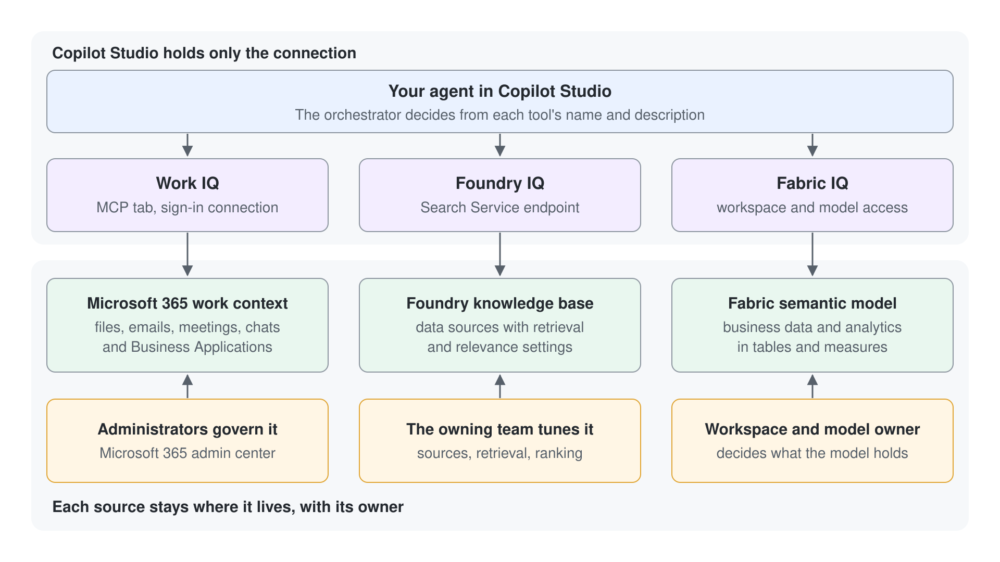

# Einen Agent mit Work IQ grounden und Arbeitsfragen an ihn weiterleiten

Ein Agent ohne Tools rät bei genau der Arbeit, die einem Account Manager am wichtigsten ist: was ein Kunde geschrieben hat und was vereinbart wurde. In diesem Lab fügen Sie einem Microsoft Copilot Harness Agent Work IQ hinzu, schreiben die Instructions, die ihm sagen, wann er Work IQ aufruft, und prüfen das Ergebnis im Activity Trace. Am Ende haben Sie einen Agent, der Arbeitsfragen aus Ihren eigenen E-Mails beantwortet, und Sie können am Trace belegen, welche Antworten von Work IQ stammen.

Was Sie hier üben: Instructions schreiben, die eine Art von Frage an ein Grounding Tool weiterleiten, und dieses Routing danach im Activity Trace prüfen.

Dauer: etwa 25 Minuten, ohne den optionalen Schritt 9.

## Was Sie bauen

- Aurora Provisions Account Assistant, ein Microsoft Copilot Harness Agent mit Work IQ (Preview) im Abschnitt Tools.
- Instructions, die Fragen zum Arbeitskontext an Work IQ senden und die Quelle jeder Antwort nennen.
- Eine Antwort, die eine E-Mail zur Vertragsverlängerung zitiert, die Sie sich selbst geschickt haben, abgeglichen mit Ihrem Posteingang.
- Eine Prüfung im Trace, die zeigt, welche Antworten Work IQ genutzt haben und welche nicht.



## Was dieses Lab abdeckt

| Schritt | Schwerpunkt |
|------|-------|
| 1 | Einen Microsoft Copilot Harness Agent erstellen |
| 2 | Eine Seed-E-Mail senden, die der Agent finden muss |
| 3 | Den Agent ohne Grounding fragen und die Baseline lesen |
| 4 | Work IQ (Preview) über das Panel Tools hinzufügen |
| 5 | Fragen zum Arbeitskontext in den Instructions an Work IQ weiterleiten |
| 6 | Eine Frage zum Arbeitskontext testen und den Consent erteilen |
| 7 | Den Activity Trace lesen und die Quelle prüfen |
| 8 | Bestätigen, dass eine allgemeine Frage Work IQ nicht aufruft |
| 9 | Optional: den Agent mit Foundry IQ oder Fabric IQ grounden |

## Voraussetzungen

- Eine Copilot Studio Environment, in der Sie Agents erstellen können (Maker-Rolle) und in der das Menü **New agent** auf der Seite **Agents** den Eintrag **Agent** mit dem Badge **GitHub Copilot** anbietet. Die oberen Tabs des Agents heißen Build, Preview, Evaluate und Monitor.
- Ihre eigene Environment: Wählen Sie unten in der linken Navigation den Namen der Environment (**Switch environment**) und prüfen Sie, dass unter **Current environment** die nach Ihrem Account benannte Environment steht, zum Beispiel `copilot-studio-01` (Sandbox) für `copilot-studio-01@mst.fastlane.net`. Arbeiten Sie das ganze Lab darin, nie in der gemeinsamen Default Environment.
- Work IQ, von einem Administrator für den Kurs-Tenant aktiviert, und Ihr User dem Usage-based Billing Plan zugewiesen. Fehlt Work IQ (Preview) in Schritt 4 in der Tool-Liste, fragen Sie Ihren Trainer, bevor Sie weitermachen.
- Ihre eigene Kurs-Mailbox, damit Sie sich in Schritt 2 die Seed-E-Mail selbst schicken können.
- Keine Dateien zum Herunterladen. Sie fügen jeden Input aus dieser Anleitung ein.

## Schritt 1: Einen Microsoft Copilot Harness Agent erstellen

Sie brauchen einen Agent, den Sie grounden, und im Tab Build liegen Tools und Instructions. Beginnen Sie jetzt mit kurzen Instructions. In Schritt 5 schreiben Sie sie neu, sobald es Work IQ als Ziel für das Routing gibt.

1. Wählen Sie im Seitenbereich **Agents**, öffnen Sie den Pfeil neben **New agent** und wählen Sie unter **Optimize your business processes** den Eintrag **Agent** mit dem Badge **GitHub Copilot**.
2. Geben Sie im Namensfeld `Aurora Provisions Account Assistant` ein, fügen Sie dann die folgende Beschreibung in den Abschnitt **Instructions** ein und wählen Sie **Save**.

```text
You are the Aurora Provisions Account Assistant. You help Aurora Provisions account managers prepare for customer calls. Keep answers short and professional.
```

Erwartet: Der Agent öffnet sich im Tab **Build**, und die oberen Tabs heißen Build, Preview, Evaluate und Monitor. Zeigt der Agent Topics, Knowledge, Tools und Settings, ist er ein Standard Agent. Gehen Sie zurück zu **Agents** und erstellen Sie den Agent erneut mit **Agent** (GitHub Copilot) aus dem Menü **New agent**.

## Schritt 2: Sich selbst eine Seed-E-Mail senden

Work IQ kann eine Antwort nur in E-Mails grounden, die es gibt. Diese Seed-E-Mail gibt dem Agent eine echte Anfrage zur Vertragsverlängerung, die er finden kann, und die Antwort, die Sie später prüfen, muss zu Ihrem Posteingang passen, nicht zu dieser Anleitung.

1. Öffnen Sie Ihren Mail Client und senden Sie eine E-Mail an Ihre eigene Kursadresse, mit dem folgenden Betreff und Text.

```text
Subject: Aurora Provisions renewal call

Hi, before the renewal Aurora Provisions asks for three things: a 12-month price hold, the cold-chain delivery report by Friday, and a named account contact. Please confirm by Thursday.
```

Erwartet: Die Nachricht kommt in Ihrem Posteingang an. Lassen Sie vor Schritt 6 ein paar Minuten vergehen, damit die Nachricht für Work IQ verfügbar ist, wenn Sie danach fragen.

## Schritt 3: Den Agent ohne Grounding fragen

Die Baseline kommt zuerst, damit die Änderung in Schritt 6 einen Vergleichswert hat. Im Moment hat der Agent kein Tool, das E-Mails liest, also kann er nur aus seinen Instructions und seinem Allgemeinwissen schließen. Stellen Sie die Frage, die die Seed-E-Mail beantwortet.

1. Öffnen Sie den Tab **Preview** und senden Sie diese Frage:

```text
What three things did Aurora Provisions ask for before the renewal, and when do they need a reply?
```

Erwartet: Die Antwort listet die drei Anliegen aus Ihrem Posteingang nicht auf. Sie sagt entweder, dass der Agent Ihre E-Mails nicht sehen kann, oder gibt eine allgemeine Antwort. Der Trace zeigt keinen Work IQ Node, also ist jeder konkrete Name und jedes Datum in der Antwort geraten; genau diesen Fehler behebt dieses Lab.

## Schritt 4: Work IQ über das Panel Tools hinzufügen

Work IQ ist die Grounding-Quelle. Wenn Sie es hinzufügen, bekommt der Agent ein Tool, das er aufrufen kann, und Schritt 5 legt fest, wann er das tut. Learn beschreibt Work IQ als Preview Feature, das nur liest, solange kein Administrator Schreibvorgänge einschaltet. In diesem Lab nutzen Sie es nur lesend.

1. Öffnen Sie den Tab **Build** und wählen Sie **Tools** im Components Panel.
2. Wählen Sie **Add tool** und dann **MCP**.
3. Wählen Sie **Work IQ (Preview)**, klappen Sie **Connection** auf, wählen Sie **Create new connection** und dann **Create**.
4. Melden Sie sich mit Ihrem Kurs-Account an und wählen Sie dann **Add and Configure**.

Erwartet: Work IQ (Preview) erscheint im Abschnitt Tools des Tabs **Build** als verbundenes Tool.

> **Warnung:** Wählen Sie in diesem Schritt nicht Mail, Teams, OneDrive, SharePoint oder die anderen workload-spezifischen Tools. Learn führt sie als Legacy Experience mit Standard-Lizenzierung, sie sind also ein anderer Produktweg als Work IQ (Preview).

## Schritt 5: Fragen zum Arbeitskontext in den Instructions an Work IQ weiterleiten

Ein Tool bleibt ungenutzt, bis der Agent weiß, wann er es aufrufen soll. Wenn Sie die Arten von Arbeitskontext in den Instructions benennen, greift der Agent bei Fragen zu E-Mails, Meetings und Chats zu Work IQ. Die letzte Zeile verlangt, dass der Agent seine Quelle nennt; das gibt Ihnen in Schritt 7 etwas zum Prüfen.

1. Öffnen Sie im Tab **Build** die Component **Instructions**.
2. Ersetzen Sie ihren Inhalt durch den folgenden Text.
3. Wählen Sie **Save**.

```text
Role: You are the Aurora Provisions Account Assistant, an internal helper for Aurora Provisions account managers.

You do:
- When a question asks about my own work context (email, meetings, Teams chats, or files about a customer or deal), use the Work IQ tool to find the answer before you reply.
- Name the email subject, meeting, or chat that your answer came from.

Style: concise and professional.
```

Erwartet: Die Component Instructions zeigt den gespeicherten Text, und Work IQ (Preview) steht weiterhin unter Tools. Getestet ist noch nichts, der nächste Schritt ist also die erste echte Prüfung.

## Schritt 6: Eine Frage zum Arbeitskontext testen und den Consent erteilen

Die Frage ist dieselbe wie in Schritt 3, also stammt jede Änderung der Antwort aus dem Routing, das Sie geschrieben haben. Beim ersten Senden kann ein Consent Prompt erscheinen, weil Work IQ sich für Ihren Account mit Microsoft 365 Services verbindet.

1. Öffnen Sie den Tab **Preview**, starten Sie eine neue Unterhaltung und senden Sie die Frage aus Schritt 3 erneut.
2. Wenn Sie gefragt werden, ob Work IQ sich verbinden und Services nutzen darf, wählen Sie **Allow**.
3. Lesen Sie die Antwort.

Erwartet: Die Antwort listet die drei Anliegen auf (die Preisbindung, den Kühlketten-Bericht bis Freitag und einen namentlich benannten Account-Kontakt), nennt Donnerstag als Antwortfrist und nennt den Betreff Aurora Provisions renewal call. Bleibt die Antwort allgemein, nutzen Sie die Troubleshooting-Tabelle, bevor Sie etwas anderes ändern.

## Schritt 7: Den Activity Trace lesen und die Quelle prüfen

Eine Antwort ist eine Behauptung, und der Trace ist der Beleg. Sie bestätigen, dass ein Work IQ Node gelaufen ist, lesen, was er zurückgegeben hat, und vergleichen diesen Output mit der Antwort.

1. Lassen Sie im Tab **Preview** das Trace Panel neben dem Chat sichtbar. Prüfen Sie, dass der Schalter **End user preview** aus ist.
2. Wählen Sie im Trace den Node des Work IQ Tools und lesen Sie seinen Input und Output.
3. Scrollen Sie ans Ende des Trace und suchen Sie das grüne Häkchen.

Erwartet: Der Output von Work IQ enthält die Seed-E-Mail aus Schritt 2, und die drei Anliegen in der Antwort stimmen damit überein. Das grüne Häkchen zeigt, dass jeder Tool Call abgeschlossen wurde.

## Schritt 8: Bestätigen, dass eine allgemeine Frage Work IQ nicht aufruft

Routing wirkt in beide Richtungen. Eine allgemeine Frage soll ohne Suche in den E-Mails beantwortet werden, weil jeder Work IQ Aufruf im Usage-based Billing abgerechnet wird. Diese Prüfung zeigt, dass die Instruction auf den Arbeitskontext begrenzt ist.

1. Öffnen Sie den Tab **Preview**, starten Sie eine neue Unterhaltung und senden Sie die folgende Frage.
2. Öffnen Sie den Trace und prüfen Sie, ob es einen Work IQ Node gibt.

```text
Suggest a one-sentence opening for a call with a new customer.
```

Erwartet: Der Agent beantwortet die Frage direkt, und der Trace zeigt keinen Work IQ Node. Die Routing-Zeile in den Instructions deckt nur Fragen zum Arbeitskontext ab.

## Schritt 9: Optional: den Agent mit Foundry IQ oder Fabric IQ grounden

Foundry IQ und Fabric IQ grounden einen Agent in Daten außerhalb der E-Mails, aber beide brauchen eine Resource, die Ihr Trainer bereitstellen muss: eine Knowledge Base in Microsoft Foundry oder ein Semantic Model in Microsoft Fabric, das Ihr Account öffnen kann. Überspringen Sie diesen Schritt, wenn Sie keinen Zugriff haben. Fügen Sie die Connection einem zweiten Agent hinzu, damit der Work IQ Agent aus den Schritten 1 bis 7 so bleibt, wie Sie ihn gebaut haben.



Weg A: Foundry IQ

1. Wählen Sie im Tab **Build** des zweiten Agents **Tools** im Components Panel und dann **Foundry IQ**.
2. Wählen Sie **Create new connection**, wählen Sie **Microsoft Entra ID Integrated** als Authentication Type, geben Sie den Search Service Endpoint ein, den Ihr Trainer Ihnen nennt, und wählen Sie dann **Create**.
3. Wählen Sie **Next**, wählen Sie eine Knowledge Base aus der Liste, wählen Sie **Add to agent** und dann **Save**.
4. Wählen Sie die Foundry IQ Connection, schreiben Sie für jedes Thema der Knowledge Base einen Satz in den Worten, die ein Account Manager tippen würde, und wählen Sie dann **Save**.
5. Öffnen Sie den Tab **Preview**, stellen Sie eine Frage, die die Knowledge Base beantworten sollte, und öffnen Sie den Trace.

Erwartet: Der Trace zeigt einen Foundry IQ Retrieval-Schritt und listet die zurückgegebenen Einträge auf, und die Antwort nutzt diese Einträge.

Weg B: Fabric IQ

1. Wählen Sie im Tab **Build** des zweiten Agents **+ Add tool** im Components Panel und dann **Fabric IQ**.
2. Folgen Sie den üblichen Schritten zum Hinzufügen eines Tools, melden Sie sich mit dem Account an, der den Workspace öffnen kann, und wählen Sie **Save**. Der Picker zeigt nur die Items, auf die Ihr Account zugreifen kann.
3. Öffnen Sie den Tab **Preview**, stellen Sie eine Frage, die ein Measure im Semantic Model beantworten kann, und öffnen Sie den Trace.

Erwartet: Der Trace zeigt einen Node für den Fabric IQ Aufruf, und die Antwort gibt den Wert aus dem Semantic Model wieder.

> **Hinweis:** Wenn Sie eine Connection in Copilot Studio entfernen, ändert das weder die Knowledge Base in Microsoft Foundry noch das Semantic Model in Microsoft Fabric.

## Troubleshooting

| Symptom | Wahrscheinliche Ursache | Lösung |
|---------|--------------|-----|
| Work IQ (Preview) fehlt in der MCP-Liste | Der Tenant ist nicht für Work IQ eingerichtet, oder Ihr User ist nicht dem Usage-based Billing Plan zugewiesen | Bitten Sie Ihren Trainer, die einmalige Einrichtung des Tenants und die Billing-Zuweisung zu bestätigen, und öffnen Sie dann Add a tool erneut |
| Die Antwort bleibt nach Schritt 6 allgemein | Der Consent wurde nicht erteilt, die Connection nutzt einen anderen Account, oder die Seed-E-Mail ist noch nicht verfügbar | Prüfen Sie die Connection unter Tools, warten Sie noch ein paar Minuten und fragen Sie erneut; wählen Sie **Allow**, wenn der Consent Prompt wieder erscheint |
| Der Trace zeigt bei einer Arbeitsfrage keinen Work IQ Node | Die Routing-Zeile fehlt in den Instructions, oder die Formulierung klingt nicht nach Arbeitskontext | Prüfen Sie, ob Schritt 5 gespeichert wurde, und fragen Sie dann mit den Worten "from my email" |
| Ein Mail oder Teams Tool erscheint unter Tools | Das Legacy Tool wurde in Schritt 4 hinzugefügt | Entfernen Sie dieses Tool und fügen Sie Work IQ (Preview) über den Tab MCP hinzu |
| Der Picker für Foundry IQ oder Fabric IQ ist leer | Ihr Account hat keinen Zugriff auf die Knowledge Base, den Workspace oder das Semantic Model | Bitten Sie den Owner der Resource, Ihnen Zugriff zu geben, und öffnen Sie den Picker dann erneut |

## Prüfen

Sie haben das Ziel des Labs erreicht, wenn alle folgenden Punkte zutreffen:

1. Work IQ (Preview) steht im Tab **Build** unter Tools als verbundenes Tool.
2. Die Antwort aus Schritt 3 enthält kein Anliegen aus Ihrem Posteingang, und die Antwort aus Schritt 6 nennt die drei Anliegen und die Antwortfrist Donnerstag.
3. Der Trace aus Schritt 6 enthält einen Work IQ Node, dessen Output die Seed-E-Mail enthält, und der Trace aus Schritt 8 enthält keinen.
4. Die Instructions im Tab **Build** enthalten die Routing-Zeile aus Schritt 5.

## Zusammenfassung

Sie haben einen Agent in Ihren eigenen E-Mails gegroundet. Sie haben Work IQ (Preview) hinzugefügt, Instructions geschrieben, die Fragen zum Arbeitskontext dorthin leiten, die Antwort mit Ihrem Posteingang abgeglichen und mit dem Activity Trace gezeigt, dass eine allgemeine Frage das Tool überspringt. Sie können jetzt:

- Work IQ (Preview) über das Panel Tools und den Tab MCP hinzufügen und seine Connection und seinen Consent Prompt handhaben.
- Instructions schreiben, die eine Art von Frage an ein Grounding Tool senden.
- Grounding im Activity Trace belegen und eine gegroundete Antwort von einer geratenen unterscheiden.

Kehren Sie zu [Agents mit Work IQ, Foundry IQ und Fabric IQ grounden](../../../demos/06-cs-copilot-harness/05-iq-grounding/readme.md) zurück, um die drei Grounding-Quellen zu vergleichen, wenn Sie eine für einen echten Agent auswählen.

## Aufräumen

Löschen Sie den Aurora Provisions Account Assistant aus der Agent-Liste, wenn Sie ihn nicht mehr brauchen: Öffnen Sie den Agent und wählen Sie **Delete**. Haben Sie die optionalen Connections hinzugefügt, öffnen Sie den Abschnitt **Tools** des zweiten Agents und entfernen Sie jede Connection mit dem Steuerelement **x**. Wenn Sie eine Connection entfernen, bleiben die Foundry Knowledge Base und das Fabric Semantic Model unverändert. Löschen Sie die Seed-E-Mail aus Ihrer Mailbox, wenn Sie sie nicht behalten möchten.
