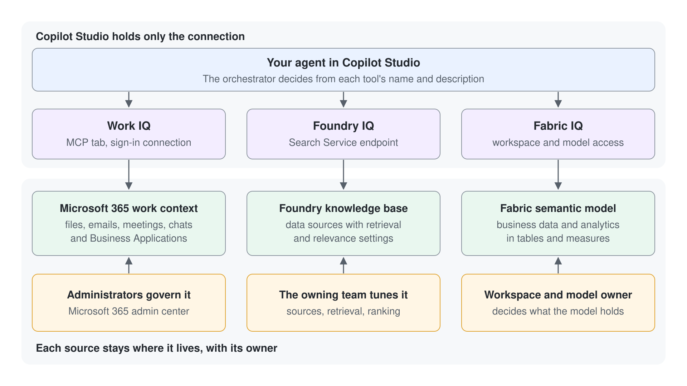

# Ground an Agent with the HR MCP Server and Route Staff Questions to It

An agent with no tools guesses about the facts a shift manager needs most: who is on the team, what they can do, and which languages they speak. This lab adds the class HR MCP server to a Microsoft Copilot harness agent, writes the instructions that tell it when to call the server, and checks the result in the Preview step list. You finish with an agent that answers staff questions from the live staff list, and you can prove from the step list which answers came from the server.

What you practice here: writing instructions that route one kind of question to a grounding tool, then verifying the routing in the step list.

Duration: about 25 minutes, not counting the optional Step 8.

## What you'll build

- Restaurant Staff Assistant, a Microsoft Copilot harness agent with the HR MCP server in its Tools section.
- Instructions that send staff questions to the HR MCP server, keep it read-only, and name the source of each answer.
- A reply that names the right team member, checked against the server's output in the step list.
- A step-list check that shows which replies used the HR MCP server and which did not.



## What This Lab Covers

| Step | Focus |
|------|-------|
| 1 | Create a Microsoft Copilot harness agent |
| 2 | Ask the agent without grounding and read the baseline |
| 3 | Add the HR MCP server from the Tools panel |
| 4 | Route staff questions to the HR MCP server in Instructions |
| 5 | Test a staff question |
| 6 | Read the step list and check the source |
| 7 | Confirm that a general question does not call the HR MCP server |
| 8 | Optional: ground the agent with Foundry IQ or Fabric IQ |

## Prerequisites

- A Copilot Studio environment where you can create agents (maker role), where the **New agent** menu on the **Agents** page offers **Agent** with the **GitHub Copilot** badge. The agent's top tabs read Build, Preview, Evaluate, and Monitor.
- Your own environment: select the environment name at the bottom of the left navigation (**Switch environment**) and check that **Current environment** shows the environment named after your account, for example `copilot-studio-01` (Sandbox) for `copilot-studio-01@mst.fastlane.net`. Work through the whole lab in it, never in the shared Default environment.
- The class HR MCP server at `https://lab-human-resource-mcp.azurewebsites.net/mcp`, hosted for the class with no sign-in. Every learner reads the same staff list, so this lab only reads from it.
- No files to download. You paste every input from this guide.

## Step 1: Create a Microsoft Copilot harness agent

You need an agent to ground, and the Build tab is where tools and instructions live. Start with short instructions now. You rewrite them in Step 4, once the HR MCP server exists to route to.

1. In the side pane, select **Agents**, open the arrow next to **New agent**, and under **Optimize your business processes** select **Agent** with the **GitHub Copilot** badge.
2. Select the pencil icon next to the agent name and enter `Restaurant Staff Assistant`.
3. Paste the text below into the **Instructions** section.

```text
You are the Restaurant Staff Assistant. You help shift managers plan the team for each service. Keep answers short and professional.
```

4. In the components panel, a new agent already lists **Work IQ** under **Tools** and **Search all websites** under **Knowledge**. Select the **x** on **Work IQ** and confirm **Remove** in **Remove tool?**, so the HR MCP server becomes the agent's only tool.
5. Select **Save** (the disk icon at the top right).

Expected: "Your agent has been saved." appears, the agent stays on the **Build** tab, and the top tabs read Build, Preview, Evaluate, and Monitor. **Tools** is empty. If the agent shows Topics, Knowledge, Tools, and Settings, it is a Standard agent. Go back to **Agents** and create the agent again with **Agent** (GitHub Copilot) from the **New agent** menu.

## Step 2: Ask the agent without grounding

The baseline comes first, so the change in Step 5 has something to beat. Right now the agent has no tool that reads the staff list, so it can only reason from its instructions and general knowledge. Ask the question that the staff list answers.

1. Open the **Preview** tab and send this question:

```text
Who on our team speaks Japanese, and what is their role and email address?
```

Expected: the reply does not name Kenji Tanaka. It either says it has no access to staff records or gives a general answer. The step list under the reply shows no **Used tool** line, so any name in the reply is a guess, which is the failure this lab fixes.

## Step 3: Add the HR MCP server from the Tools panel

The HR MCP server is the grounding source. Adding it gives the agent a set of staff tools it can call, and Step 4 decides when it does. The server can also add, change and remove employees and assign shifts; you turn those write tools off in this lab because every learner shares the same staff list.

1. Open the **Build** tab and select **+** next to **Tools** in the components panel.
2. In **Add a tool**, select **+ Add**, then select **Model Context Protocol (MCP)**.
3. In **Add MCP server**, fill in the fields below, set **Authentication** to **None**, and select **Add**.
   - Server name: `HR MCP Server`
   - Server description: `Looks up the restaurant's employees: names, roles, skills, spoken languages and email addresses.`
   - Server URL: `https://lab-human-resource-mcp.azurewebsites.net/mcp`
4. Under **Select a connection**, open the **Not connected** list, select **Create new connection**, and select **Create** in the connection dialog (the display name is optional). When the list shows the connection, select **Add**.
5. Select **Save** before you open the tool; opening it with unsaved changes asks **Leave without saving?**, and **Discard** drops the new tool.
6. Under **Tools**, select **HR MCP Server** to open **Edit tool**. Under **Tool permissions**, turn off every tool that adds, updates or removes an employee or assigns a shift, keep **List employees** and **Search employees** on, select **Done**, and select **Save**.

Expected: **HR MCP Server** appears under **Tools** on the **Build** tab, and its **Tool permissions** allow only **List employees** and **Search employees**.

## Step 4: Route staff questions to the HR MCP server in Instructions

A tool sits unused until the agent knows when to call it. Naming the kinds of staff question in Instructions tells the agent to reach for the HR MCP server, and the "You do not" line keeps the shared staff list unchanged. The last "You do" line asks the agent to name its source, which gives you something to check in Step 6.

1. On the **Build** tab, select the text under **Instructions**.
2. Replace it with the text below.
3. Select **Save**.

```text
Role: You are the Restaurant Staff Assistant, an internal helper for the restaurant's shift managers.

You do:
- When a question asks about our team (who works here, their roles, skills, spoken languages or email addresses), use the HR MCP Server to look it up before you reply.
- Name the HR MCP Server as the source of every staff fact in your answer.

You do not:
- Add, change or remove employees, or assign shifts.

Style: concise and professional.
```

Expected: **Instructions** shows the saved text, and **HR MCP Server** is still listed under **Tools**. Nothing is tested yet, so the next step is the first real check.

## Step 5: Test a staff question

The question matches Step 2, so any change in the reply comes from the tool and the routing you wrote.

1. Open the **Preview** tab, select **New chat**, and send the Step 2 question again.
2. Read the reply.

Expected: the reply names Kenji Tanaka, Sushi Chef, with the email address `kenji.tanaka@restaurant.com`, and says the facts come from the HR MCP Server. If the reply is still generic, use the Troubleshooting table before you change anything else.

## Step 6: Read the step list and check the source

A reply is a claim, and the step list is the evidence. With **Debug mode** on (the default in the **Preview** header), every answer carries an expandable list of the steps the agent took. You confirm that the HR MCP server ran, read what it returned, and compare that output with the reply.

1. Under the Step 5 reply, expand the step list.
2. Find the **Used tool** line for the HR MCP server and open its **Input** and **Output**.

Expected: the **Used tool** line shows a call such as `search_employees` or `list_employees`, its **Output** contains Kenji Tanaka with the role Sushi Chef and the languages Japanese, English, and Mandarin, and the reply matches that output. Each finished tool line carries a grey check-circle.

## Step 7: Confirm a general question does not call the HR MCP server

Routing works in both directions. A general question should answer without a staff lookup, because each tool call adds time and cost. This check shows that the instruction is scoped to staff questions.

1. In the **Preview** tab, select **New chat** and send the question below.
2. Expand the step list under the reply and check for a **Used tool** line.

```text
Suggest a one-sentence welcome for a new waiter on their first shift.
```

Expected: the agent answers the question directly, and the step list shows no **Used tool** line for the HR MCP server. The routing line in Instructions covers staff questions only.

## Step 8: Optional: ground the agent with Foundry IQ or Fabric IQ

Foundry IQ and Fabric IQ ground an agent in data outside the HR MCP server, but each needs a resource that your instructor must provide: a knowledge base in Microsoft Foundry, or a semantic model in Microsoft Fabric that your account can open. Skip this step if you do not have access. Add either connection to a second agent, so the HR agent from Steps 1 to 7 stays as built.



Path A: Foundry IQ

1. On the second agent's **Build** tab, select **+** next to **Tools**, open the **MCP** tab of **Add a tool**, and select **Azure - Foundry IQ**.
2. Select **Create new connection**, choose **Microsoft Entra ID Integrated** as the authentication type, enter the Search Service endpoint your instructor gives you, then select **Create**.
3. Select **Next**, select a knowledge base from the list, select **Add to agent**, then select **Save**.
4. Select the Foundry IQ connection, write one sentence for each topic the knowledge base covers in the words a shift manager would type, then select **Save**.
5. Open the **Preview** tab, ask a question the knowledge base should answer, and expand the step list.

Expected: the step list shows a Foundry IQ retrieval step and lists the items it returned, and the reply uses those items.

Path B: Fabric IQ

1. On the second agent's **Build** tab, select **+** next to **Tools**, open the **MCP** tab of **Add a tool**, and select **Fabric IQ Data MCP** (or **Fabric IQ Ontology MCP** for an ontology).
2. Follow the standard add-tool steps, sign in with the account that can open the workspace, and select **Save**. The picker shows only the items your account can access.
3. Open the **Preview** tab, ask a question that a measure in the semantic model can answer, and expand the step list.

Expected: the step list shows a line for the Fabric IQ call, and the reply reflects the figure in the semantic model.

> **Note:** Removing a connection in Copilot Studio does not change the knowledge base in Microsoft Foundry or the semantic model in Microsoft Fabric.

## Troubleshooting

| Symptom | Likely cause | Fix |
|---------|--------------|-----|
| **Add MCP server** says "Choose a different server name. This name is already in use." | The server was already created in this environment, for example in an earlier attempt whose tool was discarded, and **Add a tool** does not list it | Enter another server name, for example `HR MCP Server 2`, and repeat Step 3 |
| **HR MCP Server** shows no tools or reads **Not connected** | The connection was not created in Step 3 | Open the tool, select **Create new connection**, then **Create**, and save the agent |
| The reply is generic after Step 5 | Step 4 was not saved, or the question does not look like a staff question | Check that Step 4 was saved, then ask with the words "from our staff list" |
| The step list shows no **Used tool** line for a staff question | The routing line is missing from Instructions, or Work IQ is still under **Tools** and answered instead | Check that Step 4 was saved and that **Work IQ** is removed under **Tools** |
| The reply lists people you do not expect, such as test entries | Every learner shares the staff list, and the MCP lab in module 04 adds employees to it | This is fine for this lab; check that Kenji Tanaka is in the reply |
| The agent offers to add, change or remove an employee | A write tool is still on, or the "You do not" line is missing | Turn the write tools off under **Tool permissions** (Step 3) and check that Step 4 was saved; never confirm a write in this lab |
| Preview answers "You need credits to continue ... Error code: EnforcementUsageCredits" | The environment has no Copilot Credits left, and a Microsoft Copilot harness agent uses credits in Preview | Ask the admin to allocate Copilot Credits to the environment, then send the message again |
| The Foundry IQ or Fabric IQ picker is empty | Your account has no access to the knowledge base, workspace, or semantic model | Ask the owner of the resource to grant access, then reopen the picker |

## Verify

You have met the lab goal when all of the following are true:

1. **HR MCP Server** appears under **Tools** on the **Build** tab as a connected tool, and **Work IQ** is removed.
2. The Step 2 reply does not name Kenji Tanaka, and the Step 5 reply names him with his role and email address.
3. The Step 5 step list contains a **Used tool** line for the HR MCP server whose output includes Kenji Tanaka, and the Step 7 step list contains none.
4. The Instructions on the **Build** tab contain the routing line and the "You do not" line from Step 4.

## Summary

You grounded an agent in the class HR MCP server. You added the server as a tool, wrote Instructions that route staff questions to it and keep it read-only, confirmed the answer against the server's output, and used the step list to show that a general question skips the tool. You can now:

- Add a hosted MCP server from the Tools panel through **+ Add** > **Model Context Protocol (MCP)**, and create its connection.
- Write Instructions that send one kind of question to a grounding tool and rule out its write operations.
- Prove grounding in the step list and tell a grounded reply from a guess.

Return to [Grounding Agents with Work IQ, Foundry IQ, and Fabric IQ](../../../demos/06-cs-copilot-harness/05-iq-grounding/readme.md) to compare the grounding sources when you choose one for a real agent.

## Cleanup

Delete the Restaurant Staff Assistant from the agent list if you do not need it: open the agent, then choose **Delete**. If you added the optional connections, open the second agent's **Tools** section and remove each connection with the **x** control. Removing a connection leaves the HR MCP server, the Foundry knowledge base and the Fabric semantic model unchanged.
