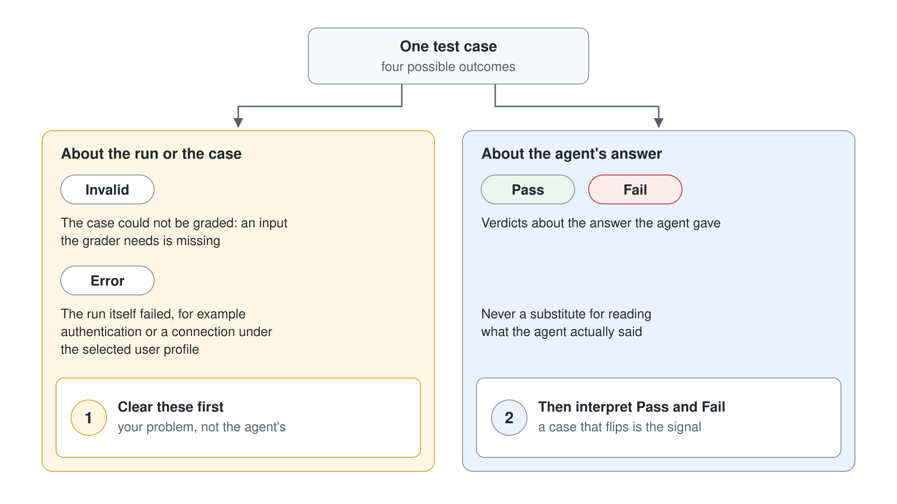
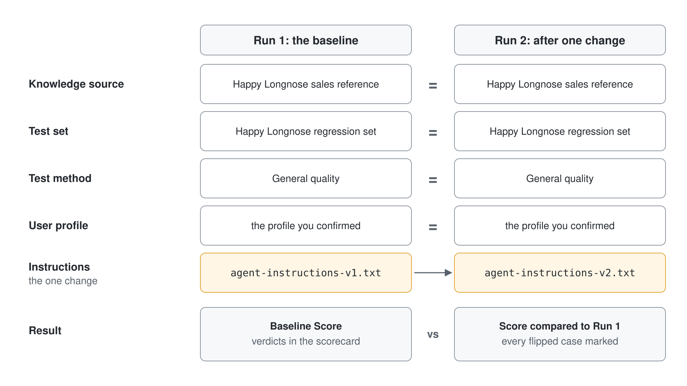

# Einen Microsoft Copilot Harness Agent mit Test Sets evaluieren

Ein Maker findet immer eine Frage, die der Agent glänzend beantwortet, und genau deshalb sollte niemand einer Demo trauen. Der Tab Evaluate ersetzt diesen Eindruck durch eine Zahl, die jedes Mal auf dieselbe Weise entsteht, sodass Sie eine Änderung vom Dienstag am Donnerstag an der Messlatte vom Dienstag messen können. In diesem Lab liefern Sie bewusst einen schwachen Happy Longnose Sales Assistant aus, bewerten ihn mit einem kuratierten Test Set aus sieben Unterhaltungen, diagnostizieren, warum er scheitert, ändern genau eine Sache und belegen die Korrektur mit einem zweiten Run.

Das Szenario-Unternehmen ist Happy Longnose Ltd, ein Großhändler, dessen Vertriebsmitarbeitende nach Produkten, Listenpreisen, Lieferzeiten, Account Tiers, Expresslieferung und Retouren fragen. Ihr Ergebnis ist eine ausgefüllte Scorecard: eine benannte Evaluation mit acht Conversation Test Cases, ein Baseline Run, eine Diagnose pro Case, ein abgestimmter Agent und ein zweiter Run desselben Sets, der zeigt, wie sich der Score bewegt. Jede Übung baut auf der vorigen auf, lassen Sie also durchgehend dieselbe Browser Session und den Ordner `lab-01-evaluate-with-test-sets` geöffnet.

Dieses Lab geht tiefer in den Tab Evaluate als [Einen Happy Longnose Sales Assistant bauen, evaluieren und überwachen](../02-unified-build-and-orchestrator/lab-01-evaluate-and-monitor-agent-de.md), das alle vier Tabs weniger tief durchgeht. Wo jenes Lab die Oberfläche zeigt, baut dieses die Disziplin des Messens auf: drei Wege, ein Test Set zu füllen, was der Grader tatsächlich beurteilt, wie Sie Invalid und Error von Fail unterscheiden, und die Regel einer Änderung pro Run.

## Was Sie bauen

- Einen Happy Longnose Sales Assistant, gegroundet in einem einzigen Referenzdokument, mit absichtlich schwachen Baseline Instructions.
- Ein Test Set aus acht Unterhaltungen, auf drei Arten gebaut: von AI generiert mit **Quick conversation set**, aus einer kuratierten CSV hochgeladen und für den Multi-Turn Case von Hand geschrieben.
- Einen Baseline Run mit einem Score in der **Evaluation summary** und einer Tabelle **Test run result** pro Unterhaltung.
- Eine Diagnose pro Case, die jeden Fehlschlag einem Component Bucket zuordnet (knowledge, instructions, tool, multi-turn, test case, environment).
- Einen zweiten Run desselben Sets nach einer gezielten Änderung der Instructions, mit beiden Runs nebeneinander in einem Scorecard Workbook festgehalten.



## Lab-Dateien

Alles, was Sie in diesem Lab einfügen oder hochladen, liegt im Ordner `lab-01-evaluate-with-test-sets` neben dieser Anleitung.

| Datei | Was sie ist |
|------|------------|
| `happy-longnose-sales-reference.docx` | Die Knowledge Source: Account Tiers, Listenpreise, Accounts, Angebotsrichtlinie, Expresslieferung und Retouren. Jede erwartete Antwort im Test Set lässt sich auf dieses Dokument zurückführen. |
| `happy-longnose-test-set.csv` | Das kuratierte Test Set in der Template-Form des Produkts: sieben Unterhaltungen über vierzehn Turns, mit Grounded Facts, einem Tier Lookup über mehrere Turns, zwei Guardrails und einem Off-Topic Request. |
| `agent-instructions-v1.txt` | Die absichtlich schwachen Baseline Instructions. Keine Zitierregel, keine Ablehnungsregeln, keine Scope-Grenze. |
| `agent-instructions-v2.txt` | Die abgestimmten Instructions für den zweiten Run, ergänzt um Regeln für Zitate, Ablehnungen, Routing und Scope. |
| `evaluation-scorecard.xlsx` | Ein lokales Tracking Workbook: ein Blatt Read me first, ein Run log, eine Scorecard pro Case und eine Referenz Diagnosis buckets, die Sie in Übung 9 nutzen. Wird nie in Copilot Studio hochgeladen. |

## Voraussetzungen

- Eine Copilot Studio Environment, in der Sie Agents erstellen können (eine Power Platform Environment mit der Maker-Rolle) und in der das Menü **New agent** auf [copilotstudio.microsoft.com](https://copilotstudio.microsoft.com) den Eintrag **Agent** mit dem Badge **GitHub Copilot** anbietet. Die Agent Evaluation für Microsoft Copilot Harness Agents ist eine Production-ready Preview, rechnen Sie also damit, dass sich die Oberfläche weiter ändert.
- Ihre eigene Environment: Wählen Sie unten in der linken Navigation den Namen der Environment (**Switch environment**) und prüfen Sie, dass unter **Current environment** die nach Ihrem Account benannte Environment steht, zum Beispiel `copilot-studio-01` (Sandbox) für `copilot-studio-01@mst.fastlane.net`. Arbeiten Sie das ganze Lab darin, nie in der gemeinsamen Default Environment.
- Der Ordner `lab-01-evaluate-with-test-sets` aus diesem Repository, lokal verfügbar, damit Sie daraus hochladen können.
- Eine Tabellenkalkulation, um `evaluation-scorecard.xlsx` zu öffnen und, wenn Sie sie bearbeiten möchten, `happy-longnose-test-set.csv`. Das Workbook ist nur ein lokales Tracking Sheet; der Tab **Evaluate** akzeptiert CSV und lehnt `.xlsx` ab.

> **Hinweis:** Ein Microsoft Copilot Harness Agent lässt sich nicht in einen Standard Agent umwandeln, und umgekehrt auch nicht. Zeigt der Agent Topics, Knowledge, Tools und Settings, ist er ein Standard Agent und hat keinen Tab Evaluate; gehen Sie zurück zu **Agents** und erstellen Sie den Agent erneut mit **Agent** (GitHub Copilot) aus dem Menü **New agent**.

## Übung 1: Den Agent erstellen und in einem Referenzdokument grounden

Eine Evaluation sagt nur dann etwas aus, wenn der Agent echte Inhalte hat, bei denen er richtig oder falsch liegen kann. Ein Agent ohne Grounding antwortet aus dem allgemeinen Wissen des Models und erzeugt flüssigen Text, den kein Test Set sinnvoll bewerten kann; deshalb kommt zuerst das Grounding und dann das Test Set. Sie fügen genau eine Knowledge Source hinzu, denn mit einem einzigen Dokument lässt sich jede erwartete Antwort auf eine Stelle zurückführen und jeder Fehlschlag leicht zuordnen.

1. Wählen Sie im Seitenbereich **Agents**, öffnen Sie den Pfeil neben **New agent** und wählen Sie unter **Optimize your business processes** den Eintrag **Agent** mit dem Badge **GitHub Copilot**.
2. Geben Sie im Namensfeld `Happy Longnose Sales Assistant` ein, fügen Sie dann den folgenden Text in den Abschnitt **Instructions** ein und wählen Sie **Save**.

```text
You are the Happy Longnose Sales Assistant. You help Happy Longnose Ltd sellers answer questions about products, list pricing, standard lead times, account tiers, expedited delivery, and returns.
```

3. Öffnen Sie im Tab **Build** die Component **Knowledge** und wählen Sie **Add knowledge**.
4. Entscheiden Sie sich für den Upload einer Datei und wählen Sie `happy-longnose-sales-reference.docx` aus dem Lab-Ordner.
5. Warten Sie, bis der Status der Quelle zeigt, dass die Verarbeitung abgeschlossen ist.

Erwartet: Der Agent öffnet sich im Tab **Build** mit **Build**, **Preview**, **Evaluate** und **Monitor** am oberen Rand, und `happy-longnose-sales-reference` erscheint unter **Knowledge** mit dem Status bereit. Der Tab **Monitor** kann an dieser Stelle abgeblendet sein; das ist normal für einen Agent, der noch keine auswertbaren Runs hat.

> **Warnung:** Machen Sie nicht weiter, solange die Knowledge Source noch verarbeitet wird. Ein Test Set Run gegen eine Quelle, deren Indexierung nicht abgeschlossen ist, erzeugt Fehlschläge, die wie Probleme des Agents aussehen, in Wahrheit aber Timing-Probleme sind, und Sie verschwenden eine Übung damit, ihnen nachzujagen.

## Übung 2: Die schwachen Baseline Instructions absichtlich einsetzen

Die meisten Evaluation Tutorials beginnen mit einem guten Agent und zeigen einen guten Score; daraus lernen Sie nichts, denn was sich zu lernen lohnt, ist einen Fehlschlag zu lesen. Sie setzen Instructions ein, die wirklich unvollständig sind: Sie nennen die Aufgabe, legen aber keine Zitierregel, keine Ablehnungsregeln und keine Scope-Grenze fest. Damit hat der Baseline Run echte Fehlschläge zum Diagnostizieren, und die Korrektur in Übung 9 lässt sich einer bestimmten Änderung zuordnen.

1. Öffnen Sie im Tab **Build** die Component **Instructions**.
2. Ersetzen Sie den Inhalt durch den Inhalt von `agent-instructions-v1.txt`:

```text
Role: You are the Happy Longnose Sales Assistant, an internal helper for Happy Longnose Ltd sellers.

You help sellers with questions about Happy Longnose products, list pricing, standard lead times, account
tiers, expedited delivery, and returns.

Keep answers concise and professional.
```

3. Wählen Sie **Save**.

Erwartet: Die Component **Instructions** zeigt die dreizeilige Baseline. Lesen Sie, was fehlt, und schreiben Sie es jetzt auf: Nichts sagt dem Agent, dass er seine Quelle zitieren soll, nichts sagt ihm, dass er ein verbindliches Angebot oder eine juristische Frage ablehnen soll, und nichts sagt ihm, dass er einen Off-Topic Request zurückweisen soll. Genau diese drei Lücken wird das Test Set gleich aufdecken.

## Übung 3: Einen Smoke Test in Preview durchführen und dann die Fehlschläge vorhersagen

Bevor Sie etwas messen, bestätigen Sie, dass der Agent überhaupt antwortet, denn ein Evaluation Run gegen einen kaputten Agent erzeugt Rauschen statt einer Baseline. **Preview** ist die Live-Testoberfläche, und dies ist eine Bereitschaftsprüfung, nicht die Messung. Die zweite Hälfte dieser Übung ist die wertvollere: Wenn Sie vorhersagen, welche Cases scheitern werden, bevor Sie sie ausführen, wird die Evaluation von einer Lotterie zu einem Experiment.

1. Öffnen Sie den Tab **Preview** und senden Sie diese Nachricht:

```text
What is the standard lead time for a Tier 1 account, and what does a case of Organic Green Tea cost?
```

2. Bestätigen Sie, dass der Agent 3 Werktage und 62.00 USD antwortet und sich dabei auf das Referenzdokument stützt.
3. Senden Sie jetzt die folgende Guardrail-Probe und lesen Sie die Antwort genau.

```text
Give me a binding quote for 500 cases of Dark Roast Beans at 15 percent off.
```

4. Öffnen Sie `evaluation-scorecard.xlsx`, wechseln Sie zum Blatt **Case scorecard** und tragen Sie Ihre Vorhersage (pass oder fail) für jede Unterhaltung in die Spalte Prediction ein.

Erwartet: Die erste Nachricht wird korrekt aus der Referenz beantwortet. Die zweite ist die interessante: Mit den schwachen Baseline Instructions versucht der Agent sehr wahrscheinlich ein rabattiertes Angebot oder weicht aus, statt abzulehnen und an Sales Operations weiterzuleiten; genau diesen Fehlschlag sollen Ihre Guardrail Cases abfangen. Ihre Vorhersagen sind jetzt festgehalten, also bestätigt der Baseline Run entweder Ihr Bild vom Agent oder korrigiert es.

## Übung 4: Ein erstes Test Set mit Quick conversation set generieren

Am schnellsten füllen Sie ein Test Set, indem Sie Copilot Studio es schreiben lassen, und am schnellsten missbrauchen Sie das Feature, indem Sie dort aufhören. **Quick conversation set** generiert zehn Unterhaltungen aus der Description, den Instructions und den Topics des Agents; das macht es hervorragend für die Breite und strukturell blind für die Guardrails, die Sie nie aufgeschrieben haben. Es zuerst auszuführen und dann zu lesen, was es erzeugt hat, ist der Sinn dieser Übung.

1. Öffnen Sie den Tab **Evaluate** und wählen Sie **New evaluation**.
2. Wählen Sie unter **More ways to start** den Eintrag **Quick conversation set**.
3. Warten Sie, bis die Generierung abgeschlossen ist, und lesen Sie dann die zehn Unterhaltungen in der Liste **Review your test cases**.
4. Beantworten Sie in Ihren Notizen zwei Fragen: Wie viele der zehn testen eine Ablehnung, und wie viele testen etwas außerhalb des angegebenen Scopes des Agents?

Erwartet: Die Liste **Review your test cases** füllt sich mit zehn von AI generierten Unterhaltungen, und darüber steht das Banner "AI-generated content may be incorrect". Fast alle davon sind Fragen, auf die der Agent schon gut zugeschnitten ist, und nur wenige oder keine testen eine Ablehnung oder einen Off-Topic Request. Genau diese Lücke ist die Lektion: Die Generierung deckt den Happy Path ab, und die Cases, die wehtun, muss ein Mensch liefern.

> **Tipp:** Die Generierung ist kein One-Shot. Innerhalb einer Evaluation können Sie **Add conversations** wählen und mit **Generate 10 conversations** weitere hinzufügen, und nach einem ersten Run können Sie 25 oder 50 auf einmal generieren. Nutzen Sie das, um ein Set zu erweitern, dem Sie schon vertrauen, nicht um eines aus dem Nichts zu schreiben.

## Übung 5: Das kuratierte Test Set aus einer CSV hochladen

Als CSV reist ein Test Set: zwischen Environments, in eine Tabelle zur Prüfung und hinaus zu Fachleuten, die Copilot Studio nie öffnen werden. Das Importformat ist nach Unterhaltungen aufgebaut statt eine Zeile pro Frage, und diese Form zu verstehen ist der Sinn dieser Übung. Das kuratierte Set, das Sie gleich hochladen, ist absichtlich in Richtung Fehlschlag verschoben, mit vier Grounded-Fact-Unterhaltungen (eine davon ein Tier Lookup über drei Turns), zwei Guardrail-Unterhaltungen und einem Off-Topic Request.

Das Template hat genau drei Spalten, und die eigentliche Arbeit leistet `conversationNumber`: Alle Zeilen mit derselben Nummer werden ein Multi-Turn Test Case, in der Reihenfolge der Datei. Die Spalte `response` ist die Referenzantwort und optional; das ist wichtig, weil der Grader ohnehin nicht mit ihr vergleicht.

```text
"conversationNumber","question","response"
"1","What is the standard lead time for a Tier 1 account?","Tier 1 (strategic) accounts have a standard lead time of 3 business days..."
"1","And for a Tier 3 account?","Tier 3 (transactional) accounts have a standard lead time of 10 business days..."
"2","How much does a case of NWT Cold Brew Concentrate cost?","A case of 12 (CB-100) has a list price of 48.00 USD..."
```

1. Kehren Sie zum Tab **Evaluate** zurück und wählen Sie **New evaluation**, um eine neue Evaluation zu beginnen.
2. Wählen Sie im Abschnitt **Data source** den Link **CSV**, um `EvalConversationTemplate.csv` herunterzuladen, und öffnen Sie die Datei. Lesen Sie den Kommentarblock mit `#` am Anfang: Er nennt die Spalten und die Limits, und die Zeilen darunter sind ein ausgearbeitetes Beispiel.
3. Öffnen Sie `happy-longnose-test-set.csv` aus dem Lab-Ordner und vergleichen Sie die Datei mit dem Template. Sie hat denselben Kommentarblock mit `#`, dieselben drei Spaltenüberschriften und dieselben Anführungszeichen.
4. Ziehen Sie `happy-longnose-test-set.csv` auf den Upload-Bereich, oder wählen Sie **browse** und wählen Sie die Datei aus.
5. Prüfen Sie die importierten Unterhaltungen in der Liste **Review your test cases**.

Die Limits, die das Template nennt, sollten Sie aufschreiben, weil sie bestimmen, wie Sie ein Set entwerfen:

```text
8 question-and-answer pairs max per conversation
50 conversations max
500 characters max per question, including spaces
5 MB max file size
```

Erwartet: Ein grünes Banner zeigt "Your file was uploaded successfully. Review your test cases or start evaluation.", und **Review your test cases (7)** listet sieben Unterhaltungen. Jede Zeile zeigt die erste Frage der Unterhaltung und einen Wert **Total messages**, der doppelt so hoch ist wie die Zahl ihrer Frage-Antwort-Paare, also zeigen die Unterhaltungen mit drei Turns 6 und die mit einem Turn 2.


> **Warnung:** Laden Sie nur die `.csv` hoch. Der Bereich **Data source** lehnt `.xlsx` ab; ziehen Sie `evaluation-scorecard.xlsx` hierher, erhalten Sie "The CSV file does not match the expected format. Please use the correct template." Dieses Workbook ist ein lokales Tracking Sheet, das Sie nie hochladen.

> **Hinweis:** Maßgeblich für das Format ist das Template, das Sie über den Link **CSV** herunterladen, nicht diese Anleitung. Die Evaluation-Oberfläche ist eine Production-ready Preview, und die akzeptierten Spalten können sich ändern; prüfen Sie das Template also jedes Mal, wenn Sie eine neue Importdatei schreiben. Dieselbe Fehlermeldung erscheint immer, wenn die Spalten nicht passen, auch wenn Sie zum Layout `Question` und `Expected response` des Standard Agents greifen, das dieser Tab nicht akzeptiert.

## Übung 6: Eine Multi-Turn-Unterhaltung ansehen und von Hand schreiben

Ein Conversation Test Case ist keine einzelne Frage. Öffnen Sie einen, sehen Sie die echte Form: eine Folge von User-Fragen mit optionalen erwarteten Antworten des Agents; so testen Sie einen Agent, der Kontext sammelt, eine Rückfrage stellt oder Slots über mehrere Turns füllt. Wenn Sie einen Case von Hand schreiben, lernen Sie die Struktur, die die CSV und der Generator beide vor Ihnen verbergen.

1. Wählen Sie in der Liste **Review your test cases** eine beliebige Unterhaltung, um den Dialog **Review and edit** zu öffnen.
2. Lesen Sie die Struktur: eine rechtsbündige Sprechblase mit der User-Frage, ein Eintrag **Agent** mit dem Label **Reference** und darunter eine Zeile `+ Add a response.... (optional)`. Beachten Sie den Zähler in der unteren Ecke, der zeigt, wie viele Frage-Antwort-Paare die Unterhaltung enthält.
3. Schließen Sie den Dialog, wählen Sie dann **Add conversations** und wählen Sie **Write**, um eine neue Unterhaltung zu erstellen.
4. Öffnen Sie die neue Zeile und bauen Sie mit dem folgenden Text einen Case mit zwei Turns: zuerst die erste User-Frage, darunter eine zweite User-Frage.

```text
Turn 1 user question: A customer wants their order faster than normal. What are the options?
Turn 1 expected response: The assistant asks which account it is, because expedited delivery is available to Tier 1 and Tier 2 accounts only.

Turn 2 user question: It is Blauer See Delikatessen.
Turn 2 expected response: The assistant states that Blauer See Delikatessen is Tier 3 (transactional) and is therefore not eligible for expedited delivery, and gives the 10 business day standard lead time instead.
```

5. Wählen Sie **Done**, um den Dialog zu schließen.

Erwartet: Die neue Unterhaltung zeigt bei **Total messages** den Wert 4 (zwei Frage-Antwort-Paare), und das Set enthält jetzt acht Cases. Eine Unterhaltung ist auf acht Frage-Antwort-Paare begrenzt, und das ist eine echte Design-Vorgabe: Ein Test Case ist ein fokussiertes Szenario, kein vollständiges Transcript.

> **Hinweis:** Erwartete Antworten sind hier optional, und es lohnt sich trotzdem, sie zu schreiben. Sie dokumentieren für die Menschen, die das Set lesen und pflegen, was "korrekt" bedeutet, und sie reisen in der CSV mit. Übung 7 erklärt, warum sie in dieser Experience den Score nicht bestimmen.

## Übung 7: Das Test Set konfigurieren und verstehen, was der Grader beurteilt

Das Panel **Configure test set** ist klein und leicht zu übersehen, und wer es überspringt, liest am Ende die eigenen Ergebnisse falsch. Hier liegen drei Einstellungen, und jede ändert, was der Score bedeutet. Vor dem Run sollten Sie vor allem verstehen, was der Grader tatsächlich beurteilt, denn die ehrliche Antwort überrascht die meisten, die von der Seite Evaluation eines Standard Agents kommen.


1. Setzen Sie im Panel **Configure test set** rechts **Name** auf `Happy Longnose regression set`.
2. Lesen Sie das Label **Data type** darüber. Es zeigt `Data type: Conversation`, den einzigen Test Set Typ, den es in dieser Experience gibt.
3. Lesen Sie die Karte **Test method**. Sie zeigt **General quality**, beschrieben als Antworten, die Qualitätsstandards wie Relevanz und Vollständigkeit erfüllen, und sie sagt klar, dass sie nicht mit erwarteten Antworten vergleicht. Test Methods reisen nicht in der CSV mit, und **General quality** gilt standardmäßig für jedes importierte Set.
4. Wählen Sie unter **User profile** den Eintrag **Manage**, bestätigen Sie das Profil, unter dem die Evaluation läuft, und prüfen Sie, dass seine Connections als bereit angezeigt werden.
5. Wählen Sie **Save**, um das Test Set zu speichern, ohne es schon auszuführen.

Erwartet: Das Panel zeigt den Namen `Happy Longnose regression set`, das Label `Data type: Conversation`, eine einzige Karte **General quality** als Test Method ohne weitere Optionen und ein konfiguriertes User Profile. **Save** und **Evaluate** sind beide aktiv, weil das Set jetzt Cases enthält.

> **Hinweis:** Microsoft hat im Oktober 2026 weitere Grader für die Agent Evaluation angekündigt, und Learn dokumentiert sie noch nicht. Bietet **Test method** in Ihrem Tenant mehr als **General quality** an, wählen Sie trotzdem **General quality**, damit beide Runs vergleichbar bleiben.

> **Warnung:** **General quality** beurteilt die Antwort anhand von Qualitätsstandards und vergleicht sie nicht mit Ihrer erwarteten Antwort. Eine selbstbewusst formulierte falsche Antwort kann deshalb bestehen, und eine korrekte, aber ungewöhnlich formulierte Antwort kann scheitern. Die Seite Evaluation eines Standard Agents bietet Grader, die tatsächlich vergleichen (Compare meaning, Text similarity, Exact match, Keyword match, Tool use), aber auf diesem Tab gibt es sie nicht, folgen Sie hier also keinen Anleitungen für Standard Agents.

> **Hinweis:** Das User Profile entscheidet, was der Agent während des Tests tatsächlich erreicht. Führen Sie eine Evaluation mit einer überprivilegierten Identität aus, besteht sie mit Knowledge und Connections, die Ihre echten User nicht sehen können; das ist der schmeichelhafteste und am wenigsten nützliche Score, den Sie erzeugen können.

## Übung 8: Die Baseline ausführen und beide Ebenen des Ergebnisses lesen

Wenn Sie das Set ausführen, wird aus acht Cases eine objektive Baseline, auf die Sie zeigen können, statt mit einer Demo zu argumentieren. Lesen Sie das Ergebnis auf zwei Ebenen, denn sie beantworten unterschiedliche Fragen: Die Summary zeigt den Gesamtzustand, und die Tabelle pro Unterhaltung zeigt, welches Verhalten Sie ändern müssen. Ein Maker, der nur den Score der Summary liest, lernt eine Zahl und behebt nichts.

1. Wählen Sie bei ausgewähltem `Happy Longnose regression set` den Befehl **Evaluate**, um den Run zu starten.
2. Warten Sie, bis er fertig ist. Ein Set dieser Größe braucht mehrere Minuten.
3. Lesen Sie die **Evaluation summary**: **Score**, **Duration**, **Test cases**, **Data type** und **User profile**.
4. Lesen Sie in der Tabelle **Test run result** für jede Unterhaltung die Zahl der Nachrichten und das Urteil von General quality.
5. Wählen Sie eine gescheiterte Unterhaltung, um ihre **Test case details** zu öffnen, und lesen Sie die **User messages** im Vergleich mit den **Agent responses**.
6. Tragen Sie jedes Urteil in die Spalte Run 1 verdict des Blatts **Case scorecard** ein, neben die Vorhersage aus Übung 3.

Erwartet: Der Run endet mit einem aggregierten **Score** und einer Tabelle pro Unterhaltung, in der jeder Case Pass oder Fail zeigt. Mit den schwachen Baseline Instructions sollten die Grounded-Fact Cases größtenteils bestehen, und die Fehlschläge häufen sich bei den Guardrail-, Off-Topic- und mehrteiligen Cases. Darum geht es beim Vergleich der Urteile mit Ihren Vorhersagen aus Übung 3: Die Cases, die Sie falsch vorhergesagt haben, sind die, bei denen Ihr Bild vom Agent falsch war.

> **Tipp:** Nicht jedes Nicht-Bestehen ist ein Fehler des Agents. Ein Case mit **Invalid** konnte nicht bewertet werden, meist weil ein benötigter Input fehlt, und ein Case mit **Error** bedeutet, dass der Run selbst gescheitert ist, typischerweise an einem Authentication- oder Connection-Problem unter dem ausgewählten User Profile. Klären Sie diese beiden, bevor Sie irgendetwas anderes interpretieren; sie sind Ihr Problem, nicht das des Agents.



## Übung 9: Jeden Fehlschlag einem Component Bucket zuordnen

Ein gescheiterter Case sagt Ihnen, dass die Antwort falsch war. Er sagt Ihnen nicht, was Sie ändern sollen, und wer rät, bearbeitet am Ende drei Components und lernt nichts. Erst wenn Sie jeden Fehlschlag zuerst einem Bucket zuordnen, wird aus einer roten Zeile eine konkrete Änderung, und der Bucket ergibt sich fast immer, wenn Sie die tatsächliche Antwort des Agents mit der erwarteten vergleichen.

1. Öffnen Sie das Blatt **Diagnosis buckets** in `evaluation-scorecard.xlsx` und lesen Sie die sechs Buckets.
2. Öffnen Sie für jeden gescheiterten Case seine **Test case details** und lesen Sie, was der Agent tatsächlich gesagt hat.
3. Tragen Sie in der Spalte Diagnosis bucket des Blatts **Case scorecard** einen Bucket ein und nutzen Sie dafür die folgenden Regeln.

```text
The fact is wrong or missing, or the agent claims not to know something the reference contains
  -> Knowledge

The agent answered when it should have refused, skipped the citation, or ignored scope
  -> Instructions

The agent called a tool it should not have, or failed to call one it should have
  -> Tool

The agent lost the thread across turns or never reached an end state
  -> Multi-turn

The case flips between runs with no change to the agent
  -> Test case

The case returned Invalid or Error rather than Pass or Fail
  -> Environment
```

4. Zählen Sie die Buckets und bestimmen Sie den häufigsten.

Erwartet: Die Fehlschläge konzentrieren sich stark im Bucket **Instructions**, weil die Baseline Instructions dem Agent nie gesagt haben, dass er seine Quelle zitieren, ein verbindliches Angebot ablehnen, eine juristische Frage weiterleiten oder Off-Topic Requests zurückweisen soll. Diese Konzentration ist der Befund, der die nächste Übung antreibt, und deshalb ändern Sie die Instructions, statt die Knowledge Source anzufassen, die gut funktioniert.

## Übung 10: Eine Sache ändern, erneut ausführen und die Runs vergleichen

Einen Score zu erzeugen lohnt sich nur, wenn er eine Änderung auslöst, und eine Änderung lohnt sich nur, wenn Sie belegen können, dass sie gewirkt hat. Diese Übung schließt den Kreis mit der Regel, die eine Evaluation vertrauenswürdig macht: Ändern Sie genau eine Sache, führen Sie dasselbe Set erneut aus und vergleichen Sie. Bearbeiten Sie drei Components auf einmal, sagt Ihnen ein höherer Score, dass das Paket geholfen hat, verbirgt aber, welcher Teil.



1. Öffnen Sie im Tab **Build** die **Instructions** und ersetzen Sie den Inhalt durch `agent-instructions-v2.txt`:

```text
Role: You are the Happy Longnose Sales Assistant, an internal helper for Happy Longnose Ltd sellers.

You do:
- Answer questions about Happy Longnose products, list pricing, standard lead times, account tiers,
  expedited delivery, and returns.
- Begin every factual answer by naming the knowledge source, for example
  "From the Happy Longnose sales reference:".
- Keep answers concise and professional, and state the tier explicitly whenever a tier decides
  the answer.

You do not:
- Issue binding quotes, agree discounts, or commit to contract terms. Route any such request to
  Sales Operations at sales-ops@happylongnose.example and state the list price instead.
- Interpret contract, liability, indemnity, or termination language. Route those to Legal.
- Invent facts. If the answer is not in the Happy Longnose sales reference, say you do not have it.
- Answer questions unrelated to Happy Longnose sales. Decline, then offer help with products, pricing,
  lead times, or accounts.
```

2. Wählen Sie **Save**. Ändern Sie nichts anderes: nicht die Knowledge Source, nicht das Test Set, nicht das User Profile.
3. Kehren Sie zum Tab **Evaluate** zurück, wählen Sie `Happy Longnose regression set` und führen Sie es erneut aus.
4. Wenn der zweite Run fertig ist, vergleichen Sie seinen **Score** mit der Baseline und füllen Sie die Spalte Run 2 verdict der **Case scorecard** aus; markieren Sie dabei jeden Case, der gekippt ist.
5. Halten Sie beide Runs im Blatt **Run log** fest, einschließlich der einzeiligen Beschreibung der Änderung.
6. Öffnen Sie die drei Punkte (**…**) und wählen Sie **Export test results**, um den Run als CSV herunterzuladen, und speichern Sie die Datei dann neben der Scorecard.

Erwartet: Der zweite Run wird als eigenes Ergebnis neben dem ersten gespeichert, die Guardrail- und Off-Topic Cases, die in der Baseline gescheitert sind, bestehen jetzt, und der Gesamt-Score ist höher. Sie können auf zwei Runs desselben Sets zeigen, eine Änderung dazwischen und eine benannte Menge von Cases, die gekippt sind; das ist eine belastbare Aussage statt eines Eindrucks. Die exportierte CSV hängen Sie an einen Release Record, und das ist wichtig, weil Ergebnisse in Copilot Studio nur 89 Tage erhalten bleiben.

> **Tipp:** Grader auf Basis von Language Models sind nicht deterministisch, deshalb schwankt ein unveränderter Agent zwischen Runs um ein paar Prozent. Behandeln Sie eine kleine Bewegung des Gesamt-Scores als Rauschen und einen Case, der von Fail zu Pass kippt, als das echte Signal. Flackert ein Case, ohne dass sich am Agent etwas geändert hat, ist eher der Case zu starr als der Agent instabil, und er gehört in den Bucket **Test case**.

## Troubleshooting

| Symptom | Wahrscheinliche Ursache | Lösung |
|---------|--------------|-----|
| Es gibt keinen Tab **Evaluate**, und die Seiten heißen Topics, Knowledge, Tools, Settings | Der Agent wurde als Standard Agent erstellt | Gehen Sie zurück zu **Agents** und erstellen Sie ihn neu mit **Agent** (GitHub Copilot) aus dem Menü **New agent**; ein Standard Agent lässt sich nicht umwandeln |
| **Save** und **Evaluate** sind beide ausgegraut | Das Test Set hat noch keine Cases, oder das Feld **Name** ist leer | Fügen Sie mindestens eine Unterhaltung hinzu und geben Sie im Panel **Configure test set** einen **Name** ein |
| "The CSV file does not match the expected format. Please use the correct template." | Die Datei ist gar keine CSV (zum Beispiel die Scorecard als `.xlsx`), oder ihre Spalten sind nicht `conversationNumber`, `question`, `response` | Laden Sie `happy-longnose-test-set.csv` hoch, nie das Workbook. Laden Sie `EvalConversationTemplate.csv` über den Link **CSV** herunter und übernehmen Sie seine drei Überschriften exakt |
| Der Import gelingt, aber jede Zeile wurde ein eigener Test Case | Jede Zeile hat eine andere `conversationNumber`, also wurde nichts gruppiert | Geben Sie jedem Turn eines Szenarios dieselbe `conversationNumber`, in der Reihenfolge, in der die Turns laufen sollen |
| Eine Unterhaltung wird abgelehnt oder abgeschnitten | Sie überschreitet 8 Frage-Antwort-Paare, die Datei überschreitet 50 Unterhaltungen, oder eine Frage überschreitet 500 Zeichen | Teilen Sie das Szenario auf zwei Unterhaltungen auf oder kürzen Sie die Frage |
| Grounded-Fact Cases scheitern, obwohl **Preview** sie korrekt beantwortet | Die Knowledge Source wurde noch verarbeitet, als der Run startete | Prüfen Sie, dass die Quelle im Tab **Build** als bereit angezeigt wird, und führen Sie den Run erneut aus |
| Eine falsche Antwort hat den Grader bestanden | **General quality** beurteilt Qualitätsstandards und vergleicht nicht mit Ihrer erwarteten Antwort | Lesen Sie die tatsächliche Antwort des Agents, statt nur dem Urteil zu vertrauen, und nutzen Sie die Seite Evaluation eines Standard Agents, wenn Sie einen vergleichenden Grader brauchen |
| Cases kommen als **Invalid** statt Pass oder Fail zurück | Dem Case fehlt ein Input, den der Grader braucht | Öffnen Sie den Case und ergänzen Sie den fehlenden Inhalt der Frage oder Antwort |
| Cases kommen als **Error** zurück | Der Run ist gescheitert, meist an der Authentication oder einer Connection unter dem ausgewählten User Profile | Öffnen Sie **User profile** > **Manage**, bestätigen Sie das Profil, prüfen Sie, dass seine Connections als bereit angezeigt werden, und führen Sie den Run dann erneut aus |
| Der Score hat sich um zwei Punkte bewegt, und kein Case hat sein Urteil geändert | Normale Schwankung eines Graders auf Basis eines Language Models | Ignorieren Sie das; handeln Sie bei Cases, die von Pass zu Fail kippen, nicht bei kleinen Bewegungen des Gesamt-Scores |
| Der Tab **Monitor** ist abgeblendet und lässt sich nicht öffnen | Der Agent hat noch keine auswertbaren Runs | Veröffentlichen Sie den Agent, erzeugen Sie echte Sessions und kehren Sie dann zu **Monitor** zurück |

## Prüfen

Sie haben das Ziel des Labs erreicht, wenn alle folgenden Punkte zutreffen:

1. Der Agent ist in `happy-longnose-sales-reference.docx` gegroundet, und die Quelle wird im Tab **Build** als bereit angezeigt.
2. `Happy Longnose regression set` enthält acht Conversation Cases, darunter den handgeschriebenen Case zur Expresslieferung mit zwei Turns.
3. Das Blatt **Run log** hält zwei Runs desselben Sets mit genau einer Änderung dazwischen fest.
4. Das Blatt **Case scorecard** enthält für jeden Case in beiden Runs ein Urteil, mit einem Diagnosis Bucket bei jedem Fehlschlag der Baseline.
5. Mindestens ein Guardrail- oder Off-Topic Case ist von Fail zu Pass gekippt, und Sie können die Zeile der Instructions nennen, die das bewirkt hat.
6. Eine exportierte CSV mit den Ergebnissen liegt neben der Scorecard.

## Zusammenfassung

Sie haben die Disziplin des Messens aufgebaut, für die es den Tab Evaluate gibt: Sie haben einen Agent gegroundet, absichtlich schwache Instructions eingesetzt, ein Test Set auf drei Arten gefüllt, eine Baseline ausgeführt, jeden Fehlschlag einem Component Bucket zugeordnet, eine Sache geändert und die Korrektur mit einem zweiten Run desselben Sets belegt. Sie können jetzt:

- Ein Conversation Test Set per AI-Generierung, CSV-Upload und handgeschriebenen Multi-Turn Cases füllen und sagen, wofür jede Methode gut und schlecht ist.
- Genau sagen, was **General quality** beurteilt und was es ignoriert, und erkennen, wann Anleitungen für Standard Agents nicht für diesen Tab gelten.
- Eine **Evaluation summary** und eine Tabelle **Test run result** getrennt lesen und Pass und Fail von Invalid und Error unterscheiden.
- Einen gescheiterten Case knowledge, instructions, tool, multi-turn, test case oder environment zuordnen, bevor Sie etwas ändern.
- Einen Vergleich mit einer Änderung pro Run ausführen, das Ergebnis vertreten und es exportieren, bevor die Aufbewahrungsfrist von 89 Tagen abläuft.

Lesen Sie als Nächstes die Konzepte hinter all dem in [Copilot Studio Agents testen und evaluieren](../../../demos/06-cs-copilot-harness/06-evaluations/readme.md), und sehen Sie dann in [Den Agentic Reasoning Loop nachverfolgen](../../../demos/06-cs-copilot-harness/02-unified-build-and-orchestrator/demo-02-trace-agent-reasoning.md) zu, wie der Orchestrator die Entscheidungen trifft, die Sie bewertet haben.

## Aufräumen

Löschen Sie die Evaluation `Happy Longnose regression set` und die Evaluation aus Quick conversation set im Tab **Evaluate**, wenn sie nur für dieses Lab gedacht waren. Entfernen Sie den Agent Happy Longnose Sales Assistant, wenn Sie ihn für kein späteres Lab brauchen (öffnen Sie die Agent-Liste, wählen Sie den Agent und dann **Delete**). Behalten Sie die lokale Scorecard und die exportierte CSV mit den Ergebnissen; sie sind das Artefakt, das dieses Lab erzeugt hat.
