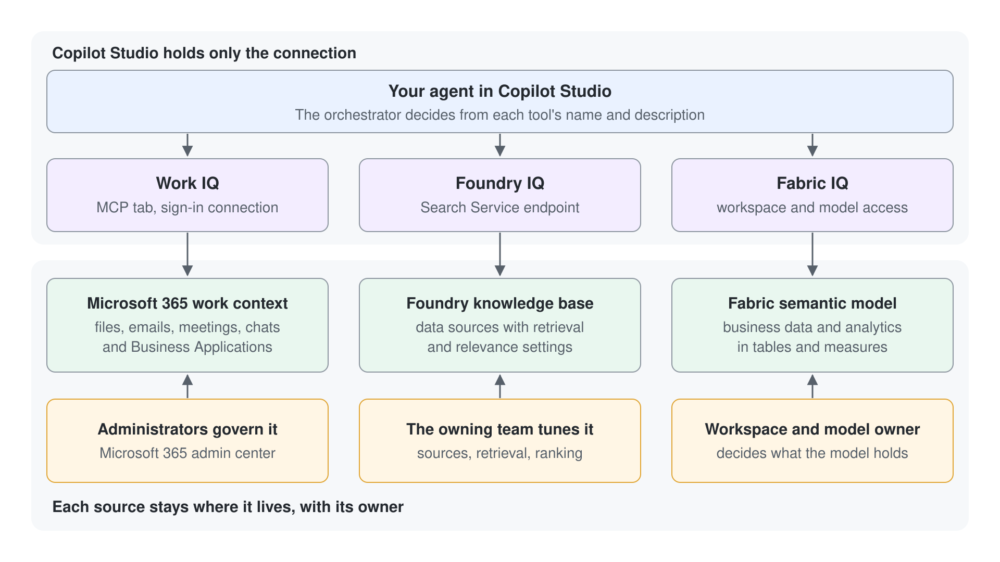

# Einen Agent mit dem HR MCP Server grounden und Fragen zum Team an ihn weiterleiten

Ein Agent ohne Tools rät bei genau den Fakten, die eine Schichtleitung am dringendsten braucht: wer zum Team gehört, was die Leute können und welche Sprachen sie sprechen. In diesem Lab fügen Sie einem Microsoft Copilot Harness Agent den HR MCP Server der Klasse hinzu, schreiben die Instructions, die festlegen, wann er den Server aufruft, und prüfen das Ergebnis in der Liste der Schritte in Preview. Am Ende haben Sie einen Agent, der Fragen zum Team aus der Live-Mitarbeiterliste beantwortet, und Sie können anhand der Liste der Schritte belegen, welche Antworten vom Server stammen.

Was Sie hier üben: Instructions schreiben, die eine Art von Frage an ein Grounding Tool weiterleiten, und dieses Routing dann in der Liste der Schritte prüfen.

Dauer: etwa 25 Minuten, ohne den optionalen Schritt 8.

## Was Sie bauen

- Restaurant Staff Assistant, einen Microsoft Copilot Harness Agent mit dem HR MCP Server im Abschnitt Tools.
- Instructions, die Fragen zum Team an den HR MCP Server senden, ihn auf Lesen beschränken und die Quelle jeder Antwort nennen.
- Eine Antwort, die das richtige Teammitglied nennt, geprüft gegen den Output des Servers in der Liste der Schritte.
- Eine Prüfung der Liste der Schritte, die zeigt, welche Antworten den HR MCP Server genutzt haben und welche nicht.



## Was dieses Lab abdeckt

| Schritt | Schwerpunkt |
|------|-------|
| 1 | Einen Microsoft Copilot Harness Agent erstellen |
| 2 | Den Agent ohne Grounding fragen und die Ausgangslage lesen |
| 3 | Den HR MCP Server über das Panel Tools registrieren und hinzufügen |
| 4 | Fragen zum Team in den Instructions an den HR MCP Server weiterleiten |
| 5 | Eine Frage zum Team testen |
| 6 | Die Liste der Schritte lesen und die Quelle prüfen |
| 7 | Bestätigen, dass eine allgemeine Frage den HR MCP Server nicht aufruft |
| 8 | Optional: den Agent mit Foundry IQ oder Fabric IQ grounden |

## Voraussetzungen

- Eine Copilot Studio Environment, in der Sie Agents erstellen können (Maker-Rolle) und in der das Menü **New agent** auf der Seite **Agents** den Eintrag **Agent** mit dem Badge **GitHub Copilot** anbietet. Die Tabs oben im Agent heißen Build, Preview, Evaluate und Monitor.
- Ihre eigene Environment: Wählen Sie unten in der linken Navigation den Namen der Environment (**Switch environment**) und prüfen Sie, dass unter **Current environment** die nach Ihrem Account benannte Environment steht, zum Beispiel `copilot-studio-01` (Sandbox) für `copilot-studio-01@mst.fastlane.net`. Arbeiten Sie das ganze Lab darin, nie in der gemeinsamen Default Environment.
- Der HR MCP Server der Klasse unter `https://lab-human-resource-mcp.azurewebsites.net/mcp`, für die Klasse gehostet und ohne Anmeldung erreichbar. Alle Teilnehmenden lesen dieselbe Mitarbeiterliste, deshalb liest dieses Lab nur daraus.
- Keine Dateien zum Herunterladen. Sie fügen jeden Input aus dieser Anleitung ein.

## Schritt 1: Einen Microsoft Copilot Harness Agent erstellen

Sie brauchen einen Agent zum Grounden, und auf dem Tab Build liegen Tools und Instructions. Beginnen Sie jetzt mit kurzen Instructions. Sie schreiben sie in Schritt 4 neu, sobald der HR MCP Server als Ziel des Routings existiert.

1. Wählen Sie im Seitenbereich **Agents**, öffnen Sie den Pfeil neben **New agent** und wählen Sie unter **Optimize your business processes** den Eintrag **Agent** mit dem Badge **GitHub Copilot**.
2. Wählen Sie das Stiftsymbol neben dem Namen des Agents und geben Sie `Restaurant Staff Assistant` ein.
3. Fügen Sie den Text unten in den Abschnitt **Instructions** ein.

```text
You are the Restaurant Staff Assistant. You help shift managers plan the team for each service. Keep answers short and professional.
```

4. Im Components Panel listet ein neuer Agent bereits **Work IQ** unter **Tools** und **Search all websites** unter **Knowledge**. Wählen Sie das **x** bei **Work IQ** und bestätigen Sie **Remove** in **Remove tool?**, damit der HR MCP Server das einzige Tool des Agents wird.
5. Wählen Sie **Save** (das Diskettensymbol oben rechts).

Erwartet: "Your agent has been saved." erscheint, der Agent bleibt auf dem Tab **Build**, und die Tabs oben heißen Build, Preview, Evaluate und Monitor. **Tools** ist leer. Zeigt der Agent Topics, Knowledge, Tools und Settings, ist es ein Standard Agent. Gehen Sie zurück zu **Agents** und erstellen Sie den Agent erneut mit **Agent** (GitHub Copilot) aus dem Menü **New agent**.

## Schritt 2: Den Agent ohne Grounding fragen

Die Ausgangslage kommt zuerst, damit die Änderung in Schritt 5 etwas zu schlagen hat. Im Moment hat der Agent kein Tool, das die Mitarbeiterliste liest, deshalb kann er nur aus seinen Instructions und allgemeinem Wissen schlussfolgern. Stellen Sie die Frage, die die Mitarbeiterliste beantwortet.

1. Öffnen Sie den Tab **Preview** und senden Sie diese Frage:

```text
Who on our team speaks Japanese, and what is their role and email address?
```

Erwartet: Die Antwort nennt Kenji Tanaka nicht. Sie sagt entweder, dass der Agent keinen Zugriff auf Mitarbeiterdaten hat, oder gibt eine allgemeine Antwort. Die Liste der Schritte unter der Antwort zeigt keine Zeile **Used tool**, also ist jeder Name in der Antwort geraten; genau diesen Fehler behebt dieses Lab.

## Schritt 3: Den HR MCP Server über das Panel Tools registrieren und hinzufügen

Der HR MCP Server ist die Quelle für das Grounding. Mit ihm bekommt der Agent einen Satz von Tools zum Team, die er aufrufen kann, und Schritt 4 legt fest, wann er das tut. Der Server kann auch Mitarbeitende hinzufügen, ändern und entfernen und Schichten zuweisen; diese schreibenden Tools schalten Sie in diesem Lab aus, weil alle Teilnehmenden dieselbe Mitarbeiterliste teilen.

1. Öffnen Sie den Tab **Build** und wählen Sie im Components Panel das **+** neben **Tools**.
2. Wählen Sie in **Add a tool** den Eintrag **+ Add** und dann **Model Context Protocol (MCP)**.
3. Registrieren Sie den Server: Füllen Sie in **Add MCP server** die Felder unten aus, setzen Sie **Authentication** auf **None** und wählen Sie **Add**.
   - Server name: `HR MCP Server`
   - Server description: `Looks up the restaurant's employees: names, roles, skills, spoken languages and email addresses.`
   - Server URL: `https://lab-human-resource-mcp.azurewebsites.net/mcp`
4. Verbinden Sie den registrierten Server mit dem Agent: Öffnen Sie unter **Select a connection** die Liste **Not connected**, wählen Sie **Create new connection** und im Dialog der Connection **Create** (der Anzeigename ist optional). Sobald die Liste die Connection zeigt, wählen Sie **Add**.
5. Wählen Sie **Save**, bevor Sie das Tool öffnen; mit ungespeicherten Änderungen fragt Copilot Studio **Leave without saving?**, und **Discard** verwirft das neue Tool.
6. Wählen Sie unter **Tools** den Eintrag **HR MCP Server**, um **Edit tool** zu öffnen. Schalten Sie unter **Tool permissions** jedes Tool aus, das Mitarbeitende hinzufügt, ändert oder entfernt oder eine Schicht zuweist, lassen Sie **List employees** und **Search employees** eingeschaltet und wählen Sie **Done**. Wählen Sie dann oben rechts **Save**; **Done** allein speichert die Berechtigungen nicht.

Erwartet: **HR MCP Server** erscheint unter **Tools** auf dem Tab **Build**, und seine **Tool permissions** erlauben nur **List employees** und **Search employees**.

## Schritt 4: Fragen zum Team in den Instructions an den HR MCP Server weiterleiten

Ein Tool bleibt ungenutzt, bis der Agent weiß, wann er es aufrufen soll. Wenn die Instructions die Arten von Fragen zum Team benennen, greift der Agent zum HR MCP Server, und die Zeile "You do not" lässt die gemeinsame Mitarbeiterliste unverändert. Die letzte Zeile unter "You do" bittet den Agent, seine Quelle zu nennen; das gibt Ihnen in Schritt 6 etwas zum Prüfen.

1. Wählen Sie auf dem Tab **Build** den Text unter **Instructions**.
2. Ersetzen Sie ihn durch den Text unten.
3. Wählen Sie **Save**.

```text
Role: You are the Restaurant Staff Assistant, an internal helper for the restaurant's shift managers.

You do:
- When a question asks about our team (who works here, their roles, skills, spoken languages or email addresses), use the HR MCP Server to look it up before you reply.
- Name the HR MCP Server as the source of every staff fact in your answer.

You do not:
- Add, change or remove employees, or assign shifts.

Style: concise and professional.
```

Erwartet: **Instructions** zeigt den gespeicherten Text, und **HR MCP Server** steht weiterhin unter **Tools**. Getestet ist noch nichts, deshalb ist der nächste Schritt die erste echte Prüfung.

## Schritt 5: Eine Frage zum Team testen

Die Frage entspricht Schritt 2, also stammt jede Änderung in der Antwort vom Tool und vom Routing, das Sie geschrieben haben.

1. Öffnen Sie den Tab **Preview**, wählen Sie **New chat** und senden Sie die Frage aus Schritt 2 erneut.
2. Lesen Sie die Antwort.

Erwartet: Die Antwort nennt Kenji Tanaka, Sushi Chef, mit der E-Mail-Adresse `kenji.tanaka@restaurant.com` und sagt, dass die Fakten vom HR MCP Server stammen. Ist die Antwort weiterhin allgemein, nutzen Sie die Tabelle Troubleshooting, bevor Sie etwas anderes ändern.

## Schritt 6: Die Liste der Schritte lesen und die Quelle prüfen

Eine Antwort ist eine Behauptung, und die Liste der Schritte ist der Beleg. Mit eingeschaltetem **Debug mode** (der Standard im Header von **Preview**) trägt jede Antwort eine aufklappbare Liste der Schritte, die der Agent ausgeführt hat. Sie prüfen, dass der HR MCP Server lief, lesen, was er zurückgegeben hat, und vergleichen diesen Output mit der Antwort.

1. Klappen Sie unter der Antwort aus Schritt 5 die Liste der Schritte auf.
2. Suchen Sie die Zeile **Used tool** für den HR MCP Server und öffnen Sie ihren **Input** und **Output**.

Erwartet: Die Zeile **Used tool** zeigt einen Aufruf wie `search_employees` oder `list_employees`, ihr **Output** enthält Kenji Tanaka mit der Rolle Sushi Chef und den Sprachen Japanese, English und Mandarin, und die Antwort stimmt mit diesem Output überein. Jede abgeschlossene Tool-Zeile trägt einen grauen Haken im Kreis.

## Schritt 7: Bestätigen, dass eine allgemeine Frage den HR MCP Server nicht aufruft

Routing wirkt in beide Richtungen. Eine allgemeine Frage soll ohne Abfrage der Mitarbeiterliste beantwortet werden, weil jeder Tool-Aufruf Zeit und Kosten verursacht. Diese Prüfung zeigt, dass die Instruction auf Fragen zum Team beschränkt ist.

1. Wählen Sie im Tab **Preview** den Eintrag **New chat** und senden Sie die Frage unten.
2. Klappen Sie die Liste der Schritte unter der Antwort auf und prüfen Sie, ob es eine Zeile **Used tool** gibt.

```text
Suggest a one-sentence welcome for a new waiter on their first shift.
```

Erwartet: Der Agent beantwortet die Frage direkt, und die Liste der Schritte zeigt keine Zeile **Used tool** für den HR MCP Server. Die Routing-Zeile in den Instructions gilt nur für Fragen zum Team.

## Schritt 8: Optional: den Agent mit Foundry IQ oder Fabric IQ grounden

Foundry IQ und Fabric IQ grounden einen Agent in Daten außerhalb des HR MCP Servers, aber beide brauchen eine Ressource, die Ihre Trainerin oder Ihr Trainer bereitstellen muss: eine Knowledge Base in Microsoft Foundry oder ein Semantic Model in Microsoft Fabric, das Ihr Account öffnen kann. Überspringen Sie diesen Schritt, wenn Sie keinen Zugriff haben. Fügen Sie die Connection einem zweiten Agent hinzu, damit der HR Agent aus den Schritten 1 bis 7 so bleibt, wie er gebaut ist.



Pfad A: Foundry IQ

1. Wählen Sie auf dem Tab **Build** des zweiten Agents das **+** neben **Tools**, öffnen Sie den Tab **MCP** in **Add a tool** und wählen Sie **Azure - Foundry IQ**.
2. Wählen Sie **Create new connection**, wählen Sie **Microsoft Entra ID Integrated** als Authentifizierungstyp, geben Sie den Search Service Endpoint ein, den Ihre Trainerin oder Ihr Trainer Ihnen nennt, und wählen Sie dann **Create**.
3. Wählen Sie **Next**, wählen Sie eine Knowledge Base aus der Liste, wählen Sie **Add to agent** und dann **Save**.
4. Wählen Sie die Connection zu Foundry IQ, schreiben Sie für jedes Thema der Knowledge Base einen Satz in den Worten, die eine Schichtleitung tippen würde, und wählen Sie dann **Save**.
5. Öffnen Sie den Tab **Preview**, stellen Sie eine Frage, die die Knowledge Base beantworten sollte, und klappen Sie die Liste der Schritte auf.

Erwartet: Die Liste der Schritte zeigt einen Retrieval-Schritt von Foundry IQ und listet die zurückgegebenen Einträge auf, und die Antwort nutzt diese Einträge.

Pfad B: Fabric IQ

1. Wählen Sie auf dem Tab **Build** des zweiten Agents das **+** neben **Tools**, öffnen Sie den Tab **MCP** in **Add a tool** und wählen Sie **Fabric IQ Data MCP** (oder **Fabric IQ Ontology MCP** für eine Ontologie).
2. Folgen Sie den üblichen Schritten zum Hinzufügen eines Tools, melden Sie sich mit dem Account an, der den Workspace öffnen kann, und wählen Sie **Save**. Die Auswahl zeigt nur die Elemente, auf die Ihr Account zugreifen kann.
3. Öffnen Sie den Tab **Preview**, stellen Sie eine Frage, die ein Measure im Semantic Model beantworten kann, und klappen Sie die Liste der Schritte auf.

Erwartet: Die Liste der Schritte zeigt eine Zeile für den Aufruf von Fabric IQ, und die Antwort gibt den Wert aus dem Semantic Model wieder.

> **Hinweis:** Wenn Sie eine Connection in Copilot Studio entfernen, ändert das weder die Knowledge Base in Microsoft Foundry noch das Semantic Model in Microsoft Fabric.

## Troubleshooting

| Symptom | Wahrscheinliche Ursache | Lösung |
|---------|--------------|-----|
| **Add MCP server** meldet "Choose a different server name. This name is already in use." | Der Server wurde in dieser Environment bereits angelegt, zum Beispiel bei einem früheren Versuch, dessen Tool verworfen wurde, und **Add a tool** listet ihn nicht | Geben Sie einen anderen Servernamen ein, zum Beispiel `HR MCP Server 2`, und wiederholen Sie Schritt 3 |
| **HR MCP Server** zeigt keine Tools oder **Not connected** | Die Connection wurde in Schritt 3 nicht erstellt | Öffnen Sie das Tool, wählen Sie **Create new connection** und dann **Create**, und speichern Sie den Agent |
| Die Antwort ist nach Schritt 5 allgemein | Schritt 4 wurde nicht gespeichert, oder die Frage wirkt nicht wie eine Frage zum Team | Prüfen Sie, dass Schritt 4 gespeichert ist, und fragen Sie mit den Worten "from our staff list" |
| Die Liste der Schritte zeigt bei einer Frage zum Team keine Zeile **Used tool** | Die Routing-Zeile fehlt in den Instructions, oder Work IQ steht noch unter **Tools** und hat stattdessen geantwortet | Prüfen Sie, dass Schritt 4 gespeichert ist und **Work IQ** unter **Tools** entfernt wurde |
| Die Antwort nennt Personen, die Sie nicht erwarten, etwa Testeinträge | Alle Teilnehmenden teilen die Mitarbeiterliste, und das MCP Lab in Modul 04 fügt ihr Mitarbeitende hinzu | Das ist für dieses Lab in Ordnung; prüfen Sie, dass Kenji Tanaka in der Antwort steht |
| Der Agent bietet an, Mitarbeitende hinzuzufügen, zu ändern oder zu entfernen | Ein schreibendes Tool ist noch eingeschaltet, oder die Zeile "You do not" fehlt | Schalten Sie die schreibenden Tools unter **Tool permissions** aus (Schritt 3) und prüfen Sie, dass Schritt 4 gespeichert ist; bestätigen Sie in diesem Lab nie eine Änderung |
| Preview antwortet "You need credits to continue ... Error code: EnforcementUsageCredits" | Die Environment hat keine Copilot Credits mehr, und ein Microsoft Copilot Harness Agent verbraucht in Preview Credits | Bitten Sie den Admin, der Environment Copilot Credits zuzuweisen, und senden Sie die Nachricht erneut |
| Die Auswahl für Foundry IQ oder Fabric IQ ist leer | Ihr Account hat keinen Zugriff auf die Knowledge Base, den Workspace oder das Semantic Model | Bitten Sie die Person, der die Ressource gehört, um Zugriff, und öffnen Sie die Auswahl erneut |

## Prüfen

Sie haben das Ziel des Labs erreicht, wenn alles Folgende zutrifft:

1. **HR MCP Server** erscheint unter **Tools** auf dem Tab **Build** als verbundenes Tool, und **Work IQ** ist entfernt.
2. Die Antwort aus Schritt 2 nennt Kenji Tanaka nicht, und die Antwort aus Schritt 5 nennt ihn mit Rolle und E-Mail-Adresse.
3. Die Liste der Schritte aus Schritt 5 enthält eine Zeile **Used tool** für den HR MCP Server, deren Output Kenji Tanaka enthält, und die Liste aus Schritt 7 enthält keine.
4. Die Instructions auf dem Tab **Build** enthalten die Routing-Zeile und die Zeile "You do not" aus Schritt 4.

## Zusammenfassung

Sie haben einen Agent im HR MCP Server der Klasse gegroundet. Sie haben den Server als Tool hinzugefügt, Instructions geschrieben, die Fragen zum Team an ihn weiterleiten und ihn auf Lesen beschränken, die Antwort gegen den Output des Servers geprüft und mit der Liste der Schritte gezeigt, dass eine allgemeine Frage das Tool auslässt. Sie können jetzt:

- Einen gehosteten MCP Server über das Panel Tools mit **+ Add** > **Model Context Protocol (MCP)** hinzufügen und seine Connection erstellen.
- Instructions schreiben, die eine Art von Frage an ein Grounding Tool senden und seine schreibenden Operationen ausschließen.
- Grounding in der Liste der Schritte belegen und eine gegroundete Antwort von einer geratenen unterscheiden.

Kehren Sie zu [Grounding Agents with Work IQ, Foundry IQ, and Fabric IQ](../../../demos/06-cs-copilot-harness/06-iq-grounding/readme.md) zurück, um die Quellen für das Grounding zu vergleichen, wenn Sie eine für einen echten Agent auswählen.

## Aufräumen

Löschen Sie den Restaurant Staff Assistant aus der Liste der Agents, wenn Sie ihn nicht mehr brauchen: Öffnen Sie den Agent und wählen Sie dann **Delete**. Wenn Sie die optionalen Connections hinzugefügt haben, öffnen Sie den Abschnitt **Tools** des zweiten Agents und entfernen Sie jede Connection mit dem Steuerelement **x**. Das Entfernen einer Connection lässt den HR MCP Server, die Knowledge Base in Foundry und das Semantic Model in Fabric unverändert.
