# Eine Business App bauen und teilen

Die Sales Reps von Aurora Provisions verfolgen Verkostungsanfragen von Kunden per E-Mail, deshalb ist der Status jeder Anfrage schwer zu erkennen. In diesem Lab bauen Sie eine App, die diese Anfragen in einer SharePoint-Liste hält, verfeinern sie, veröffentlichen sie und teilen sie mit einer anderen Person aus dem Kurs. Zum Schluss belegen Sie die Regel, die nach dem Teilen am meisten zählt: Eine Person braucht Zugriff auf die Daten und nicht nur auf die App.

Was Sie hier üben: eine generierte App mit den Daten der Organisation verbinden und das Teilen der App und den Zugriff auf die Daten als zwei getrennte Berechtigungen behandeln.

Dauer: etwa 25 Minuten.

---

Setup: Melden Sie sich bei Copilot Studio in einer Environment an, die Microsoft Copilot Harness Agents und Apps anbietet, und öffnen Sie den Lab-Ordner `lab-01-build-an-app`, damit Sie seine CSV-Datei anhängen können. Ihr Trainer nennt Ihnen die SharePoint Team Site und die Person aus dem Kurs, mit der Sie teilen.

## Was Sie bauen

- Eine App für Verkostungsanfragen, die ihre Datensätze in einer SharePoint-Liste speichert.
- Einen Statusfilter und eine Sortierung nach Priorität, beide im Gespräch hinzugefügt.
- Eine veröffentlichte App, die eine Person aus dem Kurs über einen Link öffnet, mit separat erteiltem Zugriff auf die Liste.


## Lab-Dateien

| Datei | Was sie darstellt |
|------|--------------------|
| `lab-01-build-an-app/aurora-provisions-tasting-requests.csv` | Zehn Beispiel-Verkostungsanfragen mit den Feldnamen, die die App braucht. Sie hängen sie in Schritt 2 als Kontext an, und Schritt 3 nutzt ihre Zeilen als erste Datensätze in der Liste. |

## Voraussetzungen

- Ein Copilot Studio Account, mit dem Sie Apps erstellen können, mit der Kachel **App** auf der Seite **Home**.
- Ihre eigene Environment: Melden Sie sich mit Ihrem eigenen Kurs-Account an. Copilot Studio baut die App in Ihrer persönlichen Developer Environment, die nach Ihnen benannt ist (zum Beispiel **Copilot Studio 1's Environment**, Typ Developer), und wählt sie selbst aus, deshalb wechseln Sie in diesem Lab keine Environment.
- Die SharePoint Team Site, die Ihr Trainer nennt, auf der Sie Listen erstellen können.
- Den Work Account einer Person aus dem Kurs für das Teilen in Schritt 7.
- Copilot Credits, die Ihrer Environment zugewiesen sind. Jeder Build, jede Vorschau und jeder Test verbraucht Credits, halten Sie also jeden Request kurz.

## Schritt 1: Entscheiden, dass eine App zur Aufgabe passt

Bevor Sie bauen, bestätigen Sie, dass die Arbeit einen Bildschirm braucht. Sales Reps müssen Anfragen nachschlagen, ihren Status ändern und eine Übersicht sehen; dafür braucht es Datensätze und eine Ansicht. Ein Workflow führt Schritte ohne Bildschirm aus, und ein Agent beantwortet Fragen, also gibt keiner von beiden dem Team einen Ort, an dem es Datensätze ändern kann.

1. Lesen Sie die drei Build-Optionen in der Vergleichstabelle des Topic Readmes.
2. Schreiben Sie einen Satz, der sagt, warum der Tracker für Verkostungsanfragen einen Bildschirm braucht.

Erwartet: Ihr Satz nennt den Bedarf an Datensätzen, einer Ansicht und Änderungen durch mehrere Personen. Beschreibt Ihr Satz nur eine Frage oder eine feste Abfolge, lesen Sie die Vergleichstabelle noch einmal, bevor Sie weitermachen.

## Schritt 2: Die App aus der Beschreibung und der CSV erstellen

Mit der angehängten CSV bekommt der Agent die Feldnamen und Beispielzeilen, mit denen er arbeiten kann. Eine angehängte Datei ist nur Kontext, sie verbindet die App also nicht mit Live-Daten. Die Verbindung stellt Schritt 3 her.

1. Wählen Sie auf der Seite **Home** die Kachel **App**.
2. Wählen Sie **+** im Chat und hängen Sie dann `aurora-provisions-tasting-requests.csv` aus dem Ordner `lab-01-build-an-app` an.
3. Fügen Sie die folgende Beschreibung ein und wählen Sie **Submit**.

```text
Build a tasting request tracker for Aurora Provisions sales reps. Each request has a request ID, customer name, product, requested date, priority, and status. The statuses are New, Scheduled, Completed, and Cancelled. Use the attached CSV for the field names and sample rows.
```

4. Beantworten Sie jede Rückfrage in einem Satz.

Erwartet: Die Vorschau der App erscheint, und der Chat wandert in den linken Bereich. Die Felder in der Vorschau folgen den Spaltennamen der CSV, zum Beispiel request ID und customer name.

## Schritt 3: Die Datensätze mit einer SharePoint-Liste verbinden

Beispieldaten werden zurückgesetzt, wenn die App neu lädt, deshalb brauchen die Datensätze einen dauerhaften Speicherort. Eine SharePoint-Liste passt zu einfachen Team-Datensätzen wie Anfragen. In diesem Schritt bitten Sie den Agent, die Datensätze in einer Liste auf der Team Site zu speichern, die Ihr Trainer genannt hat.

1. Fügen Sie im Chat den folgenden Request ein und senden Sie ihn.

```text
Store the tasting requests in a new SharePoint list named Aurora Tasting Requests on my team site. Load the rows from the attached CSV as the first records, and read and write the list for every change.
```

2. Fragt der Agent, welche Site er nutzen soll, antworten Sie mit der Team Site, die Ihr Trainer genannt hat.
3. Bestätigen Sie jeden Connection Prompt, der erscheint, mit Ihrem eigenen Account.

Erwartet: Öffnen Sie die Ansicht **Data** über das Metadaten-Menü der App. Sie nennt die SharePoint-Liste Aurora Tasting Requests als Quelle, und die Vorschau zeigt die CSV-Zeilen als Datensätze.

> **Hinweis:** Eine Liste zu erstellen ist ein unterstütztes Preview-Szenario, aber welche Optionen Sie sehen, hängt von Ihrer Environment ab. Fehlt die Option für Listen, bitten Sie Ihren Trainer um eine vorhandene Liste und verbinden Sie sich stattdessen mit ihr.

## Schritt 4: Die App mit einem Statusfilter verfeinern

Ein Filter ist eine einzelne, überprüfbare Änderung. Beschränken Sie den Request auf eine Änderung, damit Sie wissen, welche Änderung die Ursache war, falls die Vorschau kaputtgeht.



1. Fügen Sie den folgenden Request ein und senden Sie ihn.

```text
Add a filter above the list so sales reps can show only the requests with one chosen status.
```

2. Wählen Sie im neuen Filter in der Vorschau Scheduled.

Erwartet: Über der Liste erscheint ein Statusfilter, und die Auswahl Scheduled zeigt nur die Anfragen mit Status Scheduled aus den CSV-Zeilen.

## Schritt 5: Die App mit einer Sortierung nach Priorität verfeinern

Die zweite Verfeinerung ändert, wie sich die Liste liest. Die Sortierung nach Priorität stellt die dringenden Anfragen nach vorn, und genau so nutzt das Sales Team die Liste jeden Morgen.

1. Fügen Sie den folgenden Request ein und senden Sie ihn.

```text
Sort the list so High priority requests appear first, then Medium, then Low.
```

2. Prüfen Sie die ersten drei Zeilen in der Vorschau.

Erwartet: Die Liste beginnt mit den Anfragen der Priorität High, gefolgt von Medium und dann Low, und der Statusfilter aus Schritt 4 funktioniert weiterhin.

## Schritt 6: Die App veröffentlichen

Mit dem Veröffentlichen steht die zuletzt getestete Version den Personen zur Verfügung, mit denen Sie die App teilen. Testen Sie zuerst das Hauptszenario, denn Änderungen nach dem Veröffentlichen bleiben verborgen, bis Sie erneut veröffentlichen.

1. Starten Sie die App und öffnen Sie eine Anfrage. Ändern Sie ihren Status auf Completed und bestätigen Sie, dass die Liste sich aktualisiert.
2. Wählen Sie **Publish**, lesen Sie alle Validierungsmeldungen und bestätigen Sie dann.
3. Öffnen oder kopieren Sie die URL der App und prüfen Sie, dass die veröffentlichte App den Filter und die Sortierung zeigt.

Erwartet: Das Veröffentlichen wird abgeschlossen, und die URL der App öffnet die neueste Version mit dem Statusfilter und der Sortierung nach Priorität.

## Schritt 7: Die App mit einer Person aus dem Kurs teilen

Teilen gibt einer Person die Berechtigung, die App zu öffnen und zu nutzen. Es gibt ihr weder die Berechtigung, das Design zu bearbeiten, noch Zugriff auf die SharePoint-Liste. Diese Lücke sehen Sie in Schritt 8.

1. Wählen Sie **Share**.
2. Wählen Sie bestimmte Personen und geben Sie dann den Work Account der Person aus dem Kurs ein.
3. Lesen Sie die Informationen zu Datenzugriff und Connections im Teilen-Dialog und senden Sie dann die Einladung.

Erwartet: Die Person aus dem Kurs erscheint in der Liste der Freigaben, und der Dialog nennt die Daten und Connections, die die App nutzt.

## Schritt 8: Bestätigen, dass der Datenzugriff eine separate Berechtigung ist

Dieser Schritt belegt die Regel aus dem Topic Readme. Die Person aus dem Kurs kann die App öffnen, aber die Datensätze kommen aus der SharePoint-Liste, und die Liste hat eigene Berechtigungen. Diese Berechtigungen erteilen Sie in SharePoint.



1. Bitten Sie die Person aus dem Kurs, den App-Link aus Schritt 7 zu öffnen und die Einladung zum Teilen auszuwählen.
2. Bitten Sie die Person, zu notieren, was die App zeigt. Die App kann ohne Datensätze öffnen oder eine Berechtigungsmeldung oder einen Consent Prompt für die Connection zeigen.
3. Sieht die Person einen Consent Prompt, bestätigt sie die Connection mit ihrem eigenen Account.
4. Öffnen Sie die Liste **Aurora Tasting Requests** in SharePoint und erteilen Sie der Person über die Freigabe- oder Berechtigungseinstellungen der Site Zugriff auf die Liste.
5. Bitten Sie die Person, die App neu zu laden.

Erwartet: Nachdem die Berechtigung für die Liste erteilt ist, sieht die Person die zehn Verkostungsanfragen in der App. Vor der Freigabe öffnete die App ohne die Datensätze; das belegt, dass das Teilen der App und das Teilen der Daten zwei getrennte Aktionen sind.

## Troubleshooting

| Symptom | Wahrscheinliche Ursache | Lösung |
|---------|--------------|-----|
| Die Vorschau ist leer, oder der Agent stellt immer weiter Fragen | Der erste Request ist zu breit | Beantworten Sie die Rückfragen in einer Nachricht oder beginnen Sie neu mit einer kürzeren Beschreibung |
| Die angehängte CSV wirkt sich nicht auf die App aus | Eine angehängte Datei ist nur Kontext, keine Live-Verbindung | Schließen Sie Schritt 3 ab, damit die App aus der SharePoint-Liste liest |
| Die Option für SharePoint-Listen erscheint nicht | Das Szenario zum Erstellen von Listen wird in Ihrer Environment nicht angeboten | Bitten Sie Ihren Trainer um eine vorhandene Liste und verbinden Sie die App dann mit ihr |
| Die Person aus dem Kurs sieht die App, aber keine Datensätze | Das Teilen der App erteilt keinen Zugriff auf die Liste | Schließen Sie Schritt 8 ab, indem Sie der Person in SharePoint Zugriff auf die Liste erteilen |
| Änderungen verschwinden, wenn die App neu lädt | Die App nutzt noch Beispieldaten | Öffnen Sie die Ansicht **Data**, prüfen Sie, dass die SharePoint-Liste die Quelle ist, und verbinden Sie sie bei Bedarf neu |
| Die erwartete Auswahl unter **Share** fehlt | Eine Richtlinie der Environment oder des Administrators blendet sie aus | Nutzen Sie die angezeigten Methoden oder fragen Sie Ihren Trainer, welche Methoden zum Teilen die Environment erlaubt |

## Prüfen

Sie haben das Ziel des Labs erreicht, wenn alle folgenden Punkte zutreffen:

1. Die Ansicht **Data** nennt die SharePoint-Liste Aurora Tasting Requests als Quelle der App.
2. Die veröffentlichte App zeigt den Statusfilter und die Sortierung nach Priorität.
3. Die Person aus dem Kurs hat die App nach Schritt 7 geöffnet und die Datensätze erst gesehen, nachdem in Schritt 8 die Berechtigung für die Liste erteilt war.
4. Sie können in einem Satz sagen, warum das Teilen einer App nicht ihre Daten teilt.

## Zusammenfassung

Sie haben eine App für Verkostungsanfragen auf einer SharePoint-Liste gebaut, sie mit einem Filter und einer Sortierung verfeinert, veröffentlicht und mit einer Person aus dem Kurs geteilt. Außerdem haben Sie gezeigt, dass der Datenzugriff eine andere Berechtigung ist als der App-Zugriff. Sie können jetzt:

- Entscheiden, ob eine Geschäftsaufgabe eine App, einen Workflow oder einen Agent braucht.
- Eine Datei als Kontext anhängen und die App mit einer Live-Datenquelle verbinden.
- Eine getestete Version veröffentlichen und mit bestimmten Personen teilen.
- Den Datenzugriff im Quellsystem erteilen und bestätigen, dass eine geteilte App ihre Datensätze zeigt.

Kehren Sie als Nächstes zum Topic Readme zurück, um Apps mit Workflows und Microsoft Copilot Harness Agents zu vergleichen.

## Aufräumen

Entfernen Sie die Freigabe für die Person aus dem Kurs aus der App und fragen Sie dann Ihren Trainer, ob Sie die Liste Aurora Tasting Requests löschen sollen. Behalten Sie den Ordner `lab-01-build-an-app`, damit Sie das Lab wiederholen können.
