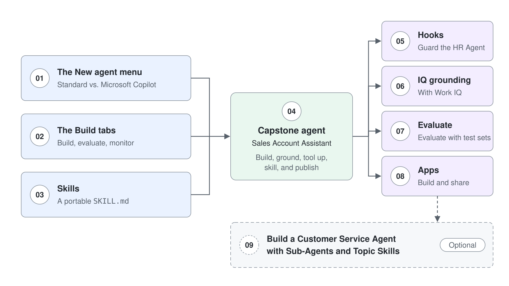

# Microsoft Copilot Harness Agents in Copilot Studio: Labs

Hands-on labs for Microsoft Copilot harness agents in Copilot Studio. Each lab belongs to a topic in the matching module, [Microsoft Copilot Harness Agents in Copilot Studio](../../demos/06-cs-copilot-harness/readme.md), and assumes you have read that topic's guide first.

Work them in order: the first three each isolate one surface (the New agent menu, the Build tabs, Skills), and the fourth pulls all of them together into a capstone agent. The labs after it add IQ grounding, evaluation with test sets and apps.

## Labs

| Topic | Lab | Deutsch | Focus | Minutes |
|-------|-----|---------|-------|---------|
| [Standard vs. Microsoft Copilot Harness Agents](../../demos/06-cs-copilot-harness/01-standard-vs-copilot-harness/readme.md) | [Compare Standard and Microsoft Copilot Harness Agents Side by Side](01-standard-vs-copilot-harness/lab-01-compare-standard-and-copilot-harness.md) | [Standard und Microsoft Copilot Harness Agents nebeneinander vergleichen](01-standard-vs-copilot-harness/lab-01-compare-standard-and-copilot-harness-de.md) | Stand up a minimal Northwind assistant as a Microsoft Copilot harness agent and contrast it with a Standard agent: the **New agent** menu, coexistence, navigation tells, and the one-way conversion rule | 25 |
| [The Unified Build Surface and the New Orchestrator](../../demos/06-cs-copilot-harness/02-unified-build-and-orchestrator/readme.md) | [Build, Evaluate, and Monitor a Northwind Sales Assistant](02-unified-build-and-orchestrator/lab-01-evaluate-and-monitor-agent.md) | [Einen Northwind Sales Assistant bauen, evaluieren und überwachen](02-unified-build-and-orchestrator/lab-01-evaluate-and-monitor-agent-de.md) | Work all four Build-surface tabs, then build a test set in Evaluate and review runs in Monitor | 25 |
| [Agent Skills in Copilot Studio](../../demos/06-cs-copilot-harness/03-agent-skills/readme.md) | [Package Team Knowledge into a Portable Skill](03-agent-skills/lab-01-portable-skill.md) | [Team-Wissen in einen portablen Skill packen](03-agent-skills/lab-01-portable-skill-de.md) | Author a `SKILL.md`, reuse it across two agents, and contrast with Standard agent topics | 25 |
| [Tools, MCP, and the New Workflows Designer](../../demos/06-cs-copilot-harness/04-workflows-and-mcp/readme.md) | [Build a Sales Account Assistant as a Microsoft Copilot Harness Agent](04-workflows-and-mcp/lab-01-sales-account-assistant.md) | [Einen Sales Account Assistant als Microsoft Copilot Harness Agent bauen](04-workflows-and-mcp/lab-01-sales-account-assistant-de.md) | Capstone: build, ground, tool up, skill, and publish a Microsoft Copilot harness agent end to end | 30 |
| [Grounding Agents with Work IQ, Foundry IQ, and Fabric IQ](../../demos/06-cs-copilot-harness/05-iq-grounding/readme.md) | [Ground an Agent with Work IQ and Route Work Questions to It](05-iq-grounding/lab-01-ground-with-iq.md) | [Einen Agent mit Work IQ grounden und Arbeitsfragen an ihn weiterleiten](05-iq-grounding/lab-01-ground-with-iq-de.md) | Add Work IQ to a Microsoft Copilot harness agent, route work-context questions to it in Instructions, and verify the routing in the activity trace | 10 |
| [Test and Evaluate Copilot Studio Agents](../../demos/06-cs-copilot-harness/06-evaluations/readme.md) | [Evaluate a Microsoft Copilot Harness Agent with Test Sets](06-evaluations/lab-01-evaluate-with-test-sets.md) | [Einen Microsoft Copilot Harness Agent mit Test Sets evaluieren](06-evaluations/lab-01-evaluate-with-test-sets-de.md) | Fill a conversation test set three ways, run a baseline, diagnose each failure into a component bucket, change one thing, and prove the fix with a second run | 25 |
| [Migrate Standard Agents to Microsoft Copilot Harness Agents](../../demos/06-cs-copilot-harness/07-migration/readme.md) | [Upgrade the HR Agent and Rebuild Its Topics](07-migration/lab-01-upgrade-the-hr-agent.md) | [Den HR Agent upgraden und seine Topics neu aufbauen](07-migration/lab-01-upgrade-the-hr-agent-de.md) | Upgrade the HR agent from module 03, read the upgrade report, map each topic to a skill, a workflow or a hook, rebuild the employee data topic as a workflow tool, and add a session-start hook | 40 |
| [Building Apps in Copilot Studio](../../demos/06-cs-copilot-harness/08-apps/readme.md) | [Build and Share a Business App](08-apps/lab-01-build-an-app.md) | [Eine Business App bauen und teilen](08-apps/lab-01-build-an-app-de.md) | Connect a generated app to a SharePoint list, publish and share it with a classmate, and confirm that data access is a separate permission | 10 |
| | **Total** | | | **190** |

## Lab assets

Some labs ship starter files in a folder next to the lab guide:

| Lab | Assets |
|-----|--------|
| [Package Team Knowledge into a Portable Skill](03-agent-skills/lab-01-portable-skill.md) | [`lab-01-portable-skill/`](03-agent-skills/lab-01-portable-skill) |
| [Build a Sales Account Assistant as a Microsoft Copilot Harness Agent](04-workflows-and-mcp/lab-01-sales-account-assistant.md) | [`lab-01-sales-account-assistant/`](04-workflows-and-mcp/lab-01-sales-account-assistant) |
| [Evaluate a Microsoft Copilot Harness Agent with Test Sets](06-evaluations/lab-01-evaluate-with-test-sets.md) | [`lab-01-evaluate-with-test-sets/`](06-evaluations/lab-01-evaluate-with-test-sets): test set CSV, two instruction versions, a knowledge document, and a scorecard |
| [Build and Share a Business App](08-apps/lab-01-build-an-app.md) | [`lab-01-build-an-app/`](08-apps/lab-01-build-an-app): ten sample tasting requests as a CSV |

## Prerequisites

- A Copilot Studio environment where the **New agent** menu offers **Agent** with the **GitHub Copilot** badge
- Permission to create agents, knowledge sources, and tools in that environment
- Your own environment, named after your class account (for example `copilot-studio-01`), selected under **Switch environment** at the bottom of the left navigation
- The Standard agent labs in [Basics](../03-cs-basics/readme.md), [Tools](../04-cs-tools/readme.md), and [Advanced](../05-cs-advanced/readme.md) completed, so the Standard to Microsoft Copilot comparisons land
