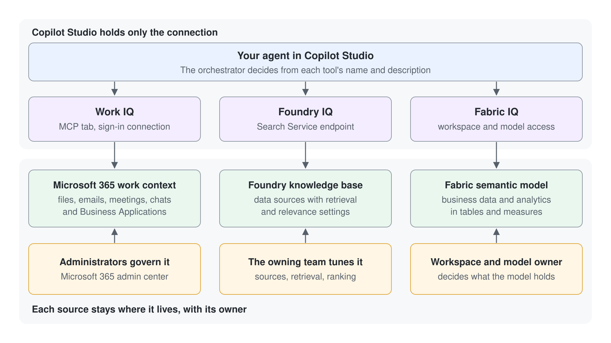

# Ground an Agent with Work IQ and Route Work Questions to It

An agent with no tools guesses about the work an account manager cares about most: what a customer wrote and what was agreed. This lab adds Work IQ to a GitHub Copilot agent, writes the instructions that tell it when to call Work IQ, and checks the result in the activity trace. You finish with an agent that answers work questions from your own mail, and you can prove from the trace which answers came from Work IQ.

What you practice here: writing instructions that route one kind of question to a grounding tool, then verifying the routing in the activity trace.

Duration: about 25 minutes, not counting the optional Step 9.

## What you'll build

- Aurora Provisions Account Assistant, a GitHub Copilot agent with Work IQ (Preview) in its Tools section.
- Instructions that send work-context questions to Work IQ and name the source of each answer.
- A reply that quotes a renewal email you sent to yourself, checked against your inbox.
- A trace check that shows which replies used Work IQ and which did not.



## What This Lab Covers

| Step | Focus |
|------|-------|
| 1 | Create a GitHub Copilot agent |
| 2 | Send a seed email that the agent will need to find |
| 3 | Ask the agent without grounding and read the baseline |
| 4 | Add Work IQ (Preview) from the Tools panel |
| 5 | Route work-context questions to Work IQ in Instructions |
| 6 | Test a work-context question and grant consent |
| 7 | Read the activity trace and check the source |
| 8 | Confirm that a general question does not call Work IQ |
| 9 | Optional: ground the agent with Foundry IQ or Fabric IQ |

## Prerequisites

- A Copilot Studio environment where you can create agents (maker role), where the **New agent** menu on the **Agents** page offers **Agent** with the **GitHub Copilot** badge. The agent's top tabs read Build, Preview, Evaluate, and Monitor.
- Work IQ enabled for the class tenant by an administrator, with your user assigned to the usage-based billing plan. If Work IQ (Preview) is missing from the tool list in Step 4, ask your instructor before you continue.
- Your own class mailbox, so you can send yourself the seed email in Step 2.
- No files to download. You paste every input from this guide.

## Step 1: Create a GitHub Copilot agent

You need an agent to ground, and the Build tab is where tools and instructions live. Start with short instructions now. You rewrite them in Step 5, once Work IQ exists to route to.

1. In the side pane, select **Agents**, open the arrow next to **New agent**, and under **Optimize your business processes** select **Agent** with the **GitHub Copilot** badge.
2. In the name field, enter `Aurora Provisions Account Assistant`, then paste the description below into the **Instructions** section and select **Save**.

```text
You are the Aurora Provisions Account Assistant. You help Aurora Provisions account managers prepare for customer calls. Keep answers short and professional.
```

Expected: the agent opens on the **Build** tab, and the top tabs read Build, Preview, Evaluate, and Monitor. If the agent shows Topics, Knowledge, Tools, and Settings, it is a Standard agent. Go back to **Agents** and create the agent again with **Agent** (GitHub Copilot) from the **New agent** menu.

## Step 2: Send yourself a seed email

Work IQ can only ground an answer in mail that exists. This seed email gives the agent a real renewal request to find, and the reply you check later must match what is in your inbox, not what this guide says.

1. Open your mail client and send an email to your own class address with the subject and body below.

```text
Subject: Aurora Provisions renewal call

Hi, before the renewal Aurora Provisions asks for three things: a 12-month price hold, the cold-chain delivery report by Friday, and a named account contact. Please confirm by Thursday.
```

Expected: the message arrives in your inbox. Allow a few minutes before Step 6, so the message is available to Work IQ when you ask about it.

## Step 3: Ask the agent without grounding

The baseline comes first, so the change in Step 6 has something to beat. Right now the agent has no tool that reads mail, so it can only reason from its instructions and general knowledge. Ask the question that the seed email answers.

1. Open the **Preview** tab and send this question:

```text
What three things did Aurora Provisions ask for before the renewal, and when do they need a reply?
```

Expected: the reply does not list the three requests from your inbox. It either says it cannot see your email or gives a general answer. The trace shows no Work IQ node, so any specific name or date in the reply is a guess, which is the failure this lab fixes.

## Step 4: Add Work IQ from the Tools panel

Work IQ is the grounding source. Adding it gives the agent a tool it can call, and Step 5 decides when it does. Learn describes Work IQ as a preview feature that is read-only unless an administrator turns on write operations. You use it read-only in this lab.

1. Open the **Build** tab and select **Tools** in the components panel.
2. Select **Add tool**, then select **MCP**.
3. Select **Work IQ (Preview)**, expand **Connection**, select **Create new connection**, then select **Create**.
4. Sign in with your class account, then select **Add and Configure**.

Expected: Work IQ (Preview) appears in the Tools section of the **Build** tab as a connected tool.

> **Warning:** Do not select Mail, Teams, OneDrive, SharePoint, or the other workload-specific tools in this step. Learn lists them as a legacy experience with standard licensing, so they are a different product path from Work IQ (Preview).

## Step 5: Route work-context questions to Work IQ in Instructions

A tool sits unused until the agent knows when to call it. Naming the kinds of work context in Instructions tells the agent to reach for Work IQ on mail, meeting, and chat questions. The last line asks the agent to name its source, which gives you something to check in Step 7.

1. On the **Build** tab, open the **Instructions** component.
2. Replace its contents with the text below.
3. Select **Save**.

```text
Role: You are the Aurora Provisions Account Assistant, an internal helper for Aurora Provisions account managers.

You do:
- When a question asks about my own work context (email, meetings, Teams chats, or files about a customer or deal), use the Work IQ tool to find the answer before you reply.
- Name the email subject, meeting, or chat that your answer came from.

Style: concise and professional.
```

Expected: the Instructions component shows the saved text, and Work IQ (Preview) is still listed under Tools. Nothing is tested yet, so the next step is the first real check.

## Step 6: Test a work-context question and grant consent

The question matches Step 3, so any change in the reply comes from the routing you wrote. The first send can ask for consent, because Work IQ connects to Microsoft 365 services for your account.

1. Open the **Preview** tab, start a new conversation, and send the Step 3 question again.
2. When asked to allow Work IQ to connect and use services, select **Allow**.
3. Read the reply.

Expected: the reply lists the three requests (the price hold, the cold-chain report by Friday, and a named account contact), gives Thursday as the reply date, and names the subject Aurora Provisions renewal call. If the reply is still generic, use the Troubleshooting table before you change anything else.

## Step 7: Read the activity trace and check the source

A reply is a claim, and the trace is the evidence. You confirm that a Work IQ node ran, read what it returned, and compare that output with the reply.

1. In the **Preview** tab, keep the trace panel visible beside the chat. Confirm the **End user preview** toggle is off.
2. Select the Work IQ tool node in the trace and read its input and output.
3. Scroll to the end of the trace and find the green checkmark.

Expected: the Work IQ output contains the seed email from Step 2, and the three requests in the reply match it. The green checkmark shows that every tool call finished.

## Step 8: Confirm a general question does not call Work IQ

Routing works in both directions. A general question should answer without a mail lookup, because every Work IQ call is metered under usage-based billing. This check shows that the instruction is scoped to work context.

1. Open the **Preview** tab, start a new conversation, and send the question below.
2. Open the trace and check for a Work IQ node.

```text
Suggest a one-sentence opening for a call with a new customer.
```

Expected: the agent answers the question directly, and the trace shows no Work IQ node. The routing line in Instructions covers work-context questions only.

## Step 9: Optional: ground the agent with Foundry IQ or Fabric IQ

Foundry IQ and Fabric IQ ground an agent in data outside mail, but each needs a resource that your instructor must provide: a knowledge base in Microsoft Foundry, or a semantic model in Microsoft Fabric that your account can open. Skip this step if you do not have access. Add either connection to a second agent, so the Work IQ agent from Steps 1 to 7 stays as built.



Path A: Foundry IQ

1. On the second agent's **Build** tab, select **Tools** in the components panel, then select **Foundry IQ**.
2. Select **Create new connection**, choose **Microsoft Entra ID Integrated** as the authentication type, enter the Search Service endpoint your instructor gives you, then select **Create**.
3. Select **Next**, select a knowledge base from the list, select **Add to agent**, then select **Save**.
4. Select the Foundry IQ connection, write one sentence for each topic the knowledge base covers in the words an account manager would type, then select **Save**.
5. Open the **Preview** tab, ask a question the knowledge base should answer, and open the trace.

Expected: the trace shows a Foundry IQ retrieval step and lists the items it returned, and the reply uses those items.

Path B: Fabric IQ

1. On the second agent's **Build** tab, select **+ Add tool** in the components panel, then select **Fabric IQ**.
2. Follow the standard add-tool steps, sign in with the account that can open the workspace, and select **Save**. The picker shows only the items your account can access.
3. Open the **Preview** tab, ask a question that a measure in the semantic model can answer, and open the trace.

Expected: the trace shows a node for the Fabric IQ call, and the reply reflects the figure in the semantic model.

> **Note:** Removing a connection in Copilot Studio does not change the knowledge base in Microsoft Foundry or the semantic model in Microsoft Fabric.

## Troubleshooting

| Symptom | Likely cause | Fix |
|---------|--------------|-----|
| Work IQ (Preview) is missing from the MCP list | The tenant is not set up for Work IQ, or your user is not on the usage-based billing plan | Ask your instructor to confirm the one-time tenant setup and billing assignment, then reopen Add a tool |
| The reply is generic after Step 6 | Consent was not given, the connection uses another account, or the seed email is not yet available | Confirm the connection under Tools, allow a few more minutes, and ask again; select **Allow** if the consent prompt returns |
| The trace shows no Work IQ node for a work question | The routing line is missing from Instructions, or the wording does not look like work context | Check that Step 5 was saved, then ask with the words "from my email" |
| A Mail or Teams tool appears in Tools | The legacy tool was added in Step 4 | Remove that tool and add Work IQ (Preview) from the MCP tab |
| The Foundry IQ or Fabric IQ picker is empty | Your account has no access to the knowledge base, workspace, or semantic model | Ask the owner of the resource to grant access, then reopen the picker |

## Verify

You have met the lab goal when all of the following are true:

1. Work IQ (Preview) appears under Tools on the **Build** tab as a connected tool.
2. The Step 3 reply contains no request from your inbox, and the Step 6 reply names the three requests and the Thursday reply date.
3. The Step 6 trace contains a Work IQ node whose output includes the seed email, and the Step 8 trace contains none.
4. The Instructions on the **Build** tab contain the routing line from Step 5.

## Summary

You grounded an agent in your own mail. You added Work IQ (Preview), wrote Instructions that route work-context questions to it, confirmed the answer against your inbox, and used the activity trace to show that a general question skips the tool. You can now:

- Add Work IQ (Preview) from the Tools panel through the MCP tab, and handle its connection and consent prompt.
- Write Instructions that send one kind of question to a grounding tool.
- Prove grounding in the activity trace and tell a grounded reply from a guess.

Return to [Grounding Agents with Work IQ, Foundry IQ, and Fabric IQ](../../../demos/06-cs-gh-copilot/05-iq-grounding/readme.md) to compare the three grounding sources when you choose one for a real agent.

## Cleanup

Delete the Aurora Provisions Account Assistant from the agent list if you do not need it: open the agent, then choose **Delete**. If you added the optional connections, open the second agent's **Tools** section and remove each connection with the **x** control. Removing a connection leaves the Foundry knowledge base and the Fabric semantic model unchanged. Delete the seed email from your mailbox if you do not want to keep it.
