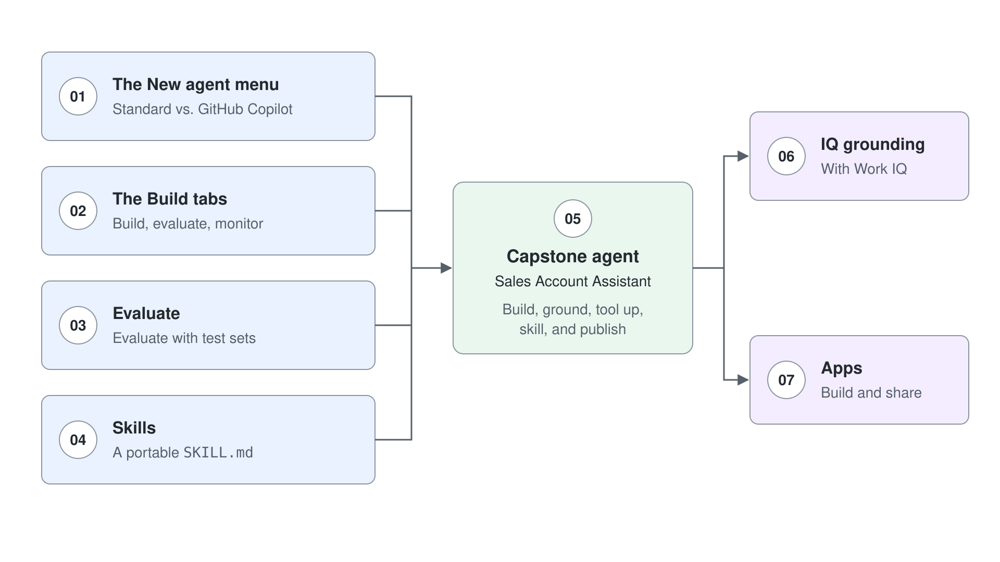

# GitHub Copilot Agents in Copilot Studio: Labs

Hands-on labs for GitHub Copilot agents in Copilot Studio. Each lab belongs to a topic in the matching module, [GitHub Copilot Agents in Copilot Studio](../../demos/06-cs-gh-copilot/readme.md), and assumes you have read that topic's guide first.

Work them in order: the first four each isolate one surface (the New agent menu, the Build tabs, Evaluate, Skills), and the fifth pulls all of them together into a capstone agent. The last two add IQ grounding and apps.

## Labs

| Topic | Lab | Focus |
|-------|-----|-------|
| [Standard vs. GitHub Copilot Agents](../../demos/06-cs-gh-copilot/01-standard-vs-github-copilot/readme.md) | [Compare Standard and GitHub Copilot Agents Side by Side](01-standard-vs-github-copilot/lab-01-compare-standard-and-github-copilot.md) | Stand up a minimal Northwind assistant as a GitHub Copilot agent and contrast it with a Standard agent: the **New agent** menu, coexistence, navigation tells, and the one-way conversion rule |
| [The Unified Build Surface and the New Orchestrator](../../demos/06-cs-gh-copilot/02-unified-build-and-orchestrator/readme.md) | [Build, Evaluate, and Monitor a Northwind Sales Assistant](02-unified-build-and-orchestrator/lab-01-evaluate-and-monitor-agent.md) | Work all four Build-surface tabs, then build a test set in Evaluate and review runs in Monitor |
| [Agent Skills in Copilot Studio](../../demos/06-cs-gh-copilot/03-agent-skills/readme.md) | [Package Team Knowledge into a Portable Skill](03-agent-skills/lab-01-portable-skill.md) | Author a `SKILL.md`, reuse it across two agents, and contrast with Standard agent topics |
| [Tools, MCP, and the New Workflows Designer](../../demos/06-cs-gh-copilot/04-workflows-and-mcp/readme.md) | [Build a Sales Account Assistant as a GitHub Copilot Agent](04-workflows-and-mcp/lab-01-sales-account-assistant.md) | Capstone: build, ground, tool up, skill, and publish a GitHub Copilot agent end to end |
| [Grounding Agents with Work IQ, Foundry IQ, and Fabric IQ](../../demos/06-cs-gh-copilot/05-iq-grounding/readme.md) | [Ground an Agent with Work IQ and Route Work Questions to It](05-iq-grounding/lab-01-ground-with-iq.md) | Add Work IQ to a GitHub Copilot agent, route work-context questions to it in Instructions, and verify the routing in the activity trace |
| [Building Apps in Copilot Studio](../../demos/06-cs-gh-copilot/06-apps/readme.md) | [Build and Share a Business App](06-apps/lab-01-build-an-app.md) | Connect a generated app to a SharePoint list, publish and share it with a classmate, and confirm that data access is a separate permission |
| [Test and Evaluate Copilot Studio Agents](../../demos/06-cs-gh-copilot/07-evaluations/readme.md) | [Evaluate a GitHub Copilot Agent with Test Sets](07-evaluations/lab-01-evaluate-with-test-sets.md) | Fill a conversation test set three ways, run a baseline, diagnose each failure into a component bucket, change one thing, and prove the fix with a second run |

## Lab assets

Some labs ship starter files in a folder next to the lab guide:

| Lab | Assets |
|-----|--------|
| [Package Team Knowledge into a Portable Skill](03-agent-skills/lab-01-portable-skill.md) | [`lab-01-portable-skill/`](03-agent-skills/lab-01-portable-skill) |
| [Build a Sales Account Assistant as a GitHub Copilot Agent](04-workflows-and-mcp/lab-01-sales-account-assistant.md) | [`lab-01-sales-account-assistant/`](04-workflows-and-mcp/lab-01-sales-account-assistant) |
| [Build and Share a Business App](06-apps/lab-01-build-an-app.md) | [`lab-01-build-an-app/`](06-apps/lab-01-build-an-app): ten sample tasting requests as a CSV |
| [Evaluate a GitHub Copilot Agent with Test Sets](07-evaluations/lab-01-evaluate-with-test-sets.md) | [`lab-01-evaluate-with-test-sets/`](07-evaluations/lab-01-evaluate-with-test-sets): test set CSV, two instruction versions, a knowledge document, and a scorecard |

## Prerequisites

- A Copilot Studio environment where the **New agent** menu offers **Agent** with the **GitHub Copilot** badge
- Permission to create agents, knowledge sources, and tools in that environment
- The Standard agent labs in [Basics](../03-cs-basics/readme.md), [Tools](../04-cs-tools/readme.md), and [Advanced](../05-cs-advanced/readme.md) completed, so the Standard to GitHub Copilot comparisons land
