# AI Teammates: Autopilot & Agent Accounts

Hands-on labs for [Module 5](../../demos/08-ai-teammates/readme.md). This is a draft lab plan: each lab gets its full guide once it has been run end to end in a Frontier tenant with agent accounts activated.

> Note: Labs 2 to 5 need a tenant enrolled in the Frontier program. Labs 3 to 5 also need an early release environment, a maker license (Microsoft 365 E5 with the Agent 365 add-on, or Microsoft 365 E7), and a free Microsoft 365 Frontier for AI Teammates license per participant agent. Lab 1 runs anywhere.

## Lab 1: Write a Teammate Brief

Topic: [Meet Autopilot](../../demos/08-ai-teammates/01-meet-autopilot/readme.md). About 20 minutes, no preview access.

- Pick a recurring process from your own work (supplier review, project status, onboarding).
- Write the name, role, goal, boundaries, and escalation rules for a teammate that owns it.
- Decide whether Autopilot or a Copilot Studio agent with an account should carry it, and justify the choice against the comparison table.

## Lab 2: Set Up Background Work and Approvals

Topic: [Working with Autopilot](../../demos/08-ai-teammates/02-autopilot-at-work/readme.md). About 30 minutes.

- Brief the teammate with the Lab 1 brief.
- Configure a heartbeat with work hours and a scheduled automation.
- Add a custom `SKILL.md` and confirm the teammate discovers it.
- Trigger an outbound message and record which actions stop for approval.

## Lab 3: Create the Cadence Agent with an Account

Topic: [Agent Accounts](../../demos/08-ai-teammates/03-agent-accounts/readme.md). About 30 minutes.

- Create a new agent in Copilot Studio Preview in the early release environment.
- Paste the Cadence instructions, add an account, and plan the display name and email address before you publish.
- Review the authentication mode of each tool.
- Publish and find Cadence in the Teams people picker and the directory.

## Lab 4: Make Cadence Proactive

Topic: [Proactive Teammates](../../demos/08-ai-teammates/04-proactive-teammates/readme.md). About 40 minutes.

- Create a workstream tracker in a SharePoint site that Cadence can read.
- Add a recurrence trigger and an email trigger.
- Run one review cycle and open the new review document.
- Contribute an update as a reviewer, once by email reply and once by @mention in Teams.

## Lab 5: Teammate Readiness Review

Topic: [Shared Memory, Licensing & Teammate Governance](../../demos/08-ai-teammates/05-memory-governance/readme.md). About 25 minutes.

- Walk the four admin activation steps and record who owns each one in your tenant.
- Check the Frontier for AI Teammates license pool before and after publishing.
- Tell Cadence a preference, a performance judgment, and a phone number, then list its shared memories and see which it kept.
- Delete one saved memory.
