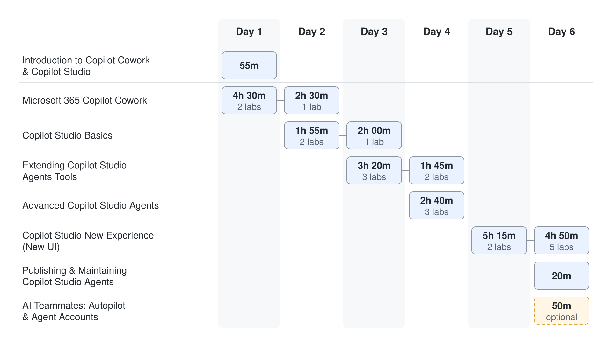
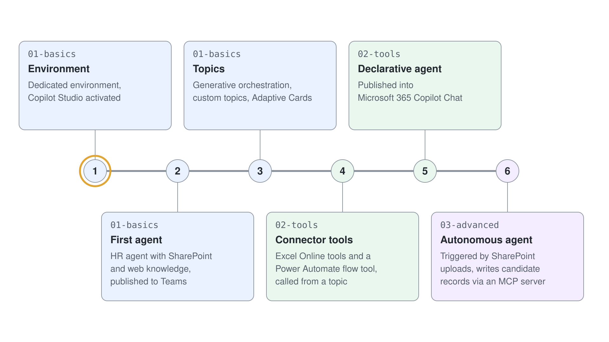

# Labs

Hands-on labs paired with the [demo modules](../demos/readme.md). Each folder mirrors a demo module.

| # | Lab area | Pairs with |
|---|----------|-----------|
| 1 | [Intro: Agents, Frontier & Productivity](./01-intro/readme.md) | [Module 1: Intro](../demos/01-intro/readme.md) |
| 2 | [Copilot Cowork](./02-cowork/readme.md): [setup](./02-cowork/lab-01-cowork-setup.md), [skills](./02-cowork/lab-02-cowork-skills.md), [plugins](./02-cowork/lab-03-cowork-plugins.md) | [Module 2: Cowork](../demos/02-cowork/readme.md) |
| 3 | [Copilot Studio Basics](./03-cs-basics/readme.md) | [Module 3: Copilot Studio Basics](../demos/03-cs-basics/readme.md) |
| 4 | [Extending Copilot Studio Agents with Tools](./04-cs-tools/readme.md) | [Module 4: Extending Copilot Studio Agents with Tools](../demos/04-cs-tools/readme.md) |
| 5 | [Advanced Copilot Studio Agents](./05-cs-advanced/readme.md) | [Module 5: Advanced Copilot Studio Agents](../demos/05-cs-advanced/readme.md) |
| 6 | [GitHub Copilot Agents in Copilot Studio](./06-cs-gh-copilot/readme.md) | [Module 6: GitHub Copilot Agents in Copilot Studio](../demos/06-cs-gh-copilot/readme.md) |
| 7 | Publishing & Maintaining Copilot Studio Agents: [build and migrate from the terminal](./07-cs-maintaining/05-agentic-building/lab-01-build-and-migrate-from-the-terminal.md) | [Module 7: Publishing & Maintaining Copilot Studio Agents](../demos/07-cs-maintaining/readme.md) |
| 8 | [AI Teammates](./08-ai-teammates/readme.md) | [Module 8: AI Teammates](../demos/08-ai-teammates/readme.md) |

## Copilot Studio Maker Path (HR agent walkthrough)

A connected sequence of Standard agent labs that builds one HR agent from an empty environment to an autonomous document processor. The Copilot Developer Camp maker labs it started from are included in this repository; the full [Maker Path at Copilot Developer Camp](https://microsoft.github.io/copilot-camp/pages/make/copilot-studio/) covers more examples.

| Lab | Focus |
|-----|-------|
| [Create Your First Copilot Studio Agent](./03-cs-basics/01-standard-agents/lab-01-create-your-first-agent.md) | Create a Trial Power Platform environment, activate Copilot Studio, and create the HR agent |
| [Ground the HR Agent with SharePoint Knowledge](./03-cs-basics/02-knowledge/lab-01-ground-with-sharepoint.md) | Add SharePoint HR documents as knowledge |
| [Define Topics, Entities, and Variables](./03-cs-basics/03-topics/lab-01-build-topics.md) | Enable generative orchestration and author single-turn and multi-turn topics |
| [Collect Input with Adaptive Cards](./03-cs-basics/05-adaptive-cards/lab-01-collect-input-with-adaptive-cards.md) | Collect a candidate's data with an Adaptive Card |
| [Publish the HR Agent to Teams and Microsoft 365 Copilot](./03-cs-basics/06-publishing/lab-01-publish-to-teams-and-copilot.md) | Publish the HR agent to Teams and build a declarative agent for Microsoft 365 Copilot Chat |
| [Define Tools with Power Platform Connectors](./04-cs-tools/03-connectors/lab-01-connector-and-flow-tools.md) | Add Excel Online tools and a Power Automate flow tool, then call them from a topic |
| [Create an Autonomous Agent](./05-cs-advanced/01-autonomous-agents/lab-01-create-an-autonomous-agent.md) | Trigger an agent from SharePoint uploads and write candidate records through an MCP server |

## Copilot Studio Learning Paths on Microsoft Learn

- [Create and extend custom copilots in Microsoft Copilot Studio](https://learn.microsoft.com/en-us/training/paths/extend-microsoft-copilot-microsoft-365-copilot-studio/)
- [Create agents in Microsoft Copilot Studio](https://learn.microsoft.com/en-us/training/paths/create-extend-custom-copilots-microsoft-copilot-studio/)
- [Create and publish agents with Microsoft Copilot Studio](https://learn.microsoft.com/en-us/training/paths/work-power-virtual-agents/)
- [Create agents with Microsoft Copilot Studio - Online Workshop](https://learn.microsoft.com/en-us/training/paths/power-virtual-agents-workshop/)
- [Extend Microsoft 365 Copilot in Copilot Studio](https://learn.microsoft.com/en-us/training/paths/extend-microsoft-365-copilot-studio/)
- [Extend and manage Microsoft Copilot Studio agents](https://learn.microsoft.com/en-us/training/paths/power-virtual-agents-enhance/)
- [Microsoft Applied Skills: Create agents in Microsoft Copilot Studio](https://learn.microsoft.com/en-us/credentials/applied-skills/create-agents-in-microsoft-copilot-studio)
- [Agent in a day - Online workshop](https://learn.microsoft.com/en-us/training/paths/agents-online-workshop/)
- [Create apps, copilots, flows, and more with Microsoft Dataverse and Teams](https://learn.microsoft.com/en-us/training/paths/work-power-platform-teams/)

## Getting Started

### 1.1 Fork the Repository

Before you start, please fork this repository to your GitHub account by clicking the `Fork` button in the upper right corner of the repository's main screen (or follow the [documentation](https://docs.github.com/en/pull-requests/collaborating-with-pull-requests/working-with-forks/fork-a-repo#forking-a-repository)). This will allow you to make changes to the repository and save your progress.

### 1.2 Spin up Development Environment

GitHub Codespaces is a cloud-based development environment that allows you to code from anywhere. It provides a fully configured environment that can be launched directly from any GitHub repository, saving you from lengthy setup times. You can access Codespaces from your browser, Visual Studio Code, or the GitHub CLI, making it easy to work from virtually any device.

To open GitHub Codespaces, click on the button below:

> Note: You can also use this dev container locally with VS Code and Docker. Read [Develop inside a DevContainer](https://code.visualstudio.com/docs/devcontainers/containers) for instructions.
