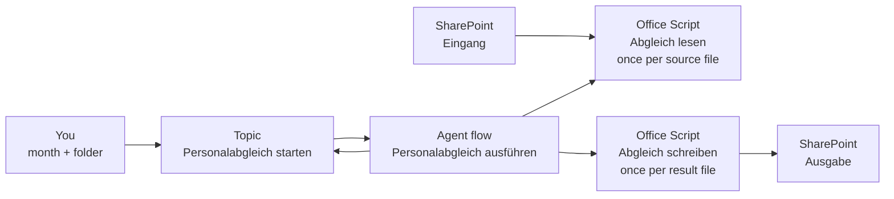

# Bezügestatistik und Soll-Listen mit einem Agent Flow abgleichen

Jeden Monat kopiert jemand Personalnummern, Kostenstellen und VZÄ-Anteile aus der Bezügestatistik und einem Dutzend Soll-Blättern in eine neue Arbeitsmappe und vergleicht sie Zeile für Zeile. In diesem Lab fragt ein Standard Agent nach dem Monat, ein Agent Flow liest jede Quelldatei in einem SharePoint-Ordner, und zwei Office Scripts schreiben die Auszüge, die Differenzen und die Fehlerliste in neue Arbeitsmappen in SharePoint.

Was Sie hier üben: eine Geschäftsregel deterministisch halten, indem Sie sie in ein Script und einen Flow legen, und den Agent nur die Eingaben sammeln und das Ergebnis melden lassen.

Dauer: etwa 80 Minuten.

## Was Sie bauen

- Einen SharePoint-Ordner `Eingang` mit Martins Testdaten und einen Ordner `Ausgabe` für die Ergebnisse
- Die Office Scripts **Abgleich lesen** (liest eine Quell-Arbeitsmappe über die Spaltenüberschriften) und **Abgleich schreiben** (schreibt eine Ergebnis-Arbeitsmappe)
- Den Agent Flow **Personalabgleich ausführen**, der die Scripts über jede Datei laufen lässt, deren Name mit `BezStat` oder `Soll` beginnt
- Den Standard Agent **Personalabgleich** mit einem Topic, das nach dem Monat und dem Zielordner fragt
- Drei Arbeitsmappen pro Lauf: `BezStat_Auszug_<month>.xlsx`, `Soll_Auszug_<month>.xlsx` und `Abgleich_<month>.xlsx` mit den Blättern **Differenzen** und **Fehlerliste**

## Die beteiligten Teile



## Voraussetzungen

- Eine Copilot Studio Environment, in der Sie Standard Agents und Agent Flows erstellen können, geöffnet unter [copilotstudio.microsoft.com](https://copilotstudio.microsoft.com).
- Eine Microsoft 365 Business-Lizenz mit Excel für das Web und dessen Tab **Automate** (Office Scripts).
- Eine SharePoint Team Site, die Sie bearbeiten dürfen, geöffnet über [office.com/launch/sharepoint](https://www.office.com/launch/sharepoint). Die Schritte nennen sie `Personalabgleich`; jede Site funktioniert.

## Lab-Dateien

| Datei | Was sie ist |
|-------|-------------|
| [Beschreibung.docx](Beschreibung.docx) | Martins Anforderungen auf Deutsch |
| [BezStat0526_T2.xlsx](BezStat0526_T2.xlsx) | Bezügestatistik für Mai 2026, 17 Blätter in zwei Layouts |
| [Soll_H2.xlsx](Soll_H2.xlsx), [Soll_S2.xlsx](Soll_S2.xlsx) | Soll-Listen mit einer VZÄ-Spalte pro Monat, 19 Blätter |
| [abgleich-lesen.ts](lab-01-reconcile-with-an-agent-flow/abgleich-lesen.ts) | Office Script, das eine Quell-Arbeitsmappe liest |
| [abgleich-schreiben.ts](lab-01-reconcile-with-an-agent-flow/abgleich-schreiben.ts) | Office Script, das eine Ergebnis-Arbeitsmappe schreibt |

Die Testdaten sind anonymisiert: Namen in der BezStat lauten `Person 0001`, Namen in den Soll-Listen `Name0001` oder `Name_001`. Die beiden Listen treffen sich nur über die Personalnummer.

## Übung 1: Die Testdaten in SharePoint ablegen

Der Flow liest aus einem Ordner und schreibt in einen anderen, damit sich Quelldateien nie mit Ergebnissen mischen. Office Scripts können keine Arbeitsmappe anlegen, deshalb dient eine leere Arbeitsmappe als Vorlage für jede Ergebnisdatei.

1. Öffnen Sie Ihre SharePoint Site und wählen Sie **Documents**.
2. Wählen Sie **+ New** > **Folder**, nennen Sie den Ordner `Eingang` und legen Sie einen zweiten Ordner `Ausgabe` an.
3. Öffnen Sie `Eingang`, wählen Sie **Upload** > **Files** und laden Sie `BezStat0526_T2.xlsx`, `Soll_H2.xlsx` und `Soll_S2.xlsx` aus `labs/09-martin` hoch.
4. Gehen Sie zurück zu **Documents**, wählen Sie **+ New** > **Excel workbook** und benennen Sie die neue Arbeitsmappe in `Vorlage.xlsx` um. Schließen Sie den Excel-Tab.

Erwartet: **Documents** zeigt die Ordner `Eingang` und `Ausgabe` und die Datei `Vorlage.xlsx`; `Eingang` listet die drei Quell-Arbeitsmappen.

## Übung 2: Die Quelldateien über Spaltenüberschriften lesen, nicht über Spaltenbuchstaben

Martins Beschreibung nennt Spaltenbuchstaben (Personalnummer in C, anteilig in BE) und fragt, wie sich ein geänderter Spaltenaufbau abfedern lässt. Die Testdaten zeigen schon, warum Buchstaben scheitern:

| Blätter | Kopfzeile | Personalnummer | Kostenstelle | Anteil oder VZÄ |
|---------|-----------|----------------|--------------|-----------------|
| BezStat `Geringf 05` bis `WKÖ 05` | 3 | `PNR` oder `PNr` | `KST` | `anteilig` in O |
| BezStat `WKÖ Basis` | 1 | `PNR` | `KST` | `anteilig` in O |
| BezStat `vh05`, `nh05`, `wdvh05`, `wdnh05` | 1 | `Personalnummer` | `Kostenstelle` | `anteilig` in BE |
| Jedes Soll-Blatt | 8 bis 12 | `Pers.Nr` | `KST-neu` | eine Spalte pro Monat, ihre Überschrift ist ein Datum |

Das Script **Abgleich lesen** durchsucht deshalb die ersten 15 Zeilen jedes Blatts nach einer Zeile, die alle nötigen Überschriften enthält, akzeptiert die alternativen Namen aus der Tabelle und liest jede Spalte dort, wo sie steht. Für eine Soll-Datei wählt es zusätzlich die Spalte, deren Überschrift der gewünschte Monat ist, und gibt jede Zeile mit Personalnummer oder Name als JSON an den Flow zurück.

1. Öffnen Sie `Eingang` und öffnen Sie `BezStat0526_T2.xlsx` in Excel für das Web.
2. Wählen Sie den Tab **Automate** und dann **New Script**. Der Code Editor öffnet sich mit Beispielcode.
3. Öffnen Sie [abgleich-lesen.ts](lab-01-reconcile-with-an-agent-flow/abgleich-lesen.ts), kopieren Sie den gesamten Inhalt und ersetzen Sie den Beispielcode damit.
4. Wählen Sie den Script-Namen oben im Code Editor, benennen Sie das Script in `Abgleich lesen` um und wählen Sie **Save script**.

Erwartet: **Automate** > **All Scripts** listet **Abgleich lesen**. Das Script liegt in Ihrem OneDrive, deshalb kann es jede Arbeitsmappe ausführen, die Sie öffnen.

> **Tipp:** Das Script liest höchstens 300 Spalten. Einige BezStat-Blätter sind bis Spalte XFD formatiert, und den ganzen benutzten Bereich zu lesen würde die fünf Millionen Zellen überschreiten, die ein Script anfassen darf.

## Übung 3: Die Auszüge, die Differenzen und die Fehlerliste schreiben

Das zweite Script erhält das JSON aller Quelldateien und schreibt eine Ergebnis-Arbeitsmappe. Der Parameter `teil` entscheidet, welche: `BezStat`, `Soll` oder `Abgleich`. Jeder Aufruf berechnet den vollständigen Abgleich und gibt die Zahlen zurück, deshalb sagt der letzte Aufruf dem Agent, was passiert ist.

Das Script wendet Martins Regeln an:

- Eine Kombination aus Personalnummer und Kostenstelle kommt einmal vor. Steht sie auf mehreren Blättern (die BezStat wiederholt die meisten Personen auf `WKÖ Basis`), gewinnt die erste Zeile, die einen Wert trägt.
- Zeilen werden über `Personalnummer` und `Pers.Nr` verknüpft. Ein Paar mit anderer Kostenstelle oder anderem Anteil landet in **Differenzen** mit den Spalten `Firma; Personalnummer; Name; BezStat_Kostenstelle; Soll_KST-neu; BezStat_Anteilig; Soll_VZÄ_<month>`.
- Eine Zeile mit leerer Personalnummer, leerem Namen oder Vornamen und eine Person, die nur in einer der beiden Listen steht, landen in der **Fehlerliste** mit dem Grund in **Grund** und der Soll-Spalte **Anmerkung** dieser Zeile.

1. Wählen Sie in Excel für das Web erneut **Automate** > **New Script**.
2. Ersetzen Sie den Beispielcode durch den Inhalt von [abgleich-schreiben.ts](lab-01-reconcile-with-an-agent-flow/abgleich-schreiben.ts).
3. Benennen Sie das Script in `Abgleich schreiben` um und wählen Sie **Save script**.

Erwartet: **All Scripts** listet **Abgleich lesen** und **Abgleich schreiben**.

## Übung 4: Den Standard Agent erstellen

Der Agent spricht mit dem User und ruft den Flow auf; eine Differenz berechnet er nie selbst. Dass die Regeln nicht in den Instructions stehen, sorgt dafür, dass zwei Läufe auf denselben Dateien dieselben Zahlen liefern.

1. Öffnen Sie in Copilot Studio das Dropdown neben **New agent** und wählen Sie unter **Other ways to build** den Eintrag **Agent** mit dem Badge **Standard**.
2. Geben Sie in **Name your agent** `Personalabgleich` ein.
3. Wählen Sie im Abschnitt **Instructions** den Befehl **Edit**, fügen Sie den folgenden Text ein und wählen Sie **Save**.

```text
You help the HR controlling team reconcile the payroll statistics (BezStat files) with the headcount plans (Soll files) for one month.
When the user asks for a reconciliation, a Personalabgleich or a comparison of BezStat and Soll, run the topic Personalabgleich starten.
Never calculate, estimate or invent differences yourself. Report only the numbers the topic returns and point the user to the result files in SharePoint.
```

Erwartet: Die **Overview** des Agents zeigt den Namen **Personalabgleich** und die Instructions.

## Übung 5: Jede Quelldatei in einem Agent Flow lesen

Der Flow ist die Pipeline: Er findet die Dateien, lässt **Abgleich lesen** auf jeder laufen und sammelt die Ergebnisse. Dateinamen werden in Kleinbuchstaben verglichen, deshalb zählen `bezstat0526.xlsx` und `BezStat0526.xlsx` gleichermaßen.

1. Öffnen Sie in Copilot Studio den Pfeil neben **New workflow** und wählen Sie **Agent flows**.
2. Fügen Sie den Trigger **When an agent calls the flow** hinzu. Wählen Sie **Add an input**, wählen Sie **Text** und nennen Sie den Input `Monat`. Fügen Sie einen zweiten Input vom Typ **Text** mit dem Namen `Zielordner` hinzu.
3. Wählen Sie **Insert a new action**, suchen Sie nach **Get files (properties only)** (SharePoint) und benennen Sie die Action in `Dateien holen` um. Nicht **Get file properties**: Diese Action liest eine einzelne Datei und verlangt eine **Id**. Setzen Sie **Site Address** auf Ihre Site, **Library Name** auf **Documents**, wählen Sie unter **Advanced parameters** den Befehl **Show all** und setzen Sie **Limit Entries to Folder** auf `/Shared Documents/Eingang`.
4. Fügen Sie eine Action **Filter array** mit dem Namen `BezStat Dateien` hinzu. Setzen Sie **From** auf **value** von **Dateien holen**. Geben Sie in der Bedingung den folgenden Ausdruck als linken Wert ein, wählen Sie **starts with** und tippen Sie `bezstat` als rechten Wert.

```text
toLower(item()?['{FilenameWithExtension}'])
```

5. Fügen Sie eine zweite Action **Filter array** mit dem Namen `Soll Dateien`, denselben Einstellungen und dem rechten Wert `soll` hinzu.
6. Fügen Sie zwei Actions **Initialize variable** hinzu: `BezStatTeile` und `SollTeile`, beide vom Typ **Array** mit dem Wert `[]`.
7. Fügen Sie ein **Apply to each** über **Body** von **BezStat Dateien** hinzu. Fügen Sie darin **Run script** (Excel Online (Business)) mit dem Namen `BezStat lesen` hinzu: **Location** Ihre Site, **Document Library** **Documents**, **File** über das Ordnersymbol `Eingang` > `BezStat0526_T2.xlsx`, dann **Script** **Abgleich lesen**. Die Parameter **art** und **monat** lädt der Designer aus einer konkreten Arbeitsmappe; steht in **File** schon ein Ausdruck, bleiben sie aus. Setzen Sie **art** auf `BezStat` und **monat** auf den Trigger-Input **Monat**. Ersetzen Sie erst danach die Datei in **File**: Leeren Sie das Feld, wählen Sie das Symbol **fx** und geben Sie `item()?['{Identifier}']` ein. **art** und **monat** bleiben stehen.
8. Fügen Sie in derselben Schleife **Append to array variable** hinzu: **Name** `BezStatTeile`, **Value** **result** von **BezStat lesen**.
9. Wiederholen Sie die Punkte 7 und 8 für **Body** von **Soll Dateien** mit einer Action namens `Soll lesen`, **art** `Soll` und der Variable `SollTeile`.

Erwartet: Der Designer zeigt den Trigger, **Dateien holen**, beide Filter, beide Variablen und zwei Schleifen mit je einem **Run script** und einem **Append to array variable**. **Flow checker** meldet keine Fehler.

> **Hinweis:** Die erste SharePoint- und Excel-Action fragt nach einer Connection. Melden Sie sich mit dem Account an, mit dem Sie die Scripts gespeichert haben; **Run script** listet nur die Scripts des angemeldeten Accounts.

## Übung 6: Drei Ergebnis-Arbeitsmappen schreiben und dem Agent antworten

Jede Ergebnisdatei beginnt als Kopie von `Vorlage.xlsx` und wird dann von **Abgleich schreiben** gefüllt. Der Zielordner kommt aus dem Trigger-Input, das beantwortet Martins Frage, ob sich der Ordner fix hinterlegen lässt: Das Topic in der nächsten Übung setzt einen Standardwert und lässt den User ihn überschreiben.

1. Fügen Sie nach den Schleifen **Get file content using path** (SharePoint) mit dem Namen `Vorlage holen` und dem **File Path** `/Shared Documents/Vorlage.xlsx` hinzu.
2. Fügen Sie **Create file** (SharePoint) mit dem Namen `BezStat anlegen` hinzu: **Folder Path** der Trigger-Input **Zielordner**, **File Name** `BezStat_Auszug_`, dann der Input **Monat**, dann `.xlsx`, und **File Content** **File Content** von **Vorlage holen**.
3. Fügen Sie **Create file** mit dem Namen `Soll anlegen` und dem Dateinamen `Soll_Auszug_<Monat>.xlsx` hinzu, auf dieselbe Weise gebaut, und **Create file** mit dem Namen `Abgleich anlegen` und `Abgleich_<Monat>.xlsx`.
4. Fügen Sie drei Actions **Run script** mit dem Script **Abgleich schreiben** hinzu, deren **File** jeweils auf die **Id** ihrer Action **Create file** zeigt: `BezStat schreiben` mit **teil** `BezStat`, `Soll schreiben` mit **teil** `Soll` und `Abgleich schreiben` mit **teil** `Abgleich`. Setzen Sie in allen dreien **monat** auf **Monat** und geben Sie für **bezstat** und **soll** diese Ausdrücke ein:

```text
string(variables('BezStatTeile'))
```

```text
string(variables('SollTeile'))
```

5. Öffnen Sie **Respond to the agent** und fügen Sie die folgenden Outputs hinzu. Setzen Sie unter **Networking** die Option **Asynchronous response** auf **Off**.

| Output | Typ | Ausdruck |
|--------|-----|----------|
| `ZeilenBezStat` | Number | `json(outputs('Abgleich_schreiben')?['body/result'])?['zeilenBezStat']` |
| `ZeilenSoll` | Number | `json(outputs('Abgleich_schreiben')?['body/result'])?['zeilenSoll']` |
| `Differenzen` | Number | `json(outputs('Abgleich_schreiben')?['body/result'])?['differenzen']` |
| `Fehlerliste` | Number | `json(outputs('Abgleich_schreiben')?['body/result'])?['fehlerliste']` |
| `BlaetterOhneMonat` | Text | `join(json(outputs('Abgleich_schreiben')?['body/result'])?['blaetterOhneMonat'], ', ')` |

6. Benennen Sie den Flow in `Personalabgleich ausführen` um, führen Sie **Flow checker** aus und wählen Sie **Publish**.

Erwartet: Der Flow ist mit zwei Text-Inputs und fünf Outputs veröffentlicht. Ein manueller **Test** mit `Mai.2026` und `/Shared Documents/Ausgabe` hinterlässt drei Arbeitsmappen in `Ausgabe`.

## Übung 7: Monat und Zielordner in einem Topic abfragen

Ein Topic gibt der Unterhaltung einen festen Weg: Der Monat wird geprüft, bevor eine Datei angefasst wird, und der Standardordner steht einmal im Topic. Diesen Teil des Standard Harness hat ein Microsoft Copilot Harness Agent nicht.

1. Öffnen Sie den Agent, gehen Sie zu **Topics**, wählen Sie **+ Add a topic** > **From blank** und geben Sie die folgende Beschreibung ein.

```text
Starts the monthly reconciliation of the payroll statistics (BezStat) with the headcount plans (Soll) and saves the result workbooks in SharePoint.
```

2. Fügen Sie einen Node **Ask a question** mit dem Text `Which month should I reconcile? Use the format MMM.JJJJ, for example Mai.2026.` hinzu. Setzen Sie **Identify** auf **User's entire response** und benennen Sie die Variable in **Properties** in `Monat` um.
3. Geben Sie in den Properties der Frage unter **Additional entity validation** die folgende Formel ein und setzen Sie den Retry Prompt auf `Please use the month abbreviation and the year, for example Mai.2026.`

```text
IsMatch(Topic.Monat, "^\s*[A-Za-zÄäÖöÜü]{3,4}\.?\s*\d{4}\s*$")
```

4. Fügen Sie einen Node **Set variable value** hinzu: Legen Sie die Variable `Zielordner` an und setzen Sie sie auf `/Shared Documents/Ausgabe`.
5. Fügen Sie einen Node **Ask a question** `Save the results in /Shared Documents/Ausgabe?` mit **Identify** **Boolean** hinzu, gespeichert als `Standardordner`.
6. Fügen Sie eine Bedingung hinzu: **Standardordner** ist gleich **false**. Fragen Sie in diesem Zweig `Which folder should I use? Example: /Shared Documents/Ausgabe/2026` mit **User's entire response** und speichern Sie die Antwort in der vorhandenen Variable **Zielordner**.
7. Wählen Sie unter der Bedingung **+** > **Add a tool**, wählen Sie **Personalabgleich ausführen** und ordnen Sie **Monat** `Topic.Monat` und **Zielordner** `Topic.Zielordner` zu.
8. Fügen Sie **Send a message** hinzu und fügen Sie die Outputs des Flows mit dem Befehl **{x}** ein:

```text
The reconciliation for {Monat} is saved in {Zielordner}.
BezStat rows: {ZeilenBezStat}
Soll rows: {ZeilenSoll}
Differences: {Differenzen}
Error list rows: {Fehlerliste}
Soll sheets without a column for this month: {BlaetterOhneMonat}
```

9. Nennen Sie das Topic `Personalabgleich starten` und wählen Sie **Save**.

Erwartet: Das Banner **Topic Saved!** erscheint, und der Canvas zeigt zwei Fragen, die Bedingung, den Tool Node und die Nachricht.

## Übung 8: Den Abgleich im Test Pane ausführen

1. Wählen Sie **Test** und senden Sie `Start the Personalabgleich`.
2. Beantworten Sie die Frage nach dem Monat mit `05.2026`.
3. Beantworten Sie den Retry mit `Mai.2026` und die Frage nach dem Ordner mit `Yes`.

Erwartet: `05.2026` löst den Retry Prompt aus; `Mai.2026` wird akzeptiert. Nach dem Flow meldet die Nachricht `BezStat rows: 2135`, `Soll rows: 662`, `Differences: 166` und `Error list rows: 2035` und nennt die Soll-Blätter `ICC`, `Büro Euro`, `WIFI ab 2021` und `ALTWIFI` als Blätter ohne Spalte für Mai 2026. `Ausgabe` enthält `BezStat_Auszug_Mai.2026.xlsx`, `Soll_Auszug_Mai.2026.xlsx` und `Abgleich_Mai.2026.xlsx`.

## Übung 9: Das Ergebnis so lesen, wie es das HR-Team liest

Die Zahlen helfen erst, wenn jede Zeile zu einer Entscheidung führt. Öffnen Sie `Abgleich_Mai.2026.xlsx` in `Ausgabe` und setzen Sie auf jedem Blatt einen Filter.

1. Suchen Sie auf **Differenzen** die Personalnummer `15`: Beide Listen nennen die Kostenstelle `706020`, die BezStat sagt `0.63`, die Soll-Liste `0.625`.
2. Suchen Sie die Personalnummer `25040`: BezStat-Kostenstelle `700240`, Soll-Kostenstelle `E20001`.
3. Filtern Sie auf der **Fehlerliste** die Spalte **Grund**.

Erwartet: **Differenzen** hat 166 Zeilen, 124 mit unterschiedlicher Kostenstelle und 42 mit gleicher Kostenstelle, aber anderem Wert; 15 dieser 42 unterscheiden sich nur durch Rundung, etwa `0.63` gegen `0.625`. Die **Fehlerliste** hat 2.035 Zeilen:

| Grund | Zeilen | Was es bedeutet |
|-------|--------|-----------------|
| `fehlt in Soll` | 1.763 | Die BezStat-Datei deckt jede Firma ab; die beiden Soll-Dateien decken zwei Bereiche ab |
| `fehlt in BezStat` | 207 | Geplante Personen ohne Bezug im Mai, oft mit einer **Anmerkung** wie `ausgeschieden` oder `Pension` |
| `Pers.Nr fehlt, Vorname fehlt` | 49 | Meist Summenzeilen wie `Summe` und `Planposten` auf `WIFI ab 2022` |
| `Vorname fehlt`, `Pers.Nr fehlt` und Kombinationen | 16 | Einzelne Zeilen, die in den Soll-Dateien zu korrigieren sind |

> **Tipp:** Zwei Entscheidungen gehören dem HR-Team, nicht dem Script: ob `0.63` gegen `0.625` eine Differenz ist und ob Summenzeilen in den Soll-Dateien übersprungen werden. Jede ist eine Zeile in **Abgleich schreiben** (`gleich`) oder **Abgleich lesen** (der Zeilenfilter), und der Agent bleibt unverändert.

## Übung 10: Beweisen, dass ein geänderter Spaltenaufbau den Lauf nicht bricht

1. Öffnen Sie in `Eingang` die Datei `BezStat0526_T2.xlsx`, gehen Sie auf das Blatt `vh05`, klicken Sie mit der rechten Maustaste auf den Spaltenkopf **C** und wählen Sie **Insert column**. Die Personalnummern rücken in Spalte D.
2. Löschen Sie in `Ausgabe` die drei Ergebnis-Arbeitsmappen des ersten Laufs.
3. Wählen Sie im Test Pane das Aktualisieren-Symbol, starten Sie den Abgleich erneut für `Mai.2026` und bestätigen Sie den Standardordner.
4. Löschen Sie in `vh05` die eingefügte Spalte wieder.

Erwartet: Der zweite Lauf meldet dieselben 2135, 662, 166 und 2035, weil beide Scripts jede Spalte über ihre Überschrift finden.

## Troubleshooting

| Symptom | Wahrscheinliche Ursache | Lösung |
|---------|-------------------------|--------|
| Der Agent meldet, dass der Flow zu lange gedauert hat | Ein Agent Flow muss innerhalb von 100 Sekunden antworten, und sechs Excel-Script-Läufe kommen nahe heran | Öffnen Sie die Run History des Flows: Ein erfolgreicher Lauf hat die Dateien trotzdem geschrieben. Legen Sie die Soll-Schleife in einen parallelen Zweig der BezStat-Schleife (**Add a parallel branch**), damit beide gleichzeitig lesen |
| **Run script** auf einer neuen Datei scheitert mit einem Fehler wie nicht gefunden oder gesperrt | Excel hat die Datei, die **Create file** gerade geschrieben hat, noch nicht übernommen | Fügen Sie nach **Abgleich anlegen** ein **Delay** von 10 Sekunden ein |
| **Script** listet keine Scripts | Die Scripts wurden mit einem anderen Account oder gar nicht gespeichert | Speichern Sie beide Scripts in Excel für das Web mit dem Account der Excel Connection des Flows |
| `Monat '...' ist nicht im Format MMM.JJJJ` in der Run History | Der Flow wurde mit einem Monat wie `05.2026` getestet | Verwenden Sie die Monatsabkürzung und das Jahr, zum Beispiel `Mai.2026` |
| Die ganze Spalte **Soll_VZÄ** ist für manche Personen leer | Ihr Blatt hat keine Spalte für diesen Monat | Prüfen Sie `BlaetterOhneMonat`; alte Blätter wie `ALTWIFI` enden 2020 |

## Zusammenfassung

Sie haben einen Standard Agent gebaut, der die Bezügestatistik für jeden Monat mit den Soll-Listen abgleicht. Sie können jetzt:

- Excel-Blätter über Spaltenüberschriften lesen, damit eine verschobene oder umbenannte Spalte den Lauf nicht bricht
- ein Office Script aus einem Agent Flow einmal pro Datei ausführen und die Ergebnisse sammeln
- die Eingabe eines Users in einem Topic prüfen, bevor ein Flow läuft, und einen Standardwert im Topic halten
- Zahlen aus einem Flow zurückgeben und in der Unterhaltung anzeigen

Lösen Sie als Nächstes denselben Abgleich auf einem Microsoft Copilot Harness Agent mit einem Skill in [Bezügestatistik und Soll-Listen mit einem Agent Skill abgleichen](lab-02-reconcile-with-an-agent-skill-de.md).
