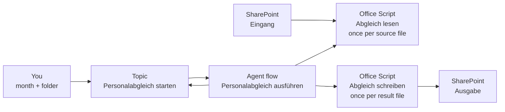

# Reconcile Payroll and Headcount Lists with an Agent Flow

Every month someone copies personnel numbers, cost centers and FTE shares out of the payroll statistics and a dozen headcount sheets into a new workbook, then compares them line by line. In this lab a Standard agent asks for the month, an agent flow reads every source file in a SharePoint folder, and two Office Scripts write the extracts, the differences and the error list into new workbooks in SharePoint.

What you practice here: keep a business rule deterministic by putting it into a script and a flow, and let the agent only collect the inputs and report the result.

Duration: about 80 minutes.

## What you'll build

- A SharePoint folder `Eingang` with Martin's test data and a folder `Ausgabe` for the results
- The Office Scripts **Abgleich lesen** (reads one source workbook by header names) and **Abgleich schreiben** (writes one result workbook)
- The agent flow **Personalabgleich ausführen**, which runs the scripts over every file whose name starts with `BezStat` or `Soll`
- The Standard agent **Personalabgleich** with a topic that asks for the month and the target folder
- Three workbooks per run: `BezStat_Auszug_<month>.xlsx`, `Soll_Auszug_<month>.xlsx` and `Abgleich_<month>.xlsx` with the sheets **Differenzen** and **Fehlerliste**

## How the pieces fit



## Prerequisites

- A Copilot Studio environment where you can create Standard agents and agent flows, opened at [copilotstudio.microsoft.com](https://copilotstudio.microsoft.com).
- A Microsoft 365 business license with Excel for the web and its **Automate** tab (Office Scripts).
- A SharePoint team site you can edit, opened from [office.com/launch/sharepoint](https://www.office.com/launch/sharepoint). The steps call it `Personalabgleich`; any site works.

## Lab files

| File | What it is |
|------|------------|
| [Beschreibung.docx](Beschreibung.docx) | Martin's requirements in German |
| [BezStat0526_T2.xlsx](BezStat0526_T2.xlsx) | Payroll statistics for May 2026, 17 sheets in two layouts |
| [Soll_H2.xlsx](Soll_H2.xlsx), [Soll_S2.xlsx](Soll_S2.xlsx) | Headcount plans with one VZÄ (FTE) column per month, 19 sheets |
| [abgleich-lesen.ts](lab-01-reconcile-with-an-agent-flow/abgleich-lesen.ts) | Office Script that reads one source workbook |
| [abgleich-schreiben.ts](lab-01-reconcile-with-an-agent-flow/abgleich-schreiben.ts) | Office Script that writes one result workbook |

The test data is anonymized: BezStat names read `Person 0001`, Soll names read `Name0001` or `Name_001`. The two lists only meet on the personnel number.

## Exercise 1: Put the test data into SharePoint

The flow reads from one folder and writes into another, so the source files never mix with the results. Office Scripts cannot create a workbook, so an empty workbook serves as the template for every result file.

1. Open your SharePoint site and select **Documents**.
2. Select **+ New** > **Folder**, name it `Eingang`, and create a second folder `Ausgabe`.
3. Open `Eingang`, select **Upload** > **Files**, and upload `BezStat0526_T2.xlsx`, `Soll_H2.xlsx` and `Soll_S2.xlsx` from `labs/09-martin`.
4. Go back to **Documents**, select **+ New** > **Excel workbook**, and rename the new workbook to `Vorlage.xlsx`. Close the Excel tab.

Expected: **Documents** shows the folders `Eingang` and `Ausgabe` and the file `Vorlage.xlsx`; `Eingang` lists the three source workbooks.

## Exercise 2: Read the source files by header name, not by column letter

Martin's description names column letters (Personalnummer in C, anteilig in BE) and asks how to cope when the layout changes. The test data already shows why letters fail:

| Sheets | Header row | Personnel number | Cost center | Share or FTE |
|--------|-----------|------------------|-------------|--------------|
| BezStat `Geringf 05` to `WKÖ 05` | 3 | `PNR` or `PNr` | `KST` | `anteilig` in O |
| BezStat `WKÖ Basis` | 1 | `PNR` | `KST` | `anteilig` in O |
| BezStat `vh05`, `nh05`, `wdvh05`, `wdnh05` | 1 | `Personalnummer` | `Kostenstelle` | `anteilig` in BE |
| Every Soll sheet | 8 to 12 | `Pers.Nr` | `KST-neu` | one column per month, its header is a date |

The script **Abgleich lesen** therefore searches the first 15 rows of every sheet for a row that holds all required headers, accepts the alternative names in the table, and reads each column wherever it sits. For a Soll file it also picks the column whose header is the requested month, and it returns every row with a personnel number or a name as JSON for the flow.

1. Open `Eingang` and open `BezStat0526_T2.xlsx` in Excel for the web.
2. Select the **Automate** tab, then **New Script**. The Code Editor opens with sample code.
3. Open [abgleich-lesen.ts](lab-01-reconcile-with-an-agent-flow/abgleich-lesen.ts), copy its whole content, and replace the sample code with it.
4. Select the script name at the top of the Code Editor, rename it to `Abgleich lesen`, and select **Save script**.

Expected: **Automate** > **All Scripts** lists **Abgleich lesen**. The script is saved in your OneDrive, so every workbook you open can run it.

> **Tip:** The script reads at most 300 columns. Some BezStat sheets are formatted out to column XFD, and reading the whole used range would exceed the five million cells a script may touch.

## Exercise 3: Write the extracts, the differences and the error list

The second script receives the JSON of every source file and writes one result workbook. The parameter `teil` decides which one: `BezStat`, `Soll` or `Abgleich`. Every call computes the full reconciliation and returns the counts, so the last call tells the agent what happened.

The script applies Martin's rules:

- A combination of personnel number and cost center appears once. When it sits on several sheets (BezStat repeats most people on `WKÖ Basis`), the first row that carries a value wins.
- Rows are matched on `Personalnummer` and `Pers.Nr`. A pair with a different cost center or a different share goes to **Differenzen** with the columns `Firma; Personalnummer; Name; BezStat_Kostenstelle; Soll_KST-neu; BezStat_Anteilig; Soll_VZÄ_<month>`.
- A row with an empty personnel number, name or first name, and a person who appears in only one of the two lists, goes to **Fehlerliste** with the reason in **Grund** and the Soll column **Anmerkung** of that row.

1. In Excel for the web, select **Automate** > **New Script** again.
2. Replace the sample code with the content of [abgleich-schreiben.ts](lab-01-reconcile-with-an-agent-flow/abgleich-schreiben.ts).
3. Rename the script to `Abgleich schreiben` and select **Save script**.

Expected: **All Scripts** lists **Abgleich lesen** and **Abgleich schreiben**.

## Exercise 4: Create the Standard agent

The agent talks to the user and calls the flow; it never calculates a difference itself. Keeping the rules out of the instructions is what makes two runs on the same files return the same numbers.

1. In Copilot Studio, open the dropdown next to **New agent** and, under **Other ways to build**, select **Agent** with the **Standard** badge.
2. In **Name your agent**, enter `Personalabgleich`.
3. Select **Edit** in the **Instructions** section, paste the text below, and select **Save**.

```text
You help the HR controlling team reconcile the payroll statistics (BezStat files) with the headcount plans (Soll files) for one month.
When the user asks for a reconciliation, a Personalabgleich or a comparison of BezStat and Soll, run the topic Personalabgleich starten.
Never calculate, estimate or invent differences yourself. Report only the numbers the topic returns and point the user to the result files in SharePoint.
```

Expected: the agent's **Overview** shows the name **Personalabgleich** and the instructions.

## Exercise 5: Read every source file in an agent flow

The flow is the pipeline: it finds the files, runs **Abgleich lesen** on each, and collects the results. File names are compared in lower case, so `bezstat0526.xlsx` and `BezStat0526.xlsx` both count.

1. In Copilot Studio, open the arrow next to **New workflow** and select **Agent flows**.
2. Add the **When an agent calls the flow** trigger. Select **Add an input**, choose **Text**, and name it `Monat`. Add a second **Text** input named `Zielordner`.
3. Select **Insert a new action**, search for **Get files (properties only)** (SharePoint), and rename the action to `Dateien holen`. Set **Site Address** to your site, **Library Name** to **Documents**, and **Limit Entries to Folder** to `/Shared Documents/Eingang`.
4. Add a **Filter array** action named `BezStat Dateien`. Set **From** to **value** of **Dateien holen**. In the condition, enter the expression below as the left value, choose **starts with**, and type `bezstat` as the right value.

```text
toLower(item()?['{FilenameWithExtension}'])
```

5. Add a second **Filter array** named `Soll Dateien` with the same settings and the right value `soll`.
6. Add two **Initialize variable** actions: `BezStatTeile` and `SollTeile`, both of type **Array** with the value `[]`.
7. Add an **Apply to each** over **Body** of **BezStat Dateien**. Inside it, add **Run script** (Excel Online (Business)) named `BezStat lesen`: **Location** your site, **Document Library** **Documents**, **Script** **Abgleich lesen**. For **File**, select the field, select the **fx** icon, and enter `item()?['{Identifier}']`. Set **art** to `BezStat` and **monat** to the trigger input **Monat**.
8. Still inside the loop, add **Append to array variable**: **Name** `BezStatTeile`, **Value** **result** of **BezStat lesen**.
9. Repeat steps 7 and 8 for **Body** of **Soll Dateien** with an action named `Soll lesen`, **art** `Soll`, and the variable `SollTeile`.

Expected: the designer shows the trigger, **Dateien holen**, both filters, both variables and two loops, each with a **Run script** and an **Append to array variable** inside. **Flow checker** reports no errors.

> **Note:** The first SharePoint and Excel action asks for a connection. Sign in with the account that saved the scripts; **Run script** only lists the scripts of the signed-in account.

## Exercise 6: Write three result workbooks and answer the agent

Each result file starts as a copy of `Vorlage.xlsx` and is then filled by **Abgleich schreiben**. The target folder comes from the trigger input, which answers Martin's question whether the folder can be fixed: the topic in the next exercise sets a default and lets the user overwrite it.

1. After the loops, add **Get file content using path** (SharePoint) named `Vorlage holen` with **File Path** `/Shared Documents/Vorlage.xlsx`.
2. Add **Create file** (SharePoint) named `BezStat anlegen`: **Folder Path** the trigger input **Zielordner**, **File Name** `BezStat_Auszug_`, then the input **Monat**, then `.xlsx`, and **File Content** **File Content** of **Vorlage holen**.
3. Add **Create file** named `Soll anlegen` with the file name `Soll_Auszug_<Monat>.xlsx` built the same way, and **Create file** named `Abgleich anlegen` with `Abgleich_<Monat>.xlsx`.
4. Add three **Run script** actions with the script **Abgleich schreiben**, each pointing **File** at the **Id** of its **Create file** action: `BezStat schreiben` with **teil** `BezStat`, `Soll schreiben` with **teil** `Soll`, and `Abgleich schreiben` with **teil** `Abgleich`. In all three, set **monat** to **Monat** and enter these expressions for **bezstat** and **soll**:

```text
string(variables('BezStatTeile'))
```

```text
string(variables('SollTeile'))
```

5. Open **Respond to the agent** and add the outputs below. Under **Networking**, set **Asynchronous response** to **Off**.

| Output | Type | Expression |
|--------|------|------------|
| `ZeilenBezStat` | Number | `json(outputs('Abgleich_schreiben')?['body/result'])?['zeilenBezStat']` |
| `ZeilenSoll` | Number | `json(outputs('Abgleich_schreiben')?['body/result'])?['zeilenSoll']` |
| `Differenzen` | Number | `json(outputs('Abgleich_schreiben')?['body/result'])?['differenzen']` |
| `Fehlerliste` | Number | `json(outputs('Abgleich_schreiben')?['body/result'])?['fehlerliste']` |
| `BlaetterOhneMonat` | Text | `join(json(outputs('Abgleich_schreiben')?['body/result'])?['blaetterOhneMonat'], ', ')` |

6. Rename the flow to `Personalabgleich ausführen`, run **Flow checker**, and select **Publish**.

Expected: the flow is published with two text inputs and five outputs. A manual **Test** with `Mai.2026` and `/Shared Documents/Ausgabe` leaves three workbooks in `Ausgabe`.

## Exercise 7: Ask for the month and the target folder in a topic

A topic gives the conversation a fixed path: the month is checked before any file is touched, and the default folder is written into the topic once. This is the part of the Standard harness that a Microsoft Copilot harness agent does not have.

1. Open the agent, go to **Topics**, select **+ Add a topic** > **From blank**, and enter the description below.

```text
Starts the monthly reconciliation of the payroll statistics (BezStat) with the headcount plans (Soll) and saves the result workbooks in SharePoint.
```

2. Add an **Ask a question** node with the text `Which month should I reconcile? Use the format MMM.JJJJ, for example Mai.2026.` Set **Identify** to **User's entire response** and rename the variable to `Monat` in **Properties**.
3. In the question's properties, under **Additional entity validation**, enter the formula below and set the retry prompt to `Please use the month abbreviation and the year, for example Mai.2026.`

```text
IsMatch(Topic.Monat, "^\s*[A-Za-zÄäÖöÜü]{3,4}\.?\s*\d{4}\s*$")
```

4. Add a **Set variable value** node: create the variable `Zielordner` and set it to `/Shared Documents/Ausgabe`.
5. Add an **Ask a question** node `Save the results in /Shared Documents/Ausgabe?` with **Identify** **Boolean**, saved as `Standardordner`.
6. Add a condition: **Standardordner** is equal to **false**. In that branch, ask `Which folder should I use? Example: /Shared Documents/Ausgabe/2026` with **User's entire response**, saved into the existing variable **Zielordner**.
7. Below the condition, select **+** > **Add a tool**, choose **Personalabgleich ausführen**, and map **Monat** to `Topic.Monat` and **Zielordner** to `Topic.Zielordner`.
8. Add **Send a message** and use the **{x}** command to insert the flow outputs:

```text
The reconciliation for {Monat} is saved in {Zielordner}.
BezStat rows: {ZeilenBezStat}
Soll rows: {ZeilenSoll}
Differences: {Differenzen}
Error list rows: {Fehlerliste}
Soll sheets without a column for this month: {BlaetterOhneMonat}
```

9. Name the topic `Personalabgleich starten` and select **Save**.

Expected: the **Topic Saved!** banner appears and the canvas shows two questions, the condition, the tool node and the message.

## Exercise 8: Run the reconciliation in the test pane

1. Select **Test** and send `Start the Personalabgleich`.
2. Answer the month question with `05.2026`.
3. Answer the retry with `Mai.2026` and the folder question with `Yes`.

Expected: `05.2026` triggers the retry prompt; `Mai.2026` is accepted. After the flow finishes, the message reports `BezStat rows: 2135`, `Soll rows: 662`, `Differences: 166` and `Error list rows: 2035`, and names the Soll sheets `ICC`, `Büro Euro`, `WIFI ab 2021` and `ALTWIFI` as sheets without a May 2026 column. `Ausgabe` holds `BezStat_Auszug_Mai.2026.xlsx`, `Soll_Auszug_Mai.2026.xlsx` and `Abgleich_Mai.2026.xlsx`.

## Exercise 9: Read the result the way the HR team will

The numbers only help when each row leads to a decision. Open `Abgleich_Mai.2026.xlsx` in `Ausgabe` and apply a filter to each sheet.

1. On **Differenzen**, find personnel number `15`: both lists name cost center `706020`, BezStat says `0.63`, Soll says `0.625`.
2. Find personnel number `25040`: BezStat cost center `700240`, Soll cost center `E20001`.
3. On **Fehlerliste**, filter **Grund**.

Expected: **Differenzen** has 166 rows, 124 with different cost centers and 42 with the same cost center but a different value; 15 of those 42 differ only by rounding, like `0.63` against `0.625`. **Fehlerliste** has 2,035 rows:

| Grund | Rows | What it means |
|-------|------|---------------|
| `fehlt in Soll` | 1,763 | The BezStat file covers every company; the two Soll files cover two areas |
| `fehlt in BezStat` | 207 | Planned people without pay in May, often with an **Anmerkung** such as `ausgeschieden` or `Pension` |
| `Pers.Nr fehlt, Vorname fehlt` | 49 | Mostly subtotal rows such as `Summe` and `Planposten` on `WIFI ab 2022` |
| `Vorname fehlt`, `Pers.Nr fehlt` and combinations | 16 | Single rows to fix in the Soll files |

> **Tip:** Two decisions belong to the HR team, not to the script: whether `0.63` against `0.625` is a difference, and whether subtotal rows in the Soll files are skipped. Each is one line in **Abgleich schreiben** (`gleich`) or **Abgleich lesen** (the row filter), and the agent stays unchanged.

## Exercise 10: Prove that a changed layout does not break the run

1. In `Eingang`, open `BezStat0526_T2.xlsx`, go to sheet `vh05`, right-click the column header **C**, and select **Insert column**. The personnel numbers move to column D.
2. In `Ausgabe`, delete the three result workbooks of the first run.
3. In the test pane, select the refresh icon, start the reconciliation again for `Mai.2026`, and confirm the default folder.
4. In `vh05`, delete the inserted column again.

Expected: the second run reports the same 2135, 662, 166 and 2035, because both scripts find every column by its header.

## Troubleshooting

| Symptom | Likely cause | Fix |
|---------|--------------|-----|
| The agent reports that the flow took too long | An agent flow must answer within 100 seconds and six Excel script runs come close to it | Open the flow's run history: a successful run has written the files anyway. Put the Soll loop into a parallel branch of the BezStat loop (**Add a parallel branch**) so both read at the same time |
| **Run script** on a new file fails with a not found or locked error | Excel has not picked up the file that **Create file** just wrote | Add a **Delay** of 10 seconds after **Abgleich anlegen** |
| **Script** lists no scripts | The scripts were saved with another account, or not saved | Save both scripts in Excel for the web with the account of the flow's Excel connection |
| `Monat '...' ist nicht im Format MMM.JJJJ` in the run history | The flow was tested with a month such as `05.2026` | Use the month abbreviation and the year, for example `Mai.2026` |
| The whole **Soll_VZÄ** column is empty for some people | Their sheet has no column for that month | Check `BlaetterOhneMonat`; old sheets such as `ALTWIFI` end in 2020 |

## Summary

You built a Standard agent that reconciles the payroll statistics with the headcount plans for any month. You can now:

- read Excel sheets by header name, so a moved or renamed column does not break the run
- run an Office Script from an agent flow once per file and collect the results
- validate a user's input in a topic before a flow runs, and keep a default value in the topic
- return counts from a flow and show them in the conversation

Next, solve the same reconciliation on a Microsoft Copilot harness agent with a skill in [Reconcile Payroll and Headcount Lists with an Agent Skill](lab-02-reconcile-with-an-agent-skill.md).
