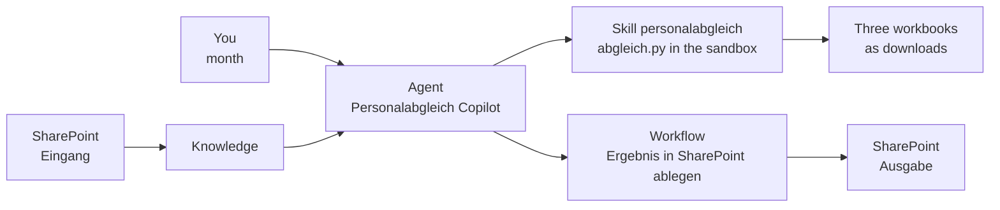

# Bezügestatistik und Soll-Listen mit einem Agent Skill abgleichen

Der monatliche Abgleich der Bezügestatistik mit den Soll-Listen ist dieselbe Aufgabe wie in [Lab 01](lab-01-reconcile-with-an-agent-flow-de.md), diesmal auf einem Microsoft Copilot Harness Agent. Statt eine Pipeline Action für Action zu verdrahten, schreiben Sie die Geschäftsregeln einmal in einen Skill mit einem Python Script. Der Agent findet die Dateien in SharePoint, führt das Script in seiner Sandbox aus, gibt drei Arbeitsmappen zurück, und ein Workflow legt sie in SharePoint ab.

Was Sie hier üben: eine Geschäftsregel als Skill verpacken, dessen Script die Berechnung übernimmt, damit jeder Lauf auf denselben Dateien dieselben Zahlen liefert.

Dauer: etwa 80 Minuten.

## Was Sie bauen

- Den Agent **Personalabgleich Copilot** auf dem Microsoft Copilot Harness, gegroundet auf den SharePoint-Ordner `Eingang`
- Den Skill **personalabgleich**: eine `SKILL.md` und das Script `scripts/abgleich.py`
- Den Workflow **Ergebnis in SharePoint ablegen**, der eine vom Agent erzeugte Datei in einem SharePoint-Ordner speichert
- Drei Arbeitsmappen pro Lauf: `BezStat_Auszug_<month>.xlsx`, `Soll_Auszug_<month>.xlsx` und `Abgleich_<month>.xlsx` mit den Blättern **Differenzen** und **Fehlerliste**

## Die beteiligten Teile



## Voraussetzungen

- Copilot Studio unter [copilotstudio.microsoft.com](https://copilotstudio.microsoft.com), wo das Menü **New agent** den Eintrag **Agent** mit dem Badge **GitHub Copilot** anbietet.
- Copilot Credits in der Environment: Die Läufe in der Sandbox und der Workflow verbrauchen Credits.
- Eine SharePoint Team Site, die Sie bearbeiten dürfen, geöffnet über [office.com/launch/sharepoint](https://www.office.com/launch/sharepoint). Haben Sie [Lab 01](lab-01-reconcile-with-an-agent-flow-de.md) gemacht, werden dessen Ordner `Eingang` und `Ausgabe` wiederverwendet, und Schritt 1 ist erledigt.

## Lab-Dateien

| Datei | Was sie ist |
|-------|-------------|
| [Beschreibung.docx](Beschreibung.docx) | Martins Anforderungen auf Deutsch |
| [BezStat0526_T2.xlsx](BezStat0526_T2.xlsx) | Bezügestatistik für Mai 2026, 17 Blätter in zwei Layouts |
| [Soll_H2.xlsx](Soll_H2.xlsx), [Soll_S2.xlsx](Soll_S2.xlsx) | Soll-Listen mit einer VZÄ-Spalte pro Monat, 19 Blätter |
| [personalabgleich/SKILL.md](lab-02-reconcile-with-an-agent-skill/personalabgleich/SKILL.md) | Der Skill: wann er gilt, was der Agent tut, welche Regeln gelten |
| [personalabgleich/scripts/abgleich.py](lab-02-reconcile-with-an-agent-skill/personalabgleich/scripts/abgleich.py) | Das Script, das die Arbeitsmappen liest, verknüpft und schreibt |

Die Testdaten sind anonymisiert: Namen in der BezStat lauten `Person 0001`, Namen in den Soll-Listen `Name0001` oder `Name_001`. Die beiden Listen treffen sich nur über die Personalnummer.

## Schritt 1: Die Testdaten in SharePoint ablegen

Der Agent liest die Quelldateien aus einem Ordner; die Ergebnisse kommen in einen anderen.

1. Öffnen Sie Ihre SharePoint Site und wählen Sie **Documents**.
2. Wählen Sie **+ New** > **Folder**, nennen Sie den Ordner `Eingang` und legen Sie einen zweiten Ordner `Ausgabe` an.
3. Öffnen Sie `Eingang`, wählen Sie **Upload** > **Files** und laden Sie `BezStat0526_T2.xlsx`, `Soll_H2.xlsx` und `Soll_S2.xlsx` aus `labs/09-martin` hoch.
4. Kopieren Sie die Adresse des Ordners `Eingang` aus der Adressleiste des Browsers für Schritt 3.

Erwartet: `Eingang` listet die drei Quell-Arbeitsmappen, und `Ausgabe` ist leer.

## Schritt 2: Den Agent erstellen

Die Instructions leiten die Aufgabe nur an den Skill weiter. Die Regeln stehen im Skill, deshalb reisen sie mit ihm, und niemand muss sie in einem zweiten Agent neu tippen.

1. Wählen Sie in Copilot Studio **New agent**, dann **Agent** mit dem Badge **GitHub Copilot**, und nennen Sie den Agent `Personalabgleich Copilot`.
2. Öffnen Sie die Component **Instructions**, fügen Sie den folgenden Text ein und wählen Sie **Save**.

```text
You help the HR controlling team reconcile the payroll statistics (BezStat files) with the headcount plans (Soll files) for one month.
Use the skill personalabgleich for every reconciliation. Never compare the lists with code you write yourself.
Answer in the language of the user.
```

Erwartet: Der Agent öffnet sich auf **Build** mit den gespeicherten Instructions.

## Schritt 3: Den Agent auf den SharePoint-Ordner grounden

1. Öffnen Sie die Component **Knowledge** und wählen Sie **Add knowledge**.
2. Wählen Sie **SharePoint**, fügen Sie die Adresse von `Eingang` aus Schritt 1 ein und fügen Sie sie dem Agent hinzu.
3. Laden Sie die Seite neu, bis der Status der Quelle **Ready** zeigt.

Erwartet: **Knowledge** listet den Ordner `Eingang` mit dem Status **Ready**.

## Schritt 4: Ohne Skill fragen und zusehen, wie das Ergebnis abweicht

Bevor Sie den Skill hinzufügen, sehen Sie, was der Agent mit der bloßen Anfrage macht. Er durchsucht die Knowledge, schreibt eigenen Code in der Sandbox und antwortet, und nichts bringt den nächsten Lauf dazu, denselben Code zu schreiben.

1. Öffnen Sie **Preview** mit eingeschaltetem **Debug mode** und wählen Sie **New chat**.
2. Senden Sie diesen Prompt und notieren Sie die Zahlen in der Antwort:

```text
Compare the BezStat and Soll files for Mai.2026. Match people on Personalnummer and Pers.Nr, list the differences in cost center and FTE, and list the people missing in one of the two lists.
```

3. Wählen Sie **New chat** und senden Sie denselben Prompt erneut.

Erwartet: Die Schrittliste zeigt **Searched knowledge** und Code, den der Agent geschrieben hat. Die Antworten hängen vom Modell ab: Öffnen Sie in beiden Läufen den Code und prüfen Sie, welche Blätter er gelesen hat und ob er neben den Blättern mit `Personalnummer` auch die Blätter mit `PNR` gefunden hat. Behalten Sie die Zahlen, um sie mit Schritt 7 zu vergleichen.

## Schritt 5: Den Skill lesen, bevor Sie ihn hochladen

Öffnen Sie [SKILL.md](lab-02-reconcile-with-an-agent-skill/personalabgleich/SKILL.md). Drei Teile erledigen drei Aufgaben:

- Die **description** im Frontmatter entscheidet, wann der Agent den Skill lädt. Die description nennt die Wörter, die ein User tippt: Personalabgleich, BezStat, Soll, VZÄ, anteilig, Kostenstelle, einen Monat wie Mai.2026.
- Die nummerierten Schritte weisen den Agent an, die Dateien zu sammeln und `scripts/abgleich.py` auszuführen, und verbieten ihm, eigenen Vergleichscode zu schreiben.
- **Rules the script applies** dokumentiert die Geschäftsregeln für die Lesenden; das Script setzt sie durch.

Das Script beantwortet Martins Frage, wie sich ein geänderter Spaltenaufbau abfedern lässt. Die Testdaten nutzen schon zwei Layouts, deshalb werden Spalten über ihre Überschrift in den ersten 15 Zeilen jedes Blatts gefunden:

| Blätter | Kopfzeile | Personalnummer | Kostenstelle | Anteil oder VZÄ |
|---------|-----------|----------------|--------------|-----------------|
| BezStat `Geringf 05` bis `WKÖ Basis` | 3, `WKÖ Basis` 1 | `PNR` oder `PNr` | `KST` | `anteilig` in O |
| BezStat `vh05`, `nh05`, `wdvh05`, `wdnh05` | 1 | `Personalnummer` | `Kostenstelle` | `anteilig` in BE |
| Jedes Soll-Blatt | 8 bis 12 | `Pers.Nr` | `KST-neu` | eine Spalte pro Monat, ihre Überschrift ist ein Datum |

Erwartet: Sie können für jede Regel der Anforderungen sagen, wo sie steht: die Verknüpfung über die Personalnummer, eine Zeile pro Personalnummer und Kostenstelle, die Spalten von **Differenzen**, die Gründe und die **Anmerkung** in der **Fehlerliste**.

## Schritt 6: Den Skill zippen und hochladen

1. Öffnen Sie im Datei-Explorer `labs/09-martin/lab-02-reconcile-with-an-agent-skill/personalabgleich`.
2. Wählen Sie `SKILL.md` und den Ordner `scripts`, klicken Sie mit der rechten Maustaste und wählen Sie **Compress to ZIP file**. Nennen Sie das Archiv `personalabgleich.zip`.
3. Öffnen Sie im Agent das Panel **Skills**, wählen Sie **Add skill**, wählen Sie **Upload a skill** und wählen Sie `personalabgleich.zip`.

> **Warnung:** Öffnen Sie zuerst den Ordner, wählen Sie seinen Inhalt und zippen Sie dann. Ein ZIP des Ordners `personalabgleich` selbst legt `SKILL.md` eine Ebene zu tief.

Erwartet: **Skills** listet **personalabgleich** als schreibgeschützt, mit der description aus dem Frontmatter.

## Schritt 7: Den Abgleich mit dem Skill ausführen

1. Wählen Sie in **Preview** den Befehl **New chat** und senden Sie:

```text
Run the Personalabgleich for 05/2026.
```

2. Beantworten Sie die Rückfrage des Agents mit `Mai.2026`.

Erwartet: Die Schrittliste zeigt **Used skill: personalabgleich**. Für `05/2026` stoppt das Script mit `Monat '05/2026' ist nicht im Format MMM.JJJJ, zum Beispiel Mai.2026`, und der Agent fragt erneut nach dem Monat. Für `Mai.2026` meldet die Antwort 2135 BezStat-Zeilen, 662 Soll-Zeilen, 166 Differenzen und 2035 Zeilen in der Fehlerliste, nennt die Soll-Blätter `ICC`, `Büro Euro`, `WIFI ab 2021` und `ALTWIFI` als Blätter ohne Spalte für Mai 2026 und bietet `BezStat_Auszug_Mai.2026.xlsx`, `Soll_Auszug_Mai.2026.xlsx` und `Abgleich_Mai.2026.xlsx` zum Download an.

> **Hinweis:** Zeigt die Schrittliste, dass keine BezStat- oder Soll-Datei gefunden wurde, hängen Sie die drei Arbeitsmappen mit der Büroklammer an den Chat an und senden Sie den Prompt erneut. Der Skill nimmt angehängte Dateien zuerst.

## Schritt 8: Das Ergebnis so lesen, wie es das HR-Team liest

Laden Sie `Abgleich_Mai.2026.xlsx` herunter und setzen Sie auf jedem Blatt einen Filter.

1. Suchen Sie auf **Differenzen** die Personalnummer `15`: Beide Listen nennen die Kostenstelle `706020`, die BezStat sagt `0.63`, die Soll-Liste `0.625`.
2. Suchen Sie die Personalnummer `25040`: BezStat-Kostenstelle `700240`, Soll-Kostenstelle `E20001`.
3. Filtern Sie auf der **Fehlerliste** die Spalte **Grund**.

Erwartet: **Differenzen** hat 166 Zeilen, 124 mit unterschiedlicher Kostenstelle und 42 mit gleicher Kostenstelle, aber anderem Wert; 15 dieser 42 unterscheiden sich nur durch Rundung. Die **Fehlerliste** hat 2.035 Zeilen:

| Grund | Zeilen | Was es bedeutet |
|-------|--------|-----------------|
| `fehlt in Soll` | 1.763 | Die BezStat-Datei deckt jede Firma ab; die beiden Soll-Dateien decken zwei Bereiche ab |
| `fehlt in BezStat` | 207 | Geplante Personen ohne Bezug im Mai, oft mit einer **Anmerkung** wie `ausgeschieden` oder `Pension` |
| `Pers.Nr fehlt, Vorname fehlt` | 49 | Meist Summenzeilen wie `Summe` und `Planposten` auf `WIFI ab 2022` |
| `Vorname fehlt`, `Pers.Nr fehlt` und Kombinationen | 16 | Einzelne Zeilen, die in den Soll-Dateien zu korrigieren sind |

Haben Sie Lab 01 gemacht, sind die Zahlen identisch: Beide Labs wenden dieselben Regeln an, einmal als Office Scripts in einem Flow und einmal als Script in einem Skill. Die Zahlen aus Schritt 4 zeigen, was dieselbe Anfrage ohne diese Regeln liefert.

## Schritt 9: Die Ergebnisse mit einem Workflow in SharePoint ablegen

Die Downloads landen auf dem Rechner einer einzelnen Person. Martin will die Ergebnisse in einem SharePoint-Ordner, den er angibt oder der fix hinterlegt ist: Der Workflow nimmt den Ordner als Input, und die Instructions des Agents halten den Standardwert.

1. Öffnen Sie die Component **Tools**, wählen Sie **Add a tool**, wählen Sie **Add** neben der Suchleiste und dann **Workflow**.
2. Prüfen Sie, dass **Trigger type** **When an agent calls the workflow** anzeigt. Wählen Sie **Add an input** und fügen Sie einen Input **File** `Datei`, einen Input **Text** `Dateiname` und einen Input **Text** `Zielordner` hinzu.
3. Fügen Sie unter dem Trigger die SharePoint Connector Action **Create file** hinzu: **Site Address** Ihre Site, **Folder Path** der Input **Zielordner**, **File Name** der Input **Dateiname**, **File Content** der Input **Datei**.
4. Fügen Sie in **Respond to the agent** einen Output **Text** `Pfad` mit dem **Path** von **Create file** hinzu.
5. Benennen Sie den Workflow in `Ergebnis in SharePoint ablegen` um, wählen Sie das Speichern-Symbol und dann **Publish**.
6. Wählen Sie zurück in **Add a tool** den Workflow, um **Workflow details** zu öffnen, setzen Sie **How is this filled?** für alle drei Inputs auf **AI** und wählen Sie **Save**.
7. Öffnen Sie die Component **Instructions**, fügen Sie den folgenden Text am Ende hinzu und wählen Sie **Save**.

```text
After the skill created the result files, call the workflow Ergebnis in SharePoint ablegen once per file: Datei is the file, Dateiname its file name, Zielordner is /Shared Documents/Ausgabe unless the user names another folder.
```

Erwartet: **Tools** listet **Ergebnis in SharePoint ablegen**, und die Instructions enden mit dem neuen Absatz.

## Schritt 10: Einen zweiten Monat ausführen und in SharePoint speichern

1. Wählen Sie in **Preview** den Befehl **New chat** und senden Sie:

```text
Run the Personalabgleich for Apr.2026 and save the results in SharePoint.
```

2. Öffnen Sie den Ordner `Ausgabe` in SharePoint.

Erwartet: Die Schrittliste zeigt **Used skill: personalabgleich** und danach drei Aufrufe von **Ergebnis in SharePoint ablegen**. Die Antwort meldet 2135 BezStat-Zeilen, 662 Soll-Zeilen, 164 Differenzen und 2035 Zeilen in der Fehlerliste: Die Soll-Werte kommen jetzt aus der April-Spalte, während die BezStat-Datei die Mai-Datei bleibt. `Ausgabe` enthält `BezStat_Auszug_Apr.2026.xlsx`, `Soll_Auszug_Apr.2026.xlsx` und `Abgleich_Apr.2026.xlsx`.

## Troubleshooting

| Symptom | Wahrscheinliche Ursache | Lösung |
|---------|-------------------------|--------|
| Die Schrittliste zeigt nie **Used skill: personalabgleich** | Der Prompt passt nicht zur description des Skills | Benennen Sie die Aufgabe so wie die description, zum Beispiel `Run the Personalabgleich for Mai.2026` |
| Der Upload scheitert, oder der Skill hat keine Instructions | Das ZIP enthält den Ordner statt seines Inhalts | Zippen Sie `SKILL.md` und `scripts` direkt und laden Sie erneut hoch |
| Die Antwort meldet andere Zahlen als 2135, 662, 166 und 2035 | Der Agent hat die Listen mit eigenem Code verglichen statt mit dem Script | Prüfen Sie die Schrittliste auf den Lauf des Scripts; starten Sie **New chat** und nennen Sie den Skill im Prompt |
| Keine Datei in der Sandbox gefunden | Die Knowledge-Quelle ist noch nicht **Ready**, oder die Suche hat nicht jede Datei geliefert | Laden Sie neu, bis **Ready** erscheint, oder hängen Sie die drei Arbeitsmappen an den Chat an |
| Der Workflow wird unter **Add a tool** nicht angeboten | Er wurde gespeichert, aber nicht veröffentlicht | Öffnen Sie ihn, wählen Sie **Publish** und fügen Sie ihn dann hinzu |

## Zusammenfassung

Sie haben einen Microsoft Copilot Harness Agent gebaut, der die Bezügestatistik mit einem Skill mit den Soll-Listen abgleicht. Sie können jetzt:

- Geschäftsregeln als Skill mit einem Script verpacken, damit der Agent getesteten Code ausführt, statt zu improvisieren
- in der Schrittliste sehen, ob ein Skill und sein Script gelaufen sind
- einen Agent auf einen SharePoint-Ordner grounden und einen Skill mit dessen Dateien in der Sandbox arbeiten lassen
- die Ergebnisdateien des Agents mit einem Workflow in SharePoint ablegen und den Standardordner in den Instructions halten

Vergleichen Sie die beiden Labs: Der Standard Agent bietet einen festen Gesprächsweg und eine sichtbare Pipeline, der Microsoft Copilot Harness Agent ein portables Paket aus Regeln und weit weniger Teile zum Bauen.
