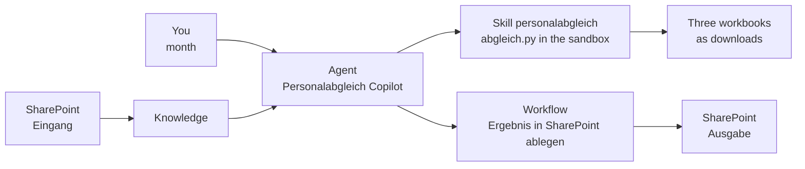

# Reconcile Payroll and Headcount Lists with an Agent Skill

The monthly reconciliation of the payroll statistics with the headcount plans is the same job as in [lab 01](lab-01-reconcile-with-an-agent-flow.md), this time on a Microsoft Copilot harness agent. Instead of wiring a pipeline action by action, you write the business rules once into a skill with a Python script. The agent finds the files in SharePoint, runs the script in its sandbox, hands back three workbooks, and a workflow files them in SharePoint.

What you practice here: package a business rule as a skill whose script does the computation, so every run on the same files returns the same numbers.

Duration: about 80 minutes.

## What you'll build

- The agent **Personalabgleich Copilot** on the Microsoft Copilot harness, grounded on the SharePoint folder `Eingang`
- The skill **personalabgleich**: a `SKILL.md` and the script `scripts/abgleich.py`
- The workflow **Ergebnis in SharePoint ablegen**, which saves a file the agent created into a SharePoint folder
- Three workbooks per run: `BezStat_Auszug_<month>.xlsx`, `Soll_Auszug_<month>.xlsx` and `Abgleich_<month>.xlsx` with the sheets **Differenzen** and **Fehlerliste**

## How the pieces fit



## Prerequisites

- Copilot Studio at [copilotstudio.microsoft.com](https://copilotstudio.microsoft.com), where the **New agent** menu offers **Agent** with the **GitHub Copilot** badge.
- Copilot Credits in the environment: the sandbox runs and the workflow consume credits.
- A SharePoint team site you can edit, opened from [office.com/launch/sharepoint](https://www.office.com/launch/sharepoint). If you did [lab 01](lab-01-reconcile-with-an-agent-flow.md), its folders `Eingang` and `Ausgabe` are reused and Step 1 is done.

## Lab files

| File | What it is |
|------|------------|
| [Beschreibung.docx](Beschreibung.docx) | Martin's requirements in German |
| [BezStat0526_T2.xlsx](BezStat0526_T2.xlsx) | Payroll statistics for May 2026, 17 sheets in two layouts |
| [Soll_H2.xlsx](Soll_H2.xlsx), [Soll_S2.xlsx](Soll_S2.xlsx) | Headcount plans with one VZÄ (FTE) column per month, 19 sheets |
| [personalabgleich/SKILL.md](lab-02-reconcile-with-an-agent-skill/personalabgleich/SKILL.md) | The skill: when it applies, what the agent does, which rules hold |
| [personalabgleich/scripts/abgleich.py](lab-02-reconcile-with-an-agent-skill/personalabgleich/scripts/abgleich.py) | The script that reads, matches and writes the workbooks |

The test data is anonymized: BezStat names read `Person 0001`, Soll names read `Name0001` or `Name_001`. The two lists only meet on the personnel number.

## Step 1: Put the test data into SharePoint

The agent reads the source files from one folder; the results go into another.

1. Open your SharePoint site and select **Documents**.
2. Select **+ New** > **Folder**, name it `Eingang`, and create a second folder `Ausgabe`.
3. Open `Eingang`, select **Upload** > **Files**, and upload `BezStat0526_T2.xlsx`, `Soll_H2.xlsx` and `Soll_S2.xlsx` from `labs/09-martin`.
4. Copy the address of the `Eingang` folder from the browser's address bar for Step 3.

Expected: `Eingang` lists the three source workbooks and `Ausgabe` is empty.

## Step 2: Create the agent

The instructions only route the job to the skill. The rules live in the skill, so they travel with it and nobody has to retype them in a second agent.

1. In Copilot Studio, select **New agent**, then **Agent** with the **GitHub Copilot** badge, and name it `Personalabgleich Copilot`.
2. Open the **Instructions** component, paste the text below, and select **Save**.

```text
You help the HR controlling team reconcile the payroll statistics (BezStat files) with the headcount plans (Soll files) for one month.
Use the skill personalabgleich for every reconciliation. Never compare the lists with code you write yourself.
Answer in the language of the user.
```

Expected: the agent opens on **Build** with the instructions saved.

## Step 3: Ground the agent on the SharePoint folder

1. Open the **Knowledge** component and select **Add knowledge**.
2. Choose **SharePoint**, paste the `Eingang` address from Step 1, and add it to the agent.
3. Reload the page until the source status shows **Ready**.

Expected: **Knowledge** lists the `Eingang` folder with the status **Ready**.

## Step 4: Ask without the skill and watch the result drift

Before you add the skill, see what the agent does with the bare request. It searches the knowledge, writes its own code in the sandbox and answers, and nothing makes the next run write the same code.

1. Open **Preview** with **Debug mode** on and select **New chat**.
2. Send this prompt and note the numbers in the answer:

```text
Compare the BezStat and Soll files for Mai.2026. Match people on Personalnummer and Pers.Nr, list the differences in cost center and FTE, and list the people missing in one of the two lists.
```

3. Select **New chat** and send the same prompt again.

Expected: the step list shows **Searched knowledge** and code the agent wrote. The answers are model-dependent: open the code in both runs and check which sheets it read and whether it found the `PNR` sheets as well as the `Personalnummer` sheets. Keep the numbers to compare them with Step 7.

## Step 5: Read the skill before you upload it

Open [SKILL.md](lab-02-reconcile-with-an-agent-skill/personalabgleich/SKILL.md). Three parts do three jobs:

- The **description** in the frontmatter decides when the agent loads the skill. It names the words a user types: Personalabgleich, BezStat, Soll, VZÄ, anteilig, Kostenstelle, a month such as Mai.2026.
- The numbered steps tell the agent to collect the files and run `scripts/abgleich.py`, and forbid it to write its own comparison code.
- **Rules the script applies** documents the business rules for the reader; the script enforces them.

The script answers Martin's question how to cope with a changed column layout. The test data already uses two layouts, so columns are found by their header name in the first 15 rows of every sheet:

| Sheets | Header row | Personnel number | Cost center | Share or FTE |
|--------|-----------|------------------|-------------|--------------|
| BezStat `Geringf 05` to `WKÖ Basis` | 3, `WKÖ Basis` 1 | `PNR` or `PNr` | `KST` | `anteilig` in O |
| BezStat `vh05`, `nh05`, `wdvh05`, `wdnh05` | 1 | `Personalnummer` | `Kostenstelle` | `anteilig` in BE |
| Every Soll sheet | 8 to 12 | `Pers.Nr` | `KST-neu` | one column per month, its header is a date |

Expected: you can name, for each rule in the requirements, where it sits: matching on the personnel number, one row per personnel number and cost center, the columns of **Differenzen**, the reasons and the **Anmerkung** in **Fehlerliste**.

## Step 6: Zip and upload the skill

1. In File Explorer, open `labs/09-martin/lab-02-reconcile-with-an-agent-skill/personalabgleich`.
2. Select `SKILL.md` and the `scripts` folder, right-click, and choose **Compress to ZIP file**. Name the archive `personalabgleich.zip`.
3. In the agent, open the **Skills** panel, select **Add skill**, choose **Upload a skill**, and select `personalabgleich.zip`.

> **Warning:** Open the folder first, select its contents, then zip. A ZIP of the `personalabgleich` folder itself puts `SKILL.md` one level too deep.

Expected: **Skills** lists **personalabgleich** as read-only, with the description from the frontmatter.

## Step 7: Run the reconciliation with the skill

1. In **Preview**, select **New chat** and send:

```text
Run the Personalabgleich for 05/2026.
```

2. Answer the agent's follow-up with `Mai.2026`.

Expected: the step list shows **Used skill: personalabgleich**. For `05/2026` the script stops with `Monat '05/2026' ist nicht im Format MMM.JJJJ, zum Beispiel Mai.2026` and the agent asks for the month again. For `Mai.2026` the answer reports 2135 BezStat rows, 662 Soll rows, 166 differences and 2035 error list rows, names the Soll sheets `ICC`, `Büro Euro`, `WIFI ab 2021` and `ALTWIFI` as sheets without a May 2026 column, and offers `BezStat_Auszug_Mai.2026.xlsx`, `Soll_Auszug_Mai.2026.xlsx` and `Abgleich_Mai.2026.xlsx` as downloads.

> **Note:** If the step list shows that no BezStat or Soll file was found, attach the three workbooks to the chat with the paperclip and send the prompt again. The skill takes attached files first.

## Step 8: Read the result the way the HR team will

Download `Abgleich_Mai.2026.xlsx` and apply a filter to each sheet.

1. On **Differenzen**, find personnel number `15`: both lists name cost center `706020`, BezStat says `0.63`, Soll says `0.625`.
2. Find personnel number `25040`: BezStat cost center `700240`, Soll cost center `E20001`.
3. On **Fehlerliste**, filter **Grund**.

Expected: **Differenzen** has 166 rows, 124 with different cost centers and 42 with the same cost center but a different value; 15 of those 42 differ only by rounding. **Fehlerliste** has 2,035 rows:

| Grund | Rows | What it means |
|-------|------|---------------|
| `fehlt in Soll` | 1,763 | The BezStat file covers every company; the two Soll files cover two areas |
| `fehlt in BezStat` | 207 | Planned people without pay in May, often with an **Anmerkung** such as `ausgeschieden` or `Pension` |
| `Pers.Nr fehlt, Vorname fehlt` | 49 | Mostly subtotal rows such as `Summe` and `Planposten` on `WIFI ab 2022` |
| `Vorname fehlt`, `Pers.Nr fehlt` and combinations | 16 | Single rows to fix in the Soll files |

If you did lab 01, the counts are identical: both labs apply the same rules, once as Office Scripts in a flow and once as a script in a skill. The numbers from Step 4 show what the same request returns without them.

## Step 9: File the results in SharePoint with a workflow

The downloads land on one person's machine. Martin wants the results in a SharePoint folder he can name, or one that is fixed: the workflow takes the folder as an input, and the agent instructions hold the default.

1. Open the **Tools** component, select **Add a tool**, select **Add** next to the search bar, then choose **Workflow**.
2. Confirm that **Trigger type** reads **When an agent calls the workflow**. Select **Add an input** and add a **File** input `Datei`, a **Text** input `Dateiname` and a **Text** input `Zielordner`.
3. Below the trigger, add the SharePoint connector action **Create file**: **Site Address** your site, **Folder Path** the input **Zielordner**, **File Name** the input **Dateiname**, **File Content** the input **Datei**.
4. In **Respond to the agent**, add a **Text** output `Pfad` with the **Path** of **Create file**.
5. Rename the workflow to `Ergebnis in SharePoint ablegen`, select the save icon, then select **Publish**.
6. Back in **Add a tool**, select the workflow to open **Workflow details**, set **How is this filled?** to **AI** for all three inputs, and select **Save**.
7. Open the **Instructions** component, add the text below to the end, and select **Save**.

```text
After the skill created the result files, call the workflow Ergebnis in SharePoint ablegen once per file: Datei is the file, Dateiname its file name, Zielordner is /Shared Documents/Ausgabe unless the user names another folder.
```

Expected: **Tools** lists **Ergebnis in SharePoint ablegen** and the instructions end with the new paragraph.

## Step 10: Run a second month and save it to SharePoint

1. In **Preview**, select **New chat** and send:

```text
Run the Personalabgleich for Apr.2026 and save the results in SharePoint.
```

2. Open the `Ausgabe` folder in SharePoint.

Expected: the step list shows **Used skill: personalabgleich** followed by three calls of **Ergebnis in SharePoint ablegen**. The answer reports 2135 BezStat rows, 662 Soll rows, 164 differences and 2035 error list rows: the Soll values now come from the April column while the BezStat file stays the May file. `Ausgabe` holds `BezStat_Auszug_Apr.2026.xlsx`, `Soll_Auszug_Apr.2026.xlsx` and `Abgleich_Apr.2026.xlsx`.

## Troubleshooting

| Symptom | Likely cause | Fix |
|---------|--------------|-----|
| The step list never shows **Used skill: personalabgleich** | The prompt does not match the skill description | Name the job as the description does, for example `Run the Personalabgleich for Mai.2026` |
| The upload fails or the skill has no instructions | The ZIP holds the folder instead of its contents | Zip `SKILL.md` and `scripts` directly, then upload again |
| The answer reports other numbers than 2135, 662, 166 and 2035 | The agent compared the lists with its own code instead of the script | Check the step list for the script run; start **New chat** and name the skill in the prompt |
| No file found in the sandbox | The knowledge source is not **Ready** yet, or the search did not return every file | Reload until **Ready**, or attach the three workbooks to the chat |
| The workflow is not offered under **Add a tool** | It was saved but not published | Open it, select **Publish**, then add it |

## Summary

You built a Microsoft Copilot harness agent that reconciles the payroll statistics with the headcount plans with a skill. You can now:

- package business rules as a skill with a script, so the agent runs tested code instead of improvising
- see in the step list whether a skill and its script ran
- ground an agent on a SharePoint folder and let a skill work with its files in the sandbox
- file the agent's result files in SharePoint with a workflow and keep the default folder in the instructions

Compare the two labs: the Standard agent gives a fixed conversation path and a visible pipeline, the Microsoft Copilot harness agent gives a portable package of rules and far fewer parts to build.
